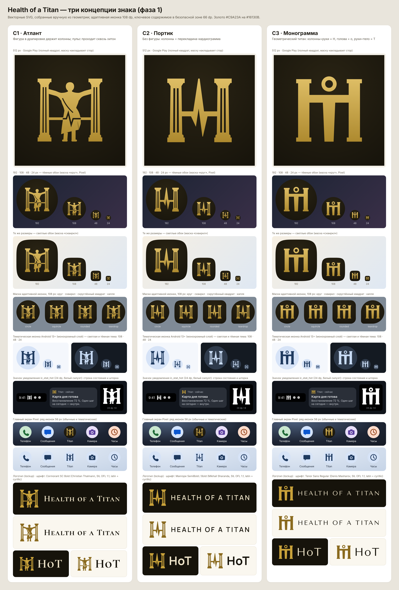

# A-brand-01 · Знак HoT: три векторные концепции (фаза 1), v1.0

Авторы: Агент 15 (бренд) и Агент 4 (UX/UI). Дата: 2026-11-06. Основа: `brand/README.md`, концепция A, мастер-вариант A2 «титан держит колонны, драпировка».

## Резюме
- Сделаны три законченные концепции знака. Они различаются степенью абстракции: **C1 «Атлант»** (фигура и пульс), **C2 «Портик»** (только пульс, без фигуры), **C3 «Монограмма»** (только фигура, геометрия H·o·T).
- У каждой концепции есть символ, адаптивная иконка Android (слои 108 dp), монохромная версия (тематическая иконка и значок уведомления 24 dp) и логотип со словесной частью «Health of a Titan» / «HoT».
- Все сравнения собраны на листе `_comparison.png`: размеры 512/192/108/48/24, тёмный и светлый фон, четыре маски, тематическая иконка, уведомление, ряд иконок на главном экране Pixel.
- **Рекомендация: C3 «Монограмма».** Она лучше всех читается в 24–48 px, называет бренд сама (H·o·T), обходится без мужской анатомии и меньше двух других похожа на логотипы клиник и фитнеса. Пульс в C3 не нарисован, он живёт в анимации: заставка и загрузка.
- Перед публичным запуском Агент 7 обязательно проверяет сходство по базам USPTO, WIPO и Роспатента.



## Что лежит в папках
| Файл (в каждой `c1-atlas/`, `c2-portico/`, `c3-monogram/`) | Назначение |
|---|---|
| `symbol.svg`, `symbol-ink.svg` | (a) символ, плоское золото `#C9A23A` / чернила `#16130B`, плотный viewBox |
| `app-icon-foreground.svg`, `app-icon-background.svg`, `app-icon.svg` | (b) слои адаптивной иконки 108×108 dp и их композит; знак в масштабе 0,9 вписан в круг r ≤ 29,6 dp, безопасная зона r = 33 dp |
| `app-icon-512.png` | превью для Google Play 512×512 (видимая область 72 dp без маски) |
| `monochrome.svg` | (c) монохромный слой для тематических иконок Android 13+ (108 dp, один цвет, отверстия через evenodd) |
| `notification-24.svg` | (c) значок уведомления `ic_stat_hot`: 24 dp, белый силуэт, поле 2 dp, упрощённая и утяжелённая геометрия |
| `lockup-horizontal-{dark,light}.svg/.png`, `lockup-hot-{dark,light}.svg` | (d) логотип: знак и «Health of a Titan» / знак и «HoT»; буквы переведены в контуры |
| `tools/` | исходник: геометрия (`concepts.py`, `geom.py`), набор текста (`wordmark.py`), сборка (`build.py`) и рендер (`render.js`) |

**Как собрано.** Каждый знак построен из примитивов (прямоугольники, окружности, кубические кривые, ломаные пульса), а затем точно объединён булевыми операциями (shapely). Растра, трассировки и сгенерированных ИИ контуров в файлах нет. Каждая версия — **один составной путь** (fill-rule evenodd), который напрямую переводится в Android VectorDrawable. Кривые аппроксимированы ломаными с отклонением не больше 0,012 dp: на любом экранном размере это незаметно. Если для регистрации знака нужны «чистые» кривые Безье, их можно получить из того же исходника.

Пересборка:
```
pip install shapely fonttools uharfbuzz
HOT_FONT_DIR=<папка со шрифтами .ttf> python3 brand/icon-concepts/tools/build.py
node brand/icon-concepts/tools/render.js
```
Шрифты в репозиторий не кладём, потому что в SVG буквы уже в контурах. Скачать их можно с Google Fonts: Cormorant SC, Manrope, Tenor Sans.

**Палитра.** Золото `#C9A23A` на `#16130B` (контраст 7,7:1). На иконке — лёгкий градиент `#E2C26A → #A9852A`. На светлом фоне используется тёмное золото `#8A6A1E` (4,7:1 на `#FAF7EF`), потому что обычное золото даёт там только 2,25:1 и не проходит AA. Текст на тёмном фоне — слоновая кость `#EDE3C8`.

## Концепции

### C1 · Атлант — фигура держит колонны, пульс проходит сквозь
**Идея.** Самый близкий к A2 вариант: титан в хитоне и гиматии (плащ через левое плечо, конец свисает с правого бедра) упирается руками в две каннелированные колонны. Колонны и руки образуют H. Линия пульса идёт от колонны к колонне золотом, а на драпировке превращается в прорезь с R-зубцом: сердцебиение буквально проходит сквозь титана.
**Почему работает.** В знаке есть все смыслы A2: опора, сила, данные. Он узнаётся как «скульптура», а не как фото тела. Обнажения нет, мускулатура не прорисована.
**Слабые места.**
- В 24 px фигура сливается в пятно, читается только H из колонн. В 48 px — «H с человеком».
- Самая сложная геометрия из трёх: дороже в анимации, хуже в вышивке, гравировке и на мелкой печати.
- Фигура остаётся мужской по канону, это вопрос для широкой аудитории и enterprise.
- Композиционно ближе всех к сгенерированному ИИ прототипу. Знак перерисован вручную, но риск производности выше.

**Шрифт.** Cormorant SC Bold (OFL, латиница и кириллица) — капитель римского типа, в паре с классической скульптурой. «HoT» в капители даёт малую «о» естественно.
**Нейтральный вариант в системе.** Колонны и пульс без фигуры, то есть фактически C2.

### C2 · Портик — колонны и кардиограмма, без фигуры
**Идея.** Две дорические колонны (абака, эхин, ствол с утонением, каннелюры, база). Перекладину H заменяет одна линия ЭКГ (QRS-комплекс). Острый R-зубец поднимается до капителей, S уходит к базам.
**Почему работает.** Самый нейтральный вариант: подходит любому полу и возрасту и корпоративным клиентам. Отлично читается в 48 px, в 24 px — «H с зубцом». Анимация пульса по перекладине — естественный жест для заставки.
**Слабые места.**
- **«H + кардиограмма» — один из самых частых приёмов в логотипах больниц, клиник и кардиосервисов** [Оценка, без поиска по базам]. Отличимость и охраноспособность ниже, чем у C1 и C3.
- Сильная медицинская коннотация. Она спорит с позиционированием «не медицинское изделие, не ставит диагнозы» и может создать у пользователя ложные ожидания.
- Титана в знаке нет: имя «of a Titan» держится только на колоннах.

**Шрифт.** Manrope SemiBold / Bold (OFL, латиница и кириллица) — нейтральный гротеск для enterprise. Капсом с разрядкой 0,16 em.

### C3 · Монограмма — геометрический титан, который пишет H·o·T
**Идея.** Колонны и руки — **H**. Голова-кольцо — **o**. Руки и тело — **T**. Получается **H·o·T**: имя бренда записано фигурой, и шрифт для этого не нужен. Тело слегка сужается к основанию, как ниспадающая одежда; колонны — простые столпы с капителью и базой.
**Почему работает.**
- Лучшая читаемость: в 24 px и в значке уведомления силуэт остаётся точным (кольцо, перекладина, три вертикали).
- Фигура абстрактная, без пола и анатомии. Поэтому знак подходит и для широкой аудитории, и для enterprise, и отдельная «нейтральная версия» не нужна.
- Простая уникальная геометрия хорошо масштабируется, анимируется (кольцо «дышит», по рукам пробегает пульс), вышивается и гравируется. Удобна для регистрации.

**Слабые места.**
- **Пульса в знаке нет.** Решение осознанное: прорезь ЭКГ на теле в тестах читалась как трещина или молния, а ЭКГ-перекладина ломала силуэт. Пульс переносится в движение (заставка Android 12: волна пробегает по рукам) и в интерфейс. Это нужно подтвердить у основателя.
- Схема «человечек в букве» встречается в логотипах HR-сервисов, клиник и отелей [Оценка]. Нужна проверка сходства (Агент 7).
- Меньше «античной роскоши», чем в C1: классика передана пропорциями и капителями, а не деталями.

**Шрифт.** Tenor Sans (OFL, латиница и кириллица) — гротеск с классическими пропорциями римских капиталей. Лёгкое начертание контрастирует с тяжёлым знаком и выглядит премиально. Кириллица («ЗДОРОВЬЕ ТИТАНА») проверена.

## Сравнение
| Критерий | C1 Атлант | C2 Портик | C3 Монограмма |
|---|---|---|---|
| Читаемость 48 px | хорошо (H + фигура) | отлично | отлично |
| Читаемость 24 px и уведомление | слабо (фигура → пятно) | хорошо | **отлично** |
| Отличимость от фитнеса и клиник | высокая | **низкая** (H + ЭКГ — клише) | высокая |
| Смысл (имя, титан, здоровье) | максимальный | только здоровье и опора | имя H·o·T + титан; пульс в движении |
| Нейтральность (пол, enterprise) | средняя | **высокая** | высокая |
| Готовность к регистрации знака | средняя (сложно, производно от ИИ-прототипа) | низкая (слабая различительная способность) | **высокая** (простая оригинальная геометрия) |
| Анимация и производство | сложно | просто | просто |

Все оценки — [Оценка] Агентов 15 и 4 по рендерам. Тест на людях (5-секундный тест и тест предпочтения на 5–10 людях из ЦА, Агент 2) до утверждения желателен, но не обязателен.

## Рекомендация: C3 «Монограмма»
1. **Читаемость.** Это единственный вариант, который в 24 dp (строка состояния, значок уведомления, маленькая тематическая иконка) остаётся тем же знаком, а не его тенью.
2. **Отличимость.** C2 попадает в самое массовое клише медицинских логотипов. C1 узнаваем, но в мелких размерах его не видно. C3 — собственная форма.
3. **Смысл.** Знак сам произносит имя (H·o·T) и при этом изображает титана, который держит опоры. Пульс остаётся в системе бренда через движение и UI, поэтому идея A2 не теряется.
4. **Товарный знак.** У C3 простая оригинальная геометрия, построенная с нуля, а не по контурам сгенерированного прототипа. С таким исходником проще доказывать авторство и регистрировать знак.
5. **Система.** C1 можно оставить как иллюстрацию (онбординг, маркетинг, мерч), но не как иконку.

## Обязательная проверка перед запуском
- **Агент 7:** поиск сходства знака и словесной части «HoT» / «Health of a Titan» по USPTO (TESS), WIPO Global Brand Database и Роспатенту. Классы МКТУ 9, 42, 44 (и 41 при коучинге). Венская классификация для изобразительного элемента: человек, колонны, буквы.
- **Агент 7:** подтвердить, что вручную построенный вектор даёт авторство команды, несмотря на ИИ-прототип в основе идеи.
- Шрифты OFL 1.1 разрешают использование в логотипе и в приложении. Если шрифт вшивается в APK, нужно приложить текст OFL.

## Фаза 2 (после выбора основателя): что войдёт в Android
1. `res/drawable/ic_launcher_foreground.xml` — VectorDrawable из `app-icon-foreground.svg`: один путь, `fillType="evenOdd"`, градиент через `aapt:attr`.
2. `res/drawable/ic_launcher_background.xml` — радиальный градиент `#2A2414 → #16130B` (или цвет `@color/hot_background`).
3. `res/drawable/ic_launcher_monochrome.xml` — из `monochrome.svg`. `mipmap-anydpi/ic_launcher.xml` перестаёт ссылаться на foreground как на монохромный слой.
4. Legacy- и round-мипмапы **не нужны**: `minSdk = 34`, адаптивная иконка покрывает `icon` и `roundIcon`. Файлы `.png` в `mipmap-*dpi` не добавляем.
5. Google Play: `hot-icon-512.png` 512×512, 32-bit PNG до 1 МБ, без собственной маски и тени.
6. Заставка (SplashScreen API, Android 12+): `windowSplashScreenAnimatedIcon` — знак на холсте 240×240 dp, вписанный в круг 160 dp (с подложкой) или 288×288 / 192 dp (без неё). `windowSplashScreenBackground = @color/hot_background`. Плюс AVD до 1000 мс: волна пульса пробегает по рукам (для C3) или по перекладине (для C1/C2). Тема — `Theme.SplashScreen` из `androidx.core:core-splashscreen`.
7. Значок уведомления `res/drawable/ic_stat_hot.xml` — из `notification-24.svg`: 24 dp, белый, без градиента. Акцентный цвет уведомления — `@color/hot_gold`.
8. Ярлык SOS (`core_ui_ic_sos`, `shortcuts.xml`): единый стиль с новым знаком — тот же фон, золото и вес линий. Спасательный круг сохраняется, красный остаётся зарезервирован за флагами (A11 §12.1). Проверить в маске круга.
9. Словесный знак для верхней панели: `res/drawable/ic_wordmark_hot.xml` (контурный VectorDrawable «HoT» и полный вариант) с `contentDescription` «Health of a Titan». Если шрифт логотипа используется ещё и в тексте UI — добавить `res/font/` и OFL.txt.
10. `values/colors.xml`: добавить `hot_gold_light #E2C26A`, `hot_gold_dark #A9852A`, `hot_gold_deep #8A6A1E`, `hot_ivory #EDE3C8`, `hot_paper #FAF7EF`.
11. Проверка: скриншоты лаунчера Pixel 9 Pro XL в светлой и тёмной теме, с тематическими иконками и без, значок в строке состояния, заставка. Затем ревью Агента 4.

## Передача
- **Артефакт:** `brand/icon-concepts/` (этот README, 3 × 11 SVG, PNG-превью, `_comparison.png`, исходники в `tools/`).
- **Главное:** (1) три законченных знака с полным набором версий; (2) рекомендован C3 «Монограмма»; (3) Android-код пока не менялся.
- **Допущения:** пульс в C3 выражается анимацией, а не формой; оценки отличимости сделаны без поиска по базам.
- **Открытые вопросы и кому:** основателю — выбор концепции и согласие с «пульсом в движении» для C3; Агенту 7 — проверка сходства и авторства; Агенту 2 — по желанию 5-секундный тест на 5–10 людях.
- **Риски:** сходство с существующими знаками (смягчается проверкой у Агента 7); у C1 — производность от ИИ-прототипа.
- **Следующий шаг:** после выбора — фаза 2 по списку выше в одной ветке, с ревью Агента 4.
- **Утвердить основателю:** концепцию (C1 / C2 / C3) и шрифт словесного знака.
