# A09 · Правила дня: режим, Карта дня и план

> **ID:** A09 · **Версия:** 0.1 · **Статус:** черновик → ревью 12 и 10 вложено (§9); дальше 5, 13, 9, 7, 8 · **Дата:** 2026-11-06
> **Владелец:** Агент 3 (медицина и наука) в паре с Агентом 12 (тренировки и питание); психологические формулировки — с проверкой Агента 10
> **Входы:** A04 §2–4, A25 v0.2, A19 v0.1, A14 v0.2 (ADR-14, §6), A10 v0.2, A26, A07, A11 §2–3, A18 Эпики 2–4, A03/A03a
> **Код:** `content/rules/*.yaml` (40 правил), схема `content/_schema/rules.schema.json`, автотесты `content/rules/_tests/day_scenarios.yaml`

## Резюме
1. План дня собирает **детерминированный конвейер из 7 стадий**: безопасность → качество данных → режим → контекст → Карта дня → план по часам → вечернее обучение. LLM в нём не участвует. Без сети конвейер работает так же.
2. Режимов три, как в A14, A19, A25 и A11: **Разгон / Ровно / Бережно**. Режим считается по **баллам напряжения**, а пороги заданы относительно *твоей* нормы (z-оценки). Самочувствие весит не меньше данных. Вниз режим переходит сразу, вверх поднимается на одну ступень в день. «Восстановление», болезнь, перелёт и возвращение — это **флаги поверх режима**, а не четвёртый режим.
3. **40 правил** по шести направлениям плюс безопасность, контекст, возвращение и стек. У каждого правила есть условие, действие, текст «почему» на «ты», уровень доказательности, противопоказания и красные флаги. Правила лежат в YAML и готовы к подключению (Агент 13).
4. Отличие от «коуча в чате» — не в объёме знаний. Мы показываем **твою** причину и **твоё** время: кофейный рубеж считается от твоего отбоя, причина вчерашнего вечера — с личной дельтой, план на трудный день готовится заранее. Объяснение строится на твоих данных, и каждое «Не согласен» учит систему. Защита от банальностей — **бюджет**: не больше 7 пунктов в плане, и у каждого есть повод.
5. **12 сценариев дней** («вход → ожидаемый режим и пункты») — эталон для JVM-тестов `:domain:engine`.

---

## 1. Как формируется план — простым языком

Представь диспетчера, который каждое утро задаёт себе 7 вопросов, всегда в одном и том же порядке.

1. **Безопасно ли сегодня вообще?** Боль в груди, кризисные слова, простуда, признаки РПП. Если да, дальше план не важен: включается защита (SAF).
2. **Можно ли верить данным?** Хватает ли ночей для нормы, всё ли записал браслет, есть ли данные сегодня (REG-05).
3. **Какой режим?** Сигналы ночи (HRV, пульс, дыхание), сон, нагрузка недели и твоё утро (карточки) складываются в баллы. Баллы дают режим, а потом идут поправки: самочувствие против данных, потолки и «ступенька вверх» (REG-01…06).
4. **Почему так?** Что было вчера: алкоголь, поздний ужин, тяжёлая тренировка, перелёт. Что будет сегодня: важное событие. Это объясняет цифры и ужесточает план, но никогда не ослабляет его (CTX).
5. **Карта дня** — что режим значит для каждой сферы: потолок тренировки, число задач, сдвиг отбоя, практика, питание, люди.
6. **План по часам.** Карта раскладывается на твои якоря: подъём, отбой, окно тренировки, собака, встречи из календаря. Кофе — до «отбой − 9 ч», ужин — до «отбой − 3 ч», свет — в первый час после подъёма.
7. **Днём и вечером.** Тап по чипу (время, место, «мне хуже», «ем вне дома», ⭐, ✈) пересобирает план за < 100 мс. Пропущенный пункт сдвигается или тихо исчезает и не копится к вечеру. Вечерняя колода обновляет норму, счётчики инсайтов и «тень» срывов. «Не согласен» тоже идёт в обучение.

```mermaid
flowchart LR
  subgraph IN[Утро: входы]
    W[WHOOP → метрики A25<br/>ORS, сон, LRB — z от твоей нормы]
    C[Карточки утра и вечера<br/>энергия, тело, алкоголь, напряжение]
    K[Календарь, цели, условия жизни<br/>собака 07:00, окно тренировки]
  end
  IN --> S0[0 Безопасность<br/>SAF-01…06]
  S0 -->|красный флаг| STOP[Экран помощи / 911 / 988<br/>тренировки скрыты]
  S0 --> S1[1 Качество данных<br/>REG-05]
  S1 --> S2[2 Режим<br/>баллы → Разгон / Ровно / Бережно<br/>REG-01…06]
  S2 --> S3[3 Контекст<br/>CTX-01…05]
  S3 --> MAP[4 Карта дня<br/>потолки по 6 сферам + RET]
  MAP --> PLAN[5 План по часам<br/>SLP, NUT, ACT, WRK, GRW, STK]
  PLAN --> TODAY[«Сегодня» + пуш<br/>+ «Почему так»]
  TODAY -->|чипы, отметки, тренировка WHOOP| S3
  TODAY --> EVE[Вечер: колода и журнал]
  EVE --> LEARN[Обучение: норма 28 дн., инсайты A25 §5,<br/>«тень» срывов, «Не согласен»]
  LEARN -. завтра .-> IN
  LLM[Наставник LLM: объясняет, разговаривает,<br/>НЕ меняет режим и план] -. читает .-> TODAY
```



### 1.1 Пример одного дня (**пример**, цифры условные)
**Вторник.** Подъём 06:45, обычный отбой 23:15. Условия жизни: собака в 07:00, окно тренировки 18–20. Календарь: встречи 10:00–12:30, питч в 15:00 (⭐).

| Вход | Значение | Что даёт |
|---|---|---|
| Сон | 5 ч 50 мин (позавчера 7 ч 10 мин) | SG-SLEEP: +1 балл (< 6 ч) |
| Ночь: z(ln rMSSD) / z(RHR) / z(дыхание) | −1,4 / +0,8 / +0,3 → ORS за ночь = 0,5·(−1,4) − 0,3·0,8 − 0,2·0,3 = **−1,0** | SG-ORS-DAY: +1 балл |
| ORS, тренд за 7 дней | −0,3 (выше −0,5) | 0 |
| Весы (LRB) | +0,4 | 0 |
| Карточки утра | сон 😐 (3), энергия 5 (z −0,6) | самочувствие не «низкое» |
| Вчера вечером | 2 порции, последняя за 1–3 ч до сна | CTX-01: известная причина |
| **Итог** | **2 балла → Ровно** (вчера тоже Ровно, гистерезис не мешает) | |

Карта дня. Ровно: силовая облегчённая или Zone 2, без интервалов (CTX-01). Одна главная задача (WRK-02, ночь < 6 ч). Отбой на 30 мин раньше, в 22:45 (SLP-01). Кофейный рубеж 13:45 (SLP-02).

| Время | Пункт | Правило |
|---|---|---|
| 06:45 | Стакан воды | CTX-01 → N04 |
| 07:00–07:20 | Прогулка с собакой = утренний свет | SLP-03 + условие жизни |
| 07:30 | Завтрак с белком | SLP-05 → N05, N18 |
| 08:00–09:15 | Фокус: подготовка питча | WRK-01, WRK-02 |
| 10:00–12:30 | Встречи; в перерыве встать и пройтись 3 мин | ACT-02 |
| 12:40 | Обед по тарелке | N01–N03 |
| 13:15–13:35 | Короткий сон, если есть где (по желанию) | SLP-05 |
| 13:45 | ☕ Последний кофе | SLP-02 (22:45 − 9 ч) |
| 14:45 | 3 минуты длинного выдоха | CTX-05 → П3 |
| 16:00 | Перекус перед тренировкой | ACT-03 → N07 |
| 18:00–18:40 | Zone 2, 40 мин (интервалы из очереди A19 заменены) | A19 + CTX-01 |
| 19:15 | Ужин, закончить до 19:45 | NUT-01, N08 |
| 21:15 | Вечерняя колода | schedule.evening |
| 21:45 | Час на «приземление» | SLP-01 |
| 22:45 | Отбой | SLP-01 (−30 мин) |

**Пуш (без S4, A25 §6):** «Ровно · без интервалов» / «Ночь 5 ч 50 мин, восстановление ниже нормы. Главное — питч в 15:00, вечером Zone 2.» Про алкоголь — только внутри приложения, в «Почему так»: *«Вчера было 2 порции, последняя — за 1–3 часа до сна. У многих это снижает ночную HRV, и сегодня твоя ниже нормы. Это просто информация, не оценка.»*
**Днём:** в 17:30 встреча затянулась, ты ставишь ⏱ 20 и 📍 «дом». Тренировка пересобирается в T08 (быстрая ходьба 20 мин), ужин остаётся в 19:15.
**Вечером:** «тренировка ✓», пик напряжения 7 (работа), алкоголь 0. Ночью норма за 28 дней пересчитывается. Пара инсайтов «2+ порции → ORS» набирает 9 дней с событием против 41 без него, |Δ| = 0,7 SD. В воскресенье придёт наблюдение и предложение эксперимента N-of-1: «2 недели в будни ≤ 1 порции».

---

## 2. Режимы дня

| Режим (`DayState.regime`) | Когда | Карта дня (`regime.yaml → map`) |
|---|---|---|
| **Разгон** `BOOST` | 0 баллов **и** ORS за ночь ≥ твоей нормы **и** сон ≥ 7 ч **и** энергия ≥ 6 (если ответа нет — ORS ≥ +0,5) **и** ожидаемое напряжение < 7 | Любые тренировки, включая интервалы (L0). 2 блока фокуса по 90 мин. Окно роста (GRW-02) |
| **Ровно** `STEADY` | По умолчанию: 1–2 балла или «Разгон» не подтвердился | Силовая RPE ≤ 7, Zone 2, без интервалов (L1). Блоки по 60 мин, перерывы каждые 90 мин. Практика П3 5 мин |
| **Бережно** `GENTLE` | ≥ 3 балла, **или** низкое самочувствие + ещё ≥ 1 балл, **или** жёсткий потолок (сон < 5 ч, болезнь) | Zone 2 лёгкая, мобильность или отдых (L2, RPE ≤ 4). Одна главная задача. Отбой −30 мин. Ходьба 20–30 мин (ACT-01) |

**Флаги поверх режима** (`DayState.flags`, предложение для Агента 5): `SICK`, `EMERGENCY`, `CARE` (кризис), `ED_CARE`, `TRAVEL`, `RETURN`, `LIGHT_WEEK`, `CALIBRATION`, `PRELIMINARY_NORM`, `MANUAL`, `DATA_LIMITED`, `SEE_SPECIALIST`. Так «Восстановление» = Бережно + `SICK` или `LIGHT_WEEK`, и схема `DayState` не ломается.

### 2.1 Сигналы (баллы напряжения)
Все z — робастные по A25 P1: медиана и MAD за 28 дней, ограничение ±3, для HRV — ln rMSSD.

| Сигнал | Порог | Балл | Выход (гистерезис) | Основание |
|---|---|---|---|---|
| SG-ORS-DAY ночь | ORS за ночь ≤ −1,0 / ≤ −2,0 | +1 / +2 | горит, пока z ≤ −0,5 | A04 #18–19, ур. C; пороги [Оценка] |
| SG-ORS-TREND | EWMA 7 дней ≤ −0,5 (SWC) | +1 | — | Plews 2013, Buchheit 2014, ур. C |
| SG-SLEEP (макс. 1) | < 6 ч, **или** < 7 ч две ночи подряд, **или** долг за 7 дней ≥ 5 ч | +1 | — | Watson 2015, ур. A (абсолютный порог, потребность во сне не «личная») |
| SG-LOAD | Весы > +1 | +1 | горит, пока > +0,75 | Meeusen 2013, ур. A (консенсус); индекс — C |
| SG-SELF | энергия ≤ 3, **или** z энергии ≤ −1, **или** сон «😫», **или** «нет сил», **или** 🔋 «мне хуже» | +1 | — | Saw 2016, ур. A |

**Приоритет сигналов** (сверху вниз, первый сработавший запрет главнее):
1. Красные флаги и кризис (SAF).
2. Жёсткие потолки REG-01: сон < 5 ч, болезнь. Самочувствие их не поднимает.
3. Самочувствие. Оно может понизить режим (SG-SELF). Если «красный» режим держится только на данных, хорошее самочувствие поднимает его до Ровно (REG-03), но интервалы остаются под запретом.
4. Физиология (ORS) и её тренд.
5. Нагрузка (Весы).
6. Контекст: только объясняет и ужесточает план.

При равенстве выбираем то, что безопаснее, обратимее и требует меньше усилий (A26 §4).

**Гистерезис (REG-04).** Вниз — сразу. Вверх — не больше одной ступени в день: после Бережно хороший день даёт Ровно, а не Разгон. Мёртвая зона сигналов — 0,5 SD (SWC, A25 P2), чтобы режим не мигал на границе порога.

**Лёгкая неделя (REG-06).** 3 бережных дня подряд или Весы > +1 семь дней подряд → флаг `LIGHT_WEEK` на 7 дней. Потолок — Ровно, объём тренировок −40 % (A19 TR-01), вечера без работы, вопрос о симптомах.

### 2.2 Мало данных (REG-05)
| Ситуация | Что делаем |
|---|---|
| **Калибровка:** < 14 ночей в норме | Флаг `CALIBRATION`, текст «изучаю твою норму». Вместо ORS берём Recovery % WHOOP **только в памяти** (≤ 33 % — балл, Разгон — при ≥ 67 %), плюс сон и самочувствие (A04 §2 п. 3). **Важно:** при подключении WHOOP загружается окно 28 дней (A14 §3). Если в истории ≥ 14 ночей, калибровки нет с первого дня |
| **Предварительная норма:** 14–27 ночей | z считаем. Разгон — только вместе с ответом на карточку энергии |
| **Пропуски:** покрытие входов ORS < 60 % (A25 P5) | Сигналы ORS выключены. Потолок — Ровно, если нет «энергия ≥ 7 и сон ≥ 7 ч» |
| **Нет WHOOP** к 09:30 или API недоступен > 24 ч | Флаг `MANUAL`, 3 вопроса (A10 C8). Потолок — Ровно. Разгон — только при «≥ 7 ч, сон ≥ 4/5, энергия ≥ 7» и если вчера не было Бережно. Нет ни данных, ни ответов → Ровно |
| **Нетипичная физиология** (препараты, влияющие на пульс, хронические болезни, беременность — онбординг, A04 §2 п. 4) | Физиология без самочувствия режим не опускает. Тексты про HRV скрыты |
| **Перелёт** ≥ 2 ч сдвига (CTX-04) | Флаг `TRAVEL` на 1 день за каждый час сдвига, но не больше 3 дней. Регулярность и Ритм на паузе, якоря — по местному времени. В первый день потолок Ровно, без интервалов |

---

## 3. Правила (40)

Полные условия, действия, тексты «почему», противопоказания и красные флаги — в YAML. Здесь — сводка. «Ур.» — уровень доказательности: `Ф` — [Факт] с источником из A04, A19 или раздела «Источники», `О` — [Оценка].

**Безопасность (6)** — `safety.yaml`, перекрывают всё, поднять режим пользователь не может

| ID | Условие | Что меняется в плане | Ур. |
|---|---|---|---|
| SAF-01 | У5 «боль в груди», острая метка BOD, стоп-флаг F1–F5 | Экран 911, тренировки скрыты, аналитики нет | C·О (консенсус безопасности) |
| SAF-02 | `crisis_level` ≥ 2 или У3/В1 на минимуме 2 дня подряд | Кризисный протокол A07 (988/911), негативное и проактивное отложено | C·О (A07) |
| SAF-03 | Простуда (У5 или метка) | Бережно (жёсткий потолок) + `SICK`, отдых или прогулка Z1 ≤ 20 мин, 1 задача, отбой −30. Пульс покоя ≥ +2 SD 3 ночи → «стоит обсудить с врачом» | C/D·О |
| SAF-04 | RHR ≥ +2 SD и дыхание ≥ +1,5 SD без известной причины | Вопрос «как ты?», потолок Ровно, без интервалов | C·Ф (A04 §2) |
| SAF-05 | 7 дней низкого состояния; 10 из 14 дней низкого настроения; 9 из 21 плохих ночей; храп с паузами | Мягкий совет: терапевт, психолог (текст A07) или врач по сну. При бессоннице — без дневного сна | A·Ф (Meeusen 2013; Riemann 2023) |
| SAF-06 | Сигналы РПП (A19 §6.3) | Без цифр еды и веса, без «лишних» тренировок и голодания, маршрут Агента 10 | A·Ф (Mountjoy 2023) |

**Режим (6)** — `regime.yaml`

| ID | Условие | Что меняется | Ур. |
|---|---|---|---|
| REG-01 | Сон < 5 ч или болезнь | Потолок Бережно, самочувствием не поднимается | A·Ф (Watson 2015; Lim & Dinges 2010) |
| REG-02 | Всегда | Баллы → режим (§2.1) | C·О |
| REG-03 | Бережно «только по данным» + хорошее самочувствие | Ровно, без интервалов | A·Ф (Saw 2016) |
| REG-04 | Есть вчерашний режим | Вверх на одну ступень, мёртвая зона 0,5 SD | D·О |
| REG-05 | Мало данных | §2.2 | C·О |
| REG-06 | 3 дня Бережно / Весы > +1 семь дней | Лёгкая неделя | A·Ф (Meeusen 2013) |

**Контекст (5)** — `context.yaml`

| ID | Условие | Что меняется | Ур. |
|---|---|---|---|
| CTX-01 | Вчера ≥ 2 порций | Объяснение «известная причина», вода, завтрак (N04, N18). При ORS ≤ −0,5 — без интервалов. При ≥ 3 порциях или последней < 1 ч до сна — облегчённая тренировка (L1). Личная дельта — после инсайта A25 §5 | A/B·Ф (Ebrahim 2013; Pietilä 2018) |
| CTX-02 | Поздняя еда, экраны или кофе вчера + засыпание на ≥ 45 мин позже или ORS ≤ −0,5 | Объяснение. Сегодня строго соблюдаются ужин, свет и кофейный рубеж | B/C·Ф (Chang 2015; Drake 2013) |
| CTX-03 | Тяжёлая тренировка вчера + ORS ≤ −0,5 | «Это адаптация». Без интервалов и тяжёлого того же паттерна, мобильность по желанию | A·Ф (Granero-Gallegos 2020) |
| CTX-04 | Перелёт или сдвиг ≥ 2 ч | `TRAVEL`, местное время, еда N13. Свет: на восток — утром, на запад — во второй половине дня, при сдвиге > 6 ч — просто днём. В день 1 — Ровно, T10 | C/D·О (фазовый ответ на свет — механизм) |
| CTX-05 | ⭐ важный день | Интенсив не раньше чем за 3 ч до события. Еда за 2–3 ч. П3 за 15 мин | D·О |

**Сон и энергия (5)** — `day_rules.yaml`

| ID | Условие | Что меняется | Ур. |
|---|---|---|---|
| SLP-01 | Задан отбой | «Приземление» за 60 мин. Отбой −30 мин при Бережно или ночи < 6 ч, но не больше чем на −60 мин | A·Ф (Watson 2015; Chang 2015) |
| SLP-02 | Задан отбой | Кофейный рубеж = отбой − 9 ч; сдвигается вместе с отбоем | A·Ф (Gardiner 2023*; Drake 2013) |
| SLP-03 | Не в поездке | 10–20 мин света в первый час. Совмещаем с собакой, дорогой или прогулкой | B/C·Ф (Blume 2019*) |
| SLP-04 | Подъём «гуляет» ≥ 60 мин или в выходные сдвиг ≥ 90 мин | Якорь подъёма ±30 мин — эксперимент на 2 недели | B·Ф (Windred 2024*) |
| SLP-05 | Ночь < 6 ч, не болен | Сон 10–20 мин до 15:00, завтрак с белком, «второй кофе ночь не вернёт» | C·Ф (Brooks & Lack 2006) |

**Стресс и ментальное (4)**

| ID | Условие | Что меняется | Ур. |
|---|---|---|---|
| MNT-01 | Пик напряжения вчера ≥ 8 или ожидаемый ≥ 8 | П3 за 15 мин до трудного момента, 5 мин «Работы» с Винсом, после «приземления» без работы | A·Ф (Fincham 2023) |
| MNT-02 | Открытый конфликт ≥ 2 | 15 мин на тему днём, до 19:00. После 22:00 наставник «паркует» тему | C·О (отложенное беспокойство*) |
| MNT-03 | Настроение z ≤ −1,5 или «грустно / пусто», без кризиса | 15 мин пешком на улице + одно дело из своего списка. Негативные инсайты отложены | A·Ф (Noetel 2024); микрошаг D |
| MNT-04 | Одиночество 2 из 3 дней или Связи ≤ −1 | Написать одному близкому (по желанию) | A·Ф (Holt-Lunstad 2010); микрошаг D |

**Питание (3)**

| ID | Условие | Что меняется | Ур. |
|---|---|---|---|
| NUT-01 | Задан отбой | Ужин закончить за 3 ч до сна; если вечер занят — полегче (N15) | C·О (A25 пара 4) |
| NUT-02 | 🍷 вечер с алкоголем | Поесть заранее, вода на каждую порцию, последняя за 3 ч до сна, завтра план учтёт. «Сухой вечер» — равноправная кнопка | A/B·Ф |
| NUT-03 | В календаре нет окна ≥ 20 мин с 11:30 до 14:30 | 5 мин на белковый перекус в ближайшее окно (N20, N14) | D·О |

**Активность (3)**

| ID | Условие | Что меняется | Ур. |
|---|---|---|---|
| ACT-01 | Бережно, не болен | Ходьба 20–30 мин в разговорном темпе (T15) | A·Ф (Noetel 2024; Bull 2020) |
| ACT-02 | ≥ 120 мин подряд без окна | Каждые 60–90 мин встать на 3 мин | A·Ф (Albulescu 2022*; Ekelund 2016) |
| ACT-03 | Есть тренировка | Слот в твоём окне. Интенсив заканчивается ≥ 2 ч до сна, иначе замена (TR-07). Еда до и после (N07, N08) | A·Ф (Stutz 2019) |

**Работа и продуктивность (3)**

| ID | Условие | Что меняется | Ур. |
|---|---|---|---|
| WRK-01 | Всегда | Блоки фокуса по Карте, через 2–5 ч после подъёма. Через 14 дней время подстраивается по Ясности | D·О |
| WRK-02 | Бережно или ночь < 6 ч | 1 главная задача, важные решения — до обеда или завтра | A·Ф (Lim & Dinges 2010) |
| WRK-03 | ≥ 55 ч работы за неделю или ≥ 2 ночные смены работы | Один вечер без работы + 15 мин «что отдать, отложить, упростить». Болезнями не пугаем | A·Ф (Kivimäki 2015) |

**Карьера и рост (2), возвращение (2), стек (1)**

| ID | Условие | Что меняется | Ур. |
|---|---|---|---|
| GRW-01 | Есть цель недели | Шаг к цели в формате «если {время} — то {шаг}». При Бережно или возвращении — минимальная версия | A·Ф (Gollwitzer & Sheeran 2006) |
| GRW-02 | Разгон, Рюкзак ≤ нормы, нет ⭐ | 25 мин на рост (по желанию) | D·О |
| RET-01 | Тишина ≥ 2 дней или 3 дня спада + тренд ORS ≤ −0,5 | `RETURN`: 10 мин движения, 1 задача, минимальный шаг. Без отчётов за паузу, «новый старт» | C/D·О (H14) |
| RET-02 | С 5-й недели: ≥ 2 группы сигналов срыва за 48 ч | Сначала вопрос «Упростить сегодня?», после «да» — только главное и твои планы «если — то». ≤ 2 проактивных сообщений в день | C·О (JITAI*) |
| STK-01 | В стеке есть пункт с кофеином (ты его так отметил) после рубежа | Своё — можно перенести раньше. Назначенное врачом — не трогаем, только вопрос к врачу. Без доз | A·Ф (Gardiner 2023*) |

\* источник требует проверки выходных данных (см. «Источники»).

**Бюджет плана** (`schedule.yaml → budget`): не больше 7 видимых пунктов (тренировка, тарелка, до 3 рабочих, до 2 микрошагов). Маркеры — кофейный рубеж, «приземление», перерывы — показываются строкой, а не пунктом. Если правил сработало больше, первыми уходят необязательные пункты в порядке приоритета `safety > regime > context > sleep > mental > work > nutrition > activity > growth > social > stack`.

---

## 4. Чем это отличается от WHOOP Coach, Oura Advisor и аналогов

`[Оценка]` По A03, лидеры дают ИИ-чат поверх своих данных и общие советы. Что именно попадает у них в ежедневный план, мы на текущих версиях не проверяли. Наше отличие — в механиках, а не в объёме знаний.

| # | Механика HoT | Правила | Банально (общий совет) | HoT |
|---|---|---|---|---|
| 1 | Самочувствие — равноправный вход, а конфликт с данными показан открыто | SG-SELF, REG-03 | «Recovery 31 %, отдыхай» | «Данные говорят об усталости, а ты бодр. Сегодня Ровно: умеренно можно, интервалы нет» |
| 2 | Причина накануне + личная дельта с порогом доверия | CTX-01…04, A25 §5 | «Алкоголь ухудшает сон» | «В дни после 2+ порций твоё восстановление ниже нормы на 0,7 (11 дней против 46). Проверим 2 недели?» |
| 3 | План по часам от твоих якорей, пересборка без сети | SLP-01…03, NUT-01, ACT-03, schedule | «Кофе до 14:00» | «Последний кофе до 13:45: ты ложишься в 22:45». При перелёте — по местному времени |
| 4 | «Тень» срывов и возвращение | RET-01, RET-02 | «Не пропускай тренировки!» | После паузы — «Рад тебя видеть», 10 минут и один шаг. Перед трудным днём — сначала вопрос |
| 5 | Стек и назначения врача в том же плане | STK-01 | — | «Предтрен стоит после твоего рубежа. Если это не назначение — перенеси раньше» |
| 6 | Работа и люди — часть плана здоровья | MNT-02, CTX-05, WRK-02, WRK-03 | «Снижай стресс» | «Конфликт — 15 минут днём, а не в полночь». «Питч в 15:00 — интенсив после него» |
| 7 | Обучение на тебе | REG-04, schedule.personalization, SLP-04, C1 | одинаковые пороги для всех | 3 «Не согласен» за 14 дней → предложение сдвинуть порог на 0,25 SD (только с твоего «да», не для SAF). Эксперименты N-of-1 |

**Почему это не банальности:** (1) каждое правило срабатывает от *твоей* нормы, а не от популяционного числа; (2) действие конкретное и привязано ко времени; (3) объяснение строится на твоих данных и называет причину; (4) бюджет ≤ 7 пунктов — без чек-листа «всё обо всём»; (5) правила учатся на «Не согласен» и экспериментах, а безопасность и потолки остаются неизменными.

---

## 5. Роль LLM при правилах (ADR-14)

| Задача | LLM-наставник делает | LLM запрещено | Как проверяем |
|---|---|---|---|
| Режим и план | Пересказывает «почему» по `firedRules` своими словами. По просьбе вызывает инструмент `apply_chip`, то есть те же правила | Менять режим, потолки, флаги; добавлять пункты мимо `content/`; отменять SAF; «разрешать» выше потолка | Режим в ответе сверяется с `DayState` (`ResponseGuard`); инструментов записи в `DayState` нет |
| Объяснение и разговор | Валидация → наблюдение с данными → маленький шаг → вопрос (A07 §1) | Новые цифры и «факты», которых нет в `ContextPack`; диагнозы; дозы; «вызывает», «доказано» | Числа в ответе должны совпадать с пакетом; словарь запретов A07 / A25 §5 |
| Недельный разбор (S2) | Черновик «что сдвинулось» по агрегатам и подтверждённым меткам | Негативные инсайты при Бережно, `RETURN`, `CARE` | Флаги из `DayState` фильтруют вход |
| Гипотезы и эксперименты | Предлагает эксперимент N-of-1 из каталога (C1) и формулирует гипотезы | Новые пары «событие → показатель» в продукт (только через ревью 3 и 10); эксперименты с веществами вне каталога | Каталог C1 — контент; новые пары — задача команде |
| Совет пяти, карточки | Оформляет текст, тон и юмор | Голос «эксперта» против правила безопасности | Врач и психолог — неснимаемые стражи (A26 §4) |
| Метки | Извлекает метки по словарю A25 §3 | Записывать без подтверждения (кроме RSK → протокол) | `record_session` по схеме |

Если LLM недоступен, план, режим, «почему» (шаблоны из YAML) и SOS работают без него.

---

## 6. Версии правил и метрик
1. **`ruleId@ver`.** Любая правка правила, включая текст, — `version + 1` и строка в `changelog`. Если меняется смысл условия, правилу дают новый ID: старое получает `status: retired`, новое — `replaces: <старый ID>`. Номера ID не переиспользуются.
2. **Что храним в истории.** `PlanItem.ruleId@ver` (уже есть в A14), `DayState.ruleSet@ver` (версия манифеста `content/rules`) и **новое `DayState.firedRules`** — список `ruleId@ver` с ключом объяснения. Историю **не пересчитываем**: прошлый день показывает то, что ты видел тогда. Недельные и квартальные отчёты агрегируют сохранённые режимы.
3. **Метрики.** В `regime.yaml → metrics_required` перечислены версии A25, на которых настроены пороги (например, `ORS@1`). Если A25 выпускает `ORS@2`, пороги проходят ревью, а файл получает новую версию. `contentCompile` в следующей версии будет сверять `metrics_required` с `content/metrics/`.
4. **Личные пороги.** `PersonalParam(ruleId@ver, key, value, acceptedAt)` в классе S3. При смене версии правила личная поправка сбрасывается, и ты получаешь уведомление.
5. **Эталон.** Правку правила принимают, только если сценарии §8 зелёные. Если меняется ожидаемый результат, его подписывает рецензент с вето (3, 12 или 10).

---

## 7. Формат для кода
| Файл | Что внутри |
|---|---|
| `content/rules/regime.yaml` | реестр фактов (что движок должен посчитать), предикаты, режимы, Карта дня, сигналы, оценка, REG-01…06 |
| `content/rules/safety.yaml` | SAF-01…06 |
| `content/rules/context.yaml` | CTX-01…05 |
| `content/rules/day_rules.yaml` | SLP, MNT, NUT, ACT, WRK, GRW, STK (21 правило) |
| `content/rules/return.yaml` | RET-01, RET-02 |
| `content/rules/schedule.yaml` | порядок стадий, правила слияния, якоря, части дня, бюджет, пересборка, вечернее обучение, ID микрошагов |
| `content/_schema/rules.schema.json` | JSON Schema файла правил |
| `content/rules/_tests/day_scenarios.yaml` | 12 эталонных дней (папка с `_` в APK не попадает) |

**Правило (сжато):**
```yaml
- id: CTX-01
  version: 1
  domain: context            # safety|regime|context|sleep|mental|nutrition|activity|work|growth|return|stack
  stage: context             # safety → data → regime → context → map → schedule → weekly
  priority: 700
  when: {fact: eve.B4, op: ge, value: 2}          # узел: all / any / not / pred / {fact, op, value}
  then:
    - {do: explain, key: known_cause_alcohol}
    - {do: add_item, domain: nutrition, content: N04, slot: {anchor: wake, offset_min: 0}}
  variants:                  # уточнения с собственными условиями
    - {id: low_recovery, when: {fact: ors.z_day, op: le, value: -0.5}, then: [{do: forbid, value: [intervals]}]}
  why_ru: "Вчера было {drinks} порции…"
  evidence: {level: A/B, kind: fact, sources: […]}
  contraindications_ru: […]
  red_flags_ru: […]
  review: [agent-3, agent-10, agent-12]
```
**Семантика движка** (`schedule.yaml → merge`): стадии идут строго по порядку. Режим, уровень тренировки и потолки — «самое строгое побеждает». Запреты и флаги объединяются. Сдвиги якорей — минимум, а не сумма. Пункты без дублей. Пользователь может опустить режим ниже, но не поднять выше потолка (`user_override`). Время пишем строкой в кавычках: snakeyaml читает `14:00` без кавычек как число.
**Проверено:** все 6 файлов — валидный YAML и соответствуют схеме; у всех файлов есть `version` и `reviewedBy`, как требует `contentCompile`; все факты, на которые ссылаются правила и сценарии, есть в реестре. Gradle офлайн в этой среде не собрался — проверку `contentCompile` нужно прогнать в CI.

---

## 7a. Откуда берутся якоря — без вопросов (D-027)

Принцип основателя: продукт сам находит и понимает распорядок, а не выспрашивает его. Пользователь ничего не заполняет. Якоря выводятся из данных, а в настройках «Распорядок» он видит их с подписью источника и может поправить.

| Якорь | Источник | Как считаем | Метка |
|---|---|---|---|
| Подъём | WHOOP sleep `end` + будильник телефона | медиана за 28 ночей, отдельно будни и выходные. Если на завтра стоит будильник (`AlarmManager.getNextAlarmClock()`, без доп. разрешений), якорь на завтра — время будильника | [Оценка] |
| Отбой | WHOOP sleep `start` и `sleep_needed` | «обычный отбой» — медиана начала сна; целевой отбой = подъём − потребность сна WHOOP − 15 мин на засыпание | [Оценка] |
| Окно тренировки | WHOOP workouts за 28 дней | самое частое окно начала по дням недели; если тренировок < 4 — слот не фиксируем, A19 предлагает по календарю | [Оценка] |
| Встречи и загрузка | календарь телефона (`READ_CALENDAR`) | занятые интервалы дня, пики (⭐) по ключевым словам и длительности | [Оценка] |
| Повторяющиеся дела (собака, дети, дорога) | повторяющиеся события календаря; ритм шагов телефона (D-024) | устойчивая прогулка в одно и то же время ≥ 5 из 7 дней → якорь «прогулка» | [Гипотеза] |
| Часовой пояс, перелёт | часовой пояс телефона + `timezone_offset` WHOOP | сдвиг ≥ 2 ч → `TRAVEL` (CTX-04) | [Факт] |

**Холодный старт.** При подключении WHOOP API отдаёт историю сна и тренировок за прошлые месяцы, поэтому якоря готовы в первый же день. До загрузки истории — значения по умолчанию (§8).

**Когда можно спросить.** Только подтверждение в один тап и только при низкой уверенности: «Похоже, по будням ты встаёшь в 06:45 — так и держим? [Да] [Поправить]». Не чаще одного такого вопроса в день, без открытых вопросов и ввода текста.

**Ручная правка побеждает вывод.** Если же фактические данные 7 дней подряд расходятся с правкой на ≥ 45 мин, предлагаем обновить якорь в один тап.

## 8. Тестовые сценарии (автотесты `:domain:engine`)
По умолчанию: подъём 07:00, отбой 23:00, норма 60 ночей, вчера Ровно. Полные входы — в `_tests/day_scenarios.yaml`.

| # | Вход | Режим | Ключевые пункты и проверки |
|---|---|---|---|
| D01 | ORS +0,8, тренд +0,3, сон 7,6 ч, энергия 8 | **Разгон** | интервалы разрешены; рубеж 14:00; фокус ×2; окно роста |
| D02 | Сон 4 ч 40 мин, ORS +0,2, энергия 7 | **Бережно** | нельзя поднять; отбой 22:30, рубеж 13:30; короткий сон; 1 задача; REG-03 **не** срабатывает |
| D03 | 3 порции, последняя < 1 ч до сна; ORS −1,6; энергия 4 (z −1,2) | **Бережно** | 2 балла + низкое самочувствие; без интервалов; N04, N18; в «почему» нет «вред», «нельзя», «срыв» |
| D04 | ORS −2,2, тренд −0,6 (3 балла); энергия 8, сон 4/5 | **Ровно** | REG-03; без интервалов; SAF-04 не срабатывает |
| D05 | ORS +0,7, сон 7,5 ч, энергия 3 | **Ровно** | 1 балл (самочувствие); интервалов нет |
| D06 | Простуда, RHR +2,3, дыхание +1,8 | **Бережно** + `SICK` | отдых или прогулка Z1 ≤ 20; отбой 22:30; SAF-04 и ACT-01 не срабатывают; к врачу — пока нет |
| D07 | 5 ночей истории, Recovery 72 %, сон 7,2 ч, энергия 7 | **Разгон** + `CALIBRATION` | текст «изучаю твою норму» |
| D08 | WHOOP молчит; ответы: 7 ч, сон 4/5, энергия 6 | **Ровно** + `MANUAL` | Разгон не выдаётся без энергии ≥ 7 |
| D09 | Вчера Бережно; сегодня ORS +0,6, сон 7,8 ч, энергия 8 | **Ровно** (по расчёту — Разгон) | ступенька вверх REG-04 |
| D10 | Вчера горел SG-ORS-DAY; ORS −0,7, тренд −0,6, сон 5,5 ч | **Бережно** | 3 балла с мёртвой зоной; без неё было бы Ровно |
| D11 | +3 ч на восток, день 1; ORS −0,8; сон 6,2 ч | **Ровно** + `TRAVEL` | без интервалов; свет утром по местному времени; рубеж 14:00 местного; SLP-03/04 не срабатывают |
| D12 | 3 дня тишины, данные в норме | **Ровно** + `RETURN` | тренировка 10 мин; 1 задача; негативное отложено; пуш «Рад тебя видеть»; нет «пропустил», «серия» |

---

## 9. Ревью внутри сессии (до живого врача и психолога)
| Рецензент | Вердикт | Правки (внесены в v0.1) |
|---|---|---|
| **Агент 12** (тренировки, питание) | **Одобрено с правками** | (1) Правила A09 не выбирают шаблон тренировки, они задают только потолок, запреты и слот. Выбор остаётся за A19 §1.2. (2) CTX-01 при 2 порциях запрещает только интервалы, силовая остаётся (TR-06 — от 3 порций). (3) ACT-03: запас 2 ч для интенсива — по умолчанию; если окно только позднее, действует TR-07. (4) **A19 N17 и A25 FUEL ③ выровнять на «отбой − 9 ч»** — задача Агенту 12 и мне. (5) ACT-01 при Бережно — T15, а не «отдых и всё» |
| **Агент 10** (психолог) | **Одобрено с правками; вето на 3 пункта** | (1) Алкоголь — только внутри приложения, не в пуше (S4). Без «вред», «нельзя», «срыв», «норма». «Сухой вечер» — равноправный вариант. (2) MNT-03: «не будем разбирать», действие на выбор, негативное отложено. (3) RET-02: сначала вопрос, «не сейчас» без штрафа, ≤ 2 проактивных сообщений в день, недели 1–4 — только «тень». (4) MNT-04: без подсказок про знакомства и близость. (5) WRK-03: без слов «инсульт», «риск болезни». **Вето:** любые тексты SAF-02 и SAF-05 low_mood вне A07; метки COG как повод менять план; показ личной дельты по алкоголю в режиме возвращения |
| **Агент 3** (я) | **Готово к ревью 7 и живого врача** | Пороги z помечены как [Оценка] до проверки на 30 днях основателя (A25 §7). Формулировки к врачу — без названий болезней. SAF-04 — пограничная зона «мониторинга» → Агенту 7 |

---

## Источники
Из A04 (выходные данные там): Watson 2015 (#1), Lim & Dinges 2010 (#2), Windred 2024 (#3*), Drake 2013 (#4), Ebrahim 2013, Pietilä 2018 (#5), Chang 2015, Blume 2019* (#6), Riemann 2023* (#7), Fincham 2023 (#8), Noetel 2024 (#10), Holt-Lunstad 2010 (#11), Bull 2020 (#12), Ekelund 2016 (#14), Granero-Gallegos 2020 (#18), Plews 2013, Buchheit 2014 (#19), Saw 2016 (#20), Meeusen 2013 (#21), Stutz 2019 (#22), Albulescu 2022* (#23), Kivimäki 2015 (#24). Из A19: Riebe 2015* (K9), Mountjoy 2023 (K13), Al Khatib 2017* (K16).
Новые в A09 (уровень — моя оценка):
- Gollwitzer P. M., Sheeran P., 2006. Implementation intentions and goal achievement: a meta-analysis of effects and processes. *Adv Exp Soc Psychol* 38:69–119 — ур. A.
- Brooks A., Lack L., 2006. A brief afternoon nap following nocturnal sleep restriction: which nap duration is most recuperative? *Sleep* 29(6):831–840 — ур. C (малое РКИ).
- Gardiner C. et al., 2023. The effect of caffeine on subsequent sleep: a systematic review and meta-analysis. *Sleep Med Rev* — ур. A; **номер статьи и оценки времени требуют проверки**.
- Khalsa S. B. S. et al., 2003. A phase response curve to single bright light pulses in human subjects. *J Physiol* 549(3) — механизм, ур. D; **требует проверки выходных данных**.
- McGowan S. K., Behar E., 2013. Stimulus control training for worry. *Behav Modif* — ур. C; **требует проверки источника**.
- Nahum-Shani I. et al., 2018. JITAI. *Ann Behav Med* — из A26; **требует проверки выходных данных**.
- Рекомендации ВОЗ для путешественников (движение на длинных перелётах) и модель профилактики срывов Марлатта — **требуют проверки источника**.

## Передача
- **Артефакт:** A09 v0.1, `docs/artifacts/A09-day-rules.md` + `content/rules/{regime,safety,context,day_rules,return,schedule}.yaml`, `content/_schema/rules.schema.json`, `content/rules/_tests/day_scenarios.yaml`. Статус: черновик, ревью 12 и 10 вложено.
- **Главное в 3 пунктах:** (1) Конвейер из 7 стадий без LLM: безопасность → данные → режим → контекст → Карта дня → план по часам → вечернее обучение. Три режима, флаги вместо четвёртого режима. Пороги — z от личной нормы, вниз сразу, вверх по ступеньке. (2) 40 правил в машиночитаемом YAML по шести направлениям плюс безопасность, контекст, возвращение и стек. У каждого — «почему», уровень доказательности, противопоказания и красные флаги. Бюджет ≤ 7 пунктов. (3) 12 эталонных дней для автотестов и 7 механик отличия от «ИИ-коуча на данных браслета».
- **Принятые допущения:** основатель здоров, скрининг A19 чистый. История WHOOP при подключении ≥ 14 ночей, поэтому калибровки, скорее всего, нет. Recovery % WHOOP можно использовать в памяти только на калибровке (не хранится, D-009). Отбой по умолчанию — подъём − 8 ч. Порция ≈ 12–14 г этанола (A25). Все z-пороги — [Оценка] до 30-го дня.
- **Открытые вопросы и кому:**
  - **Агент 5:** добавить в `DayState` поля `flags` и `firedRules`; ORS за ночь (до EWMA) как отдельный выход `:domain:metrics`; сущность `PersonalParam`.
  - **Агент 13:** вычислитель DSL (`all/any/not/pred/fact-op`), реестр фактов как контракт, сценарии D01–D12 как JVM-тесты; заменить заглушку из 3 правил в срезе 2 на `regime.yaml`.
  - **Агент 9:** доступность z для дыхания ночью и RHR в API v2; определение сдвига часового пояса; Recovery % в памяти.
  - **Агент 4:** чип 🍷 «вечер с алкоголем»; цепочка «Почему так» по `firedRules`; показ флагов.
  - **Агент 12:** A19 N17 → «отбой − 9 ч»; согласовать ACT-03 с TR-07.
  - **Агент 8:** содержание WRK и GRW (блоки фокуса, «окно роста»).
  - **Агент 7:** SAF-04 и SAF-05 — граница wellness и «мониторинга», формулировки «к врачу».
  - **Агент 10:** тексты SAF-02, SAF-05 low_mood, RET (из A07).
  - **Агент 3 (я):** A25 FUEL ③ → 9 ч; проверить источники со звёздочкой.
- **Риски:** безопасность — ложный «Разгон» в начале болезни (мера: SAF-03/04, самочувствие понижает режим, вверх по ступеньке). Психика — ортосомния и чувство «меня оценивают» (мера: без стриков, флаги `CARE` и `RETURN` откладывают негатив, «Не согласен» всегда доступен). Право — SAF-04 близко к мониторингу болезни (мера: только вопрос, без названий, ревью 7). Техника — DSL может разрастись (мера: закрытые списки `op` и `do` в схеме, факты из реестра). Продукт — правил «много, но пресно» (мера: бюджет, личные дельты, эксперименты; на 14-й день смотрим, какие правила срабатывают и где пользователь не согласен).
- **Следующий шаг и кому передаю:** Оркестратору → Агенту 13 (подключение в срез 2 вместо заглушки) и Агенту 5 (поля `DayState`), параллельно ревью 7. К дню 30 я пересматриваю пороги на данных основателя вместе с A25 §7.
- **Что нужно утвердить основателю:** (1) три режима + флаги вместо четвёртого режима; (2) «вниз сразу, вверх на одну ступень в день»; (3) сон < 5 ч и болезнь — жёсткий потолок, который самочувствие не поднимает; (4) бюджет ≤ 7 пунктов в плане; (5) кофейный рубеж «отбой − 9 ч» и отбой по умолчанию; (6) ~~твои якоря~~ — не спрашиваем: якоря выводятся автоматически из WHOOP, будильника и календаря (§7a, D-027).
