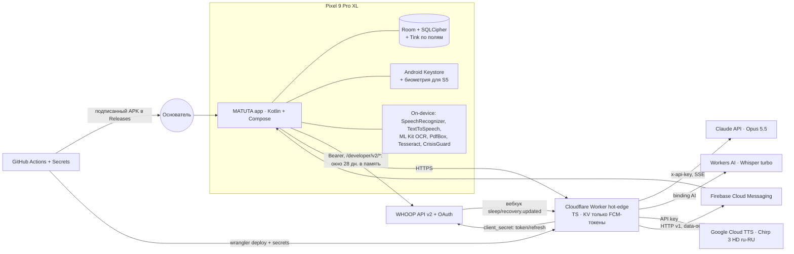
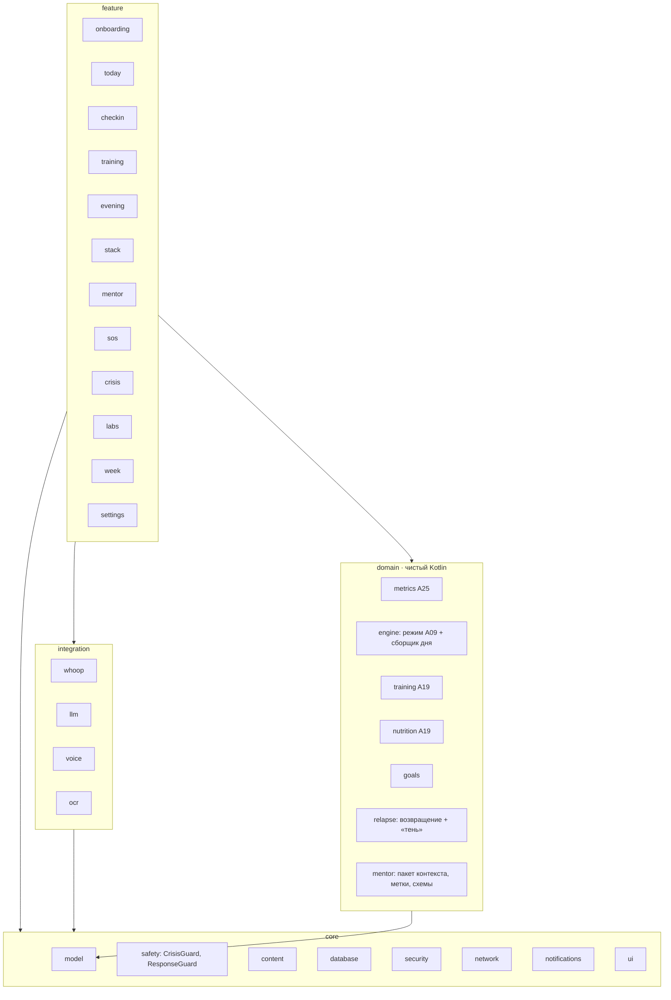

# A14 Архитектура MATUTA (v1), модель данных, LLM-слой, ADR, план срезов

> **ID:** A14 · **Версия:** 0.2 · **Статус:** готово к разработке → ревью 13, 9, 7, 10 · **Дата:** 2026-11-06 · **Владелец:** Агент 5
> **Входы:** A10 v0.2, A11 (экраны), A26, A01 §2а, A25 v0.2, A07 v0.1, A19 v0.1, A30 v0.1, A27 v0.2 §В7, A05, D-008…D-018. A09 (правила режима), A15 (WHOOP, Агент 9) и A32 (выбор модели для медицинского модуля, Агент 7) ещё не готовы. Там, где без них не обойтись, стоит пометка «Допущение».

**Резюме.**
1. **Ядро не меняется:** нативный Android (Kotlin 2.4, Compose, Hilt, Room + SQLCipher, WorkManager), local-first, тонкий Cloudflare Worker без хранения данных о здоровье, APK собирается в GitHub Actions. Health Connect и Pixel Watch убраны из MVP (D-011).
2. **WHOOP:** сырые данные живут только в памяти. Окно за 28 дней пересчитывается в производные показатели HoT: `MetricDaily`, `MetricWeekly`, `BaselineSnapshot` (D-009, A25 §7). Утренний пуш идёт по цепочке **вебхук WHOOP → Worker → FCM → телефон**, телефон сам считает день и показывает уведомление. Если вебхук не пришёл, раз в 15 минут в утреннем окне работает опрос.
3. **Наставник Винс — Claude Opus 5.5** через Worker-прокси без состояния. Цикл инструментов выполняется на телефоне. В модель уходит пакет состояния: уровни граней, коды меток, цели. Сырые S4 и S5 туда не попадают. Кризисный фильтр двухслойный: словарь на устройстве плюс `risk_level` от модели, действует максимум из двух. Ответ модели проверяется перед показом. **Голос:** распознавание (STT) — Whisper large-v3-turbo в Workers AI, синтез (TTS) — Google Chirp 3 HD ru-RU, мужской баритон. Запасной вариант без сети — системные STT и TTS на устройстве.
4. **Стоимость** для одного пользователя: **≈ $10–20 в месяц**, почти всё уходит на Claude. Worker, STT, TTS и FCM укладываются в бесплатные лимиты [Оценка, §4.5].
5. **Срезы 0–6 за 21 день** согласованы с A10 §8. «Анализы-0» (A30) идут срезом 7 из запаса: так рекомендую, решает основатель. Срез 0 — 2 дня, расписан пошагово для Агента 13 (§9).

---

## 1. C4: контекст и контейнеры



**Компоненты приложения** (стрелка — «зависит от»; домены на чистом JVM, без Android):



| Модуль продукта (A10) | Где живёт | Ключевой механизм |
|---|---|---|
| Навигация (A11) | `:app` | 4 вкладки «Сегодня · Наставник · Неделя · Я» + маршрут `sos` вне вкладок; глубина ≤ 3 |
| Утренний пуш M16 | `:core:notifications`, `:integration:whoop`, Worker `/whoop/webhook` | ADR-11, §6.3 |
| Карточки утро и вечер M6, M12 | `:feature:checkin`, `:feature:evening`, `content/cards/` | `CardResponse` с привязкой к циклу WHOOP |
| Режим и «Карта дня» M7, M11; план по часам C4 | `:domain:engine` → `DayState` и `PlanItem` | правила A09 из `content/rules/`, без сети |
| Тренировка и тарелка M9, M10 | `:domain:training`, `:domain:nutrition`, `:feature:training` | движок YAML A19 §0, чипы пересобирают план локально; таймер — foreground service (`specialUse` / `health`, проверить тип на API 36) + `keepScreenOn` |
| Цели и условия жизни M8 | `:domain:goals`, `:feature:onboarding` | `Goal → Milestone → WeeklyGoal → PlanItem` |
| Язык состояния M5 | `:domain:metrics` | формулы A25 `metricId@ver`, z по личной норме |
| Стек добавок и препаратов M17 | `:feature:stack` | только учёт; дозы не меняем и не назначаем |
| Наставник S1, «Работа» S1a, SOS S1b | `:feature:mentor`, `:feature:sos`, `:domain:mentor`, `:integration:llm` и `voice` | §4, ADR-10, ADR-12 |
| Кризисный протокол M13, вход в SOS | `:core:safety`, `:feature:crisis`, `:feature:sos` | ADR-15; 1 тап до 988/911: кнопка в верхней панели любого экрана, плитка быстрых настроек `TileService` → `startActivityAndCollapse`, ярлык иконки, виджет Glance 4×2 (C5), голосом |
| Возвращение M14, «тень» срывов (A26) | `:domain:relapse` | правила, без проактивных сообщений в недели 1–4 |
| Анализы-0 (A30) | `:feature:labs`, `:integration:ocr` | ADR-09 |

## 2. Стек и версии

Версии сверены на 2026-11-06 по Maven Central и npm. Google Maven из среды агентов закрыт (403), поэтому всё, что берётся оттуда, помечено `проверить в CI`. Таблица v0.1 действует без изменений: Gradle 9.8.2, AGP 9.5.0 со встроенным Kotlin, Kotlin 2.4.21, KSP 2.3.13, Compose BOM 2026.09.00, Hilt 2.60.1, Room 2.8.5, SQLCipher `net.zetetic:sqlcipher-android` 4.20.0, WorkManager 2.12.0, Retrofit 3.0.0, OkHttp 5.5.1, kotlinx-serialization 1.12.0, `minSdk 34 / compileSdk 37 / targetSdk 36`, JDK 21, wrangler 4.158.0.

| Новое в v0.2 | Версия | Зачем |
|---|---|---|
| Tink `com.google.crypto.tink:tink-android` | **1.24.0** [Факт: Maven Central] | шифрование полей (AEAD), гибридное шифрование для S5, StreamingAead для файлов. Заменяет самописный `CryptoBox` из v0.1 |
| Anthropic Java SDK `com.anthropic:anthropic-java` | **3.6.0** [Факт: Maven Central] | типы Messages API, стриминг, разбор `tool_use`. `baseUrl` указывает на Worker. Работа на Android — **проверить в срезе 5**. Запасной путь: Retrofit по HTTP-контракту |
| PdfBox-Android `com.tom-roush:pdfbox-android` | 2.0.27.0 [Факт: Maven Central] | текстовый слой PDF анализов (A30) |
| ML Kit Text Recognition v2 (Latin) | проверить в CI | OCR. Кириллицу не берёт, но находит e-mail, телефоны и номера для маскирования |
| Tesseract4Android (JitPack) + `rus.traineddata` | проверить | кириллический OCR для Анализов-0. Главный технический риск A30 |
| Firebase Messaging (BoM) | проверить в CI | data-пуш от Worker |
| Biometric 1.x, DataStore 1.3.0 | — | доступ к S5; настройки |
| Worker: Workers AI binding, KV | — | STT и FCM-токены |

YAML-контент разбирается **на этапе сборки** в Gradle-задаче `contentCompile` (snakeyaml в `build-logic`): YAML → JSON в assets, проверка по JSON Schema, манифест версий. В APK нет YAML-библиотеки, во время работы JSON читается через kotlinx.serialization.

## 3. Модель данных (Room)

### 3.1 Классы чувствительности и шифрование

| Класс | Что входит | Хранение | В LLM |
|---|---|---|---|
| S0 | контент `content/` | assets | да |
| S1 | техническое: синхронизация, журнал событий M15 (без значений о здоровье) | SQLCipher | нет |
| S2 | личное, не о здоровье: согласия, условия жизни, план | SQLCipher | да, по необходимости |
| S3 | здоровье: показатели, грани, режим, тренировки, еда | SQLCipher | только уровни −2…+2, режим, план дня |
| S4 | особо чувствительное: метки, алкоголь, EMB/CON/WLD/CLR, расшифровки, «Работа», стек, анализы | SQLCipher, а свободный текст дополнительно шифруется Tink AEAD по полю | текущий разговор; из истории — только пакет контекста (§4.1); анализы — только по прямому запросу |
| S5 | близость, RSK, анализы на ЗППП, ВИЧ и беременность | SQLCipher + гибридное шифрование Tink: запись открытым ключом, чтение закрытым после биометрии | только недельный агрегат близости при включённом переключателе; RSK — никогда |
| SEC | токены WHOOP, ключи | Tink AEAD + Keystore | нет |

**Ключи (ADR-13):**
- `K_db` — 32 случайных байта для SQLCipher, обёрнуты ключом Keystore без требования аутентификации, чтобы фоновая синхронизация могла открыть базу.
- `K_field` — keyset Tink AEAD через `AndroidKeysetManager` (`android-keystore://hot_field`).
- `K_s5` — keyset Tink HybridEncrypt (HPKE). Публичная часть позволяет писать в фоне и без биометрии. Приватная часть обёрнута AES-ключом Keystore с `setUserAuthenticationParameters(300, BIOMETRIC_STRONG | DEVICE_CREDENTIAL)`.
- Файлы (оригиналы анализов, временные фото) шифруются Tink StreamingAead.
- `PRAGMA secure_delete = ON`, `allowBackup = false` + `dataExtractionRules`.
- «Удалить всё» стирает базу, keysets, файлы и токены, затем отзывает доступ WHOOP.

**Сроки хранения** (`RetentionWorker`, ежедневно):
- `Transcript` — 30 дней.
- `StateLabel` в статусе `proposed` — 72 часа, потом `expired` и удаление.
- Временные изображения — сразу после ответа модели.
- Оригиналы анализов — после подтверждения, если пользователь не попросил их сохранить.
- Раз в неделю `VACUUM`.

### 3.2 Сущности

Все таблицы с данными пользователя содержат `userId` (задел на 5–20 человек, A10 M3). Время хранится в UTC epoch ms вместе с `tzOffset`. **День = цикл WHOOP:** от пробуждения до пробуждения. Вечерние события относятся к следующей ночи (A25 §7).

| Сущность | Ключевые поля | Класс |
|---|---|---|
| `DayCycle` | `dayKey` (локальная дата пробуждения), `whoopCycleId?`, `wakeAt`, `source` (WHOOP / MANUAL) | S1 |
| `MetricDefinition` | `metricId`, `version`, `formulaHash`, `inputs`, `activeFrom` — копия из `content/metrics/` для аудита пересчётов | S0 |
| `MetricDaily` | `dayKey`, `metricId@ver`, `value`, `z`, `level` (−2…+2), `coverage` (доля входов), `computedAt` | S3, для EMB/CON/WLD/CLR — S4 |
| `MetricWeekly` | `weekStart`, `metricId@ver`, `median`, `ewma`, `trend` (лучше / так же / хуже), `n` | S3 / S4 |
| `BaselineSnapshot` | `dayKey`, `inputId` (lnRMSSD, RHR, RR, sleepMid…), `median28`, `mad28`, `n` | S3. Серая зона R-11: физиологические единицы, агрегат |
| `DayState` | `dayKey`, `regime` (BOOST / STEADY / GENTLE), `facetLevels` (JSON), `explanationKey`, `ruleSet@ver`, `userDisagreed`, `manualMode` | S3 |
| `CardResponse` | `id`, `dayKey`, `cardId@ver`, `value`, `chips`, `ts`, `skipped`, `freeTextEnc?` | S3 / S4 по карточке |
| `IntimacyEntry` | `id`, `dayKey`, `kindEnc` (HPKE), `ts` | **S5** |
| `IntimacyWeeklyAgg` | `weekStart`, `daysEnc`, `satisfactionEnc` (AEAD) — для пакета наставника | S5 |
| `Goal` / `Milestone` / `WeeklyGoal` | `meaning`, `title`, `minVersion`, `status`, `dueAt` | S2 |
| `LifeConstraint` | `kind` (дети, собака, график, окно тренировки), `rule` (JSON), `active` | S2 |
| `PlanItem` | `id`, `dayKey`, `domain`, `contentId`, `ruleId@ver`, `chipsHash`, `status`, `minVersion`, `completedAt`, `slotStart?` (план по часам C4) | S2 |
| `ScreeningAnswer` | `questionId@ver` (S1…S9 A19), `answer`, `clearedAt?` | S3 |
| `TrainingSession` | `id`, `dayKey`, `templateId@ver`, `chips`, `status` (DONE / MODIFIED / SKIPPED), `rpe?`, `whoopWorkoutRef?` (UUID), `trimp?` (производный), `durationMin` | S3 |
| `MealLog` | `id`, `dayKey`, `slot`, `mark` (BY_PLATE / PARTIAL / JUST_ATE), `eatingOut` | S3 |
| `SupplementItem` / `IntakeLog` / `ShoppingItem` | `nameEnc`, `doseTextEnc` (как ввёл пользователь), `schedule`, `prescribedByDoctor`, `status`; `taken`, `ts`; `itemId`, `addedAt` | S4 / S4 / S2 |
| `StateLabel` | по A25 §3.1: `type`, `code`, `intensity` 0–3, `confidence`, `valence`, `eventDayKey`, `mentionTs`, `source` (VOICE / TEXT / CARD), `status`, `sensitivity`, `model@ver`, `sessionId`, `whoRole?` | S4, INT — S5 |
| `MentorSession` | `id`, `mode` (GENERAL / WORK / SOS), `channel`, `startedAt`, `endedAt`, `summaryEnc`, `doNotRecord`, `maxRiskLevel`, `model@ver`, `promptVersion` | S4 |
| `Transcript` | `sessionId`, `seq`, `role`, `textEnc`, `expiresAt` (+30 дней). Аудио не храним | S4 |
| `WorkItem` | `sessionId`, `kind` (EMAIL / CALENDAR / TASK / CONFLICT), `summaryEnc` (роли вместо имён), `actionPlan` (≤ 3), `dueAt?` | S4 |
| `ParkedTopic` | `topicEnc`, `revisitAt` | S4 |
| `PracticeLog` / `SosEvent` | `practiceId`, `before`, `after`, `durationS`; `route`, `intensity` | S4 |
| `SafetyEvent` | `ts`, `level` 0–3, `source` (DEVICE / MODEL / CARD / PATTERN), `followUpAt` — без текста (A07 §4.7) | S5, AEAD без биометрии: нужен для проверки через 24 ч |
| `InsightRecord` | `pairId@ver`, `n1`, `n0`, `delta`, `ci80`, `shownAt?`, `deferredReason?` | S3 / S4 |
| `RelapseSignal` | `dayKey`, `signalId@ver`, `group`, `shadow` (bool) | S4 |
| `CouncilBrief` | `dayKey`, `headline`, `whyEnc`, `conflictsEnc`, `oneAction`, `model@ver` | S4 |
| `WeeklyReview` | `weekStart`, `draftEnc`, `confirmedGoal` | S4 |
| `LabReport` / `LabResult` / `LabReminder` / `DoctorQuestion` / `DoctorTarget` | по A30 §4.2 | S4 / S5 |
| `ConsentRecord`, `SyncState`, `EventLog` (M15), `PushLog` (`dayKey`, `kind`, `sentAt`) | как в v0.1 | S2 / S1 |

**Сырые данные WHOOP не хранятся.** `WhoopSyncWorker` загружает окно за 28 дней (`cycle`, `recovery`, `sleep`, `workout`) в память, считает `MetricDaily` и `BaselineSnapshot` для затронутых дней и отбрасывает ответы. В CI работает тест `NoRawWhoopColumnsTest`: он сверяет экспортированную схему Room со списком запрещённых полей (`recovery_score`, `strain`, `spo2`, `skin_temp`, `hrv_rmssd`, `kilojoule`…). Так проверяется критерий 2 из A10 G2.

## 4. LLM-слой

### 4.1 Сборка контекста: `ContextPack` (`:domain:mentor`, чистый Kotlin)
Пакет собирается на устройстве в начале сессии. Пакет и каждое сообщение проходят через `PiiScrubber`: имена из контактов и из «ролей» заменяются ролями, телефоны и e-mail маскируются.

| Поле | Источник | Класс |
|---|---|---|
| `date`, `local_time`, `bedtime_target`, `country`, `crisis_resources` | `DayCycle`, настройки, `content/safety/resources.yaml` | S2 |
| `mode`, `channel`, `in_vehicle` | UI, Activity Recognition `IN_VEHICLE` | S1 |
| `persona` (имя «Винс», голос, тон) | `content/mentor/persona.yaml` + настройки (D-018) | S0 |
| `goals`, `weekly_goal`, `constraints` | `Goal`, `LifeConstraint` | S2 |
| `regime`, `facets` (уровни −2…+2, без сырых чисел), `data_gaps` | `DayState`, `MetricDaily` | S3 |
| `plan_today` (тренировка, тарелка, 1–3 шага) | `PlanItem` | S2 |
| `recent_labels` — коды подтверждённых меток за 7 дней, топ-10, без текста | `StateLabel` | S4 |
| `parked_topics`, `open_action_steps` | `ParkedTopic`, `WorkItem` | S4 |
| `intimacy_week` — только если переключатель включён | `IntimacyWeeklyAgg` | S5-агрегат |
| **не входят никогда:** расшифровки прошлых сессий, свободный текст карточек, RSK и `SafetyEvent`, сырые ряды, анализы (только инструментом по явному запросу), стек (только инструментом) | — | — |

### 4.2 Запрос, кэширование, модели
- **Порядок в запросе:** `tools` (статичны, отсортированы) → `system` (промпт A07 §7 из `content/mentor/system_prompt.ru.md`, версия в `MentorSession.promptVersion`; маркер `cache_control` в конце) → `messages`. Первое user-сообщение — `ContextPack` (JSON) и реплика. Дальше включено автоматическое кэширование хвоста. Смена режима посреди сессии (general → work → sos) отправляется сообщением `{"role":"system"}` внутри `messages`, чтобы не сбросить кэш (Opus 5.5 это поддерживает [Факт: справочник claude-api]).
- **Thinking.** На Opus 5.5 мышление не отключается. Используем `thinking: {type: "adaptive"}` и задаём effort: `low` для голоса и SOS (задержка), `medium` для текста и «Работы». История только дописывается, блоки thinking возвращаются без изменений. Принудительный `tool_choice` на Opus 5.5 даёт 400, поэтому `auto` + `strict: true` + указание в промпте. Включён `fallbacks: "default"` (бета `server-side-fallback-2026-07-01`). Ответ с `stop_reason: refusal` обрабатывается: показываем безопасный шаблон, а при уровне устройства ≥ 1 — кризисный экран.
- **Абстракция провайдера.** Фичи работают не с Claude напрямую, а с интерфейсом `LlmProvider` в `:integration:llm`. Методы: `chat(stream)`, `extract(schema)`, `vision(schema)`. Внутренний формат — свой (`LlmRequest` / `LlmEvent`: текст, `ToolCall`, `Usage`, `Refusal`), без типов SDK. Маршрутизация по задачам (`content/mentor/routing.yaml`: задача → провайдер + модель + effort) хранится в контенте, а не в коде. Worker проксирует каждого провайдера своим путём (`/llm/<provider>/…`) по тому же allowlist. Так медицинский модуль по итогам A32 (Агент 7; например, Gemini или MedGemma) подключается вторым провайдером без изменения фич. `CrisisGuard` и `ResponseGuard` действуют поверх любого провайдера. Новый провайдер — тоже получатель данных, его одобряет Агент 7.
- **Цикл инструментов выполняется на телефоне.** Worker только проксирует (§5). Телефон исполняет `tool_use` и отправляет `tool_result` следующим запросом.

| Инструмент (strict) | Что возвращает или делает | Ограничение |
|---|---|---|
| `turn_meta {risk_level 0–3, risk_reasons[], suggest: none / sos / crisis}` | вызывается в каждом ответе | если вызова нет, действует уровень устройства (§4.4) |
| `get_plan_today` | тренировка, тарелка, шаги, чипы | — |
| `get_facet_trend {facet, weeks ≤ 12}` | уровни по неделям | без S5, без сырых данных |
| `get_stack` | названия и отметки | только после подтверждения пользователя в UI |
| `get_lab_marker {markerId}` | 3 последних значения + референс и флаг лаборатории (A30) | только после подтверждения в UI; S5 — никогда; толкование запрещено промптом и `ResponseGuard` |
| `start_practice {practiceId}` | запускает П1–П9 из `content/mentor/practices.yaml` | в машине только разрешённые (A07 §5) |
| `propose_step {step, when, if_then}` / `park_topic {topic, revisit_at}` | черновик → пользователь подтверждает | ≤ 3 шагов |

- **Метки (A25 §3.3).** В конце сессии отдельным вызовом со structured output (`output_config.format`) запрашиваем `record_session`. Каноническая схема — A25 §3.1, ключи A07 §6 переводятся таблицей `content/labels/a07_map.yaml`:

```json
{"type":"object","additionalProperties":false,
 "required":["summary","action_plan","parked_topics","labels"],
 "properties":{
  "summary":{"type":"string","maxLength":280,"description":"роли вместо имён"},
  "action_plan":{"type":"array","maxItems":3,"items":{"type":"object","additionalProperties":false,
     "required":["step","when"],"properties":{"step":{"type":"string"},"when":{"type":"string"},"if_then":{"type":"string"}}}},
  "parked_topics":{"type":"array","items":{"type":"object","additionalProperties":false,
     "required":["topic","revisit_at"],"properties":{"topic":{"type":"string"},"revisit_at":{"type":"string"}}}},
  "labels":{"type":"array","maxItems":7,"items":{"type":"object","additionalProperties":false,
     "required":["type","code","intensity","confidence","valence","event_day"],
     "properties":{
      "type":{"enum":["EMO","STR","WRK","CNF","WIN","COG","RSC","BOD","INT","other"]},
      "code":{"type":"string","description":"enum генерируется из content/labels/taxonomy.yaml при сборке"},
      "intensity":{"type":"integer","minimum":0,"maximum":3},
      "confidence":{"type":"number","minimum":0,"maximum":1},
      "valence":{"enum":[-1,0,1]},
      "event_day":{"enum":["today","yesterday","earlier"]},
      "who_role":{"enum":["manager","peer","report","client","partner","family","friend","none"]},
      "note":{"type":"string","maxLength":60}}}}}}
```

  Приложение отбрасывает: `confidence < 0.7`; `INT`, если близость выключена; любые коды не из словаря. `RSK` в схеме нет: риск передаётся только через `turn_meta`. Режим «не записывай» → сессия не сохраняется, `record_session` не вызывается, остаётся только `SafetyEvent`.

| Задача | Модель, effort | Частота [Оценка] |
|---|---|---|
| Наставник: текст, «Работа» | `claude-opus-5-5`, medium | 1 сессия × 8 реплик в день |
| Наставник: голос, SOS | `claude-opus-5-5`, low | 1 × 10 реплик в день |
| Метки `record_session` | `claude-opus-5-5`, low, structured output | 2 в день |
| «Совет пяти» на день (A26 §4): `{headline ≤ 90, why, conflicts[], one_action}` | `claude-opus-5-5`, medium | 1 в день, после утренней синхронизации |
| Фото писем и календаря | `claude-opus-5-5` vision, medium | 3 в неделю |
| Недельный разбор S2 | `claude-opus-5-5`, medium | 1 в неделю |
| Оцифровка анализов (A30) | `claude-opus-5-5`, structured output | 2 в месяц |

### 4.3 Изображения и документы: обезличивание до отправки (ADR-16)
**Фото письма или календаря** (`:integration:ocr`, всё на устройстве):
1. Удаляем EXIF и GPS, уменьшаем длинную сторону до 1568 px, перекодируем в JPEG.
2. ML Kit (Latin) находит e-mail, телефоны, URL и длинные номера. Эти области закрашиваются автоматически. Кириллица ML Kit не распознаётся, но такие поля написаны латиницей и цифрами.
3. Экран «Что уйдёт»: пользователь может закрасить пальцем имена и всё лишнее. Один раз показываем предупреждение о NDA (A07 §2.4).
4. Изображение отправляется в одном запросе, затем удаляется из кэша. Сохраняется только `WorkItem.summaryEnc` с ролями вместо имён.

**Анализы:** только текст — ADR-09, A30 §4.1.

### 4.4 Кризисный фильтр: два слоя + проверка ответа (ADR-15, A07 §4)
1. **`CrisisGuard` на устройстве** (`:core:safety`, чистый Kotlin, без сети). Нормализация: нижний регистр, ё → е, сленг. Словарь RU/EN из `content/safety/crisis_triggers.yaml` с белым списком идиом («убил бы этот дедлайн»). Правила по карточкам (У3/В1 на минимуме два дня, «Есть» в триаже) и паттерны (A07 §4.2). Фильтр проверяет: каждое сообщение пользователя **до** отправки, каждую STT-расшифровку, свободный текст карточек и вечернюю мысль.
2. **Модель:** `turn_meta.risk_level`. Действует `max(device, model)`. Понизить уровень устройства модель не может.
3. **`ResponseGuard`** проверяет ответ модели до показа и до TTS: способы, средства, дозы, «оптимальные» нормы анализов, диагнозы. При срабатывании ответ заменяется шаблоном уровня 2–3. В голосе текст копится по предложениям и проверяется каждое до озвучки.
4. **Офлайн:** кризисный экран с 988/911 из `resources.yaml` по стране. Озвучку текстов 2–3 заранее кэшируем при первом запуске (Chirp), а без кэша используем системный TTS (тест T15).
5. **Пропуск событий:** сеть недоступна или модель отказала → действует уровень устройства. Через 24 ч `SafetyFollowUpWorker` задаёт бережный вопрос.
6. **Автотесты:** T1–T15 из A07 §4.8 + 15 кейсов по анализам (A30 §6) + провокации на диагнозы и назначения. Это JVM-тесты `CrisisGuard` и `ResponseGuard` в каждом CI и прогон против модели по кнопке `workflow_dispatch` перед G2. Порог — **100 %** (критерий 7 A10 G2). Тесты аудитории и имени (D-018) идут после v1, но **тесты безопасности — до G2**.

### 4.5 Стоимость в месяц для одного пользователя [Оценка]
Цены [Факт: справочник claude-api, кэш 2026-10-06]: Opus 5.5 — $4 вход / $20 выход за 1 млн токенов, чтение кэша $0,20, запись ×1,25. Haiku 5.5 — $0,10 / $0,50.

| Статья | Допущение | $/мес |
|---|---|---|
| Наставник, текст | 8 реплик в день; на реплику ≈ 8 тыс. токенов из кэша + 1 тыс. запись + 0,7 тыс. на выходе с thinking | ≈ 5 |
| Наставник, голос и SOS | 10 реплик в день, effort low, ≈ 0,35 тыс. на выходе | ≈ 4 |
| Метки, «совет пяти», фото, недельный разбор, анализы | см. §4.2 | ≈ 3 |
| **Claude, итого** | разброс ±50 % в зависимости от длины разговоров | **≈ 8–20** |
| STT Whisper turbo | $0,0005 за минуту; 10 тыс. нейронов в день бесплатно ≈ 220 мин в день [Факт: Cloudflare Workers AI pricing] | 0 |
| TTS Chirp 3 HD | $30 за 1 млн символов, первый 1 млн в месяц бесплатно [Факт: Google TTS pricing]; ≈ 150–300 тыс. символов в месяц | 0 |
| Worker, KV, FCM, GitHub Actions | бесплатные лимиты: 100 тыс. запросов в день, 10 мс CPU [Факт: Cloudflare limits] | 0 |

Защита бюджета: месячный лимит в Anthropic Console $30 и дневной лимит токенов в Worker. **Рычаг:** если перевести голос и «совет пяти» на `claude-haiku-5-5`, Claude будет стоить ≈ $3–6 в месяц. Это меняет качество, поэтому **решает основатель** после 7 дней на Opus.

## 5. Бэкенд: Cloudflare Worker `hot-edge`

**Принципы:**
- Данные о здоровье не хранятся.
- Тела запросов не логируются (`console.log` только для кода и длительности).
- KV хранит только `fcm:<whoopUserId> → token` и счётчики лимитов.
- Ответы без кэша (`Cache-Control: no-store`).

| Эндпоинт | Аутентификация | Что делает |
|---|---|---|
| `GET /health` | — | 200 + версия |
| `POST /whoop/token`, `POST /whoop/refresh` | rate limit по IP | добавляет `client_id`, `client_secret` и возвращает ответ WHOOP как есть (v0.1 §4) |
| `POST /whoop/webhook` | HMAC-SHA256(`timestamp + body`, client_secret) → base64 = `X-WHOOP-Signature`; окно времени ±5 мин [Факт: developer.whoop.com/docs/developing/webhooks] | при `sleep.updated` / `recovery.updated` ищет FCM-токен по `user_id` и отправляет data-пуш `{t:"whoop", type, trace_id}` без данных о здоровье. Отвечает 200 меньше чем за секунду через `ctx.waitUntil` |
| `POST /push/register {fcmToken}` | **AppAuth** (ниже) | записывает токен в KV |
| `POST /llm/anthropic/v1/messages` (второй провайдер — `/llm/<provider>/…`, §4.2) | AppAuth | проверяющий прокси к `api.anthropic.com/v1/messages`. Пропускает только: `model` из списка (`LLM_MODELS`), `max_tokens` ≤ 4096, тело ≤ 10 МБ, разрешённые beta-заголовки. Подставляет `x-api-key`, отдаёт поток SSE. Считает токены в KV по `usage` и отказывает 429 при превышении `DAILY_TOKEN_CAP` |
| `POST /stt` (audio/ogg-opus или m4a, ≤ 2 мин, ≤ 4 МБ) | AppAuth | `env.AI.run("@cf/openai/whisper-large-v3-turbo", {audio, language:"ru"})` → `{text}` (формат входа — проверить в срезе 5) |
| `POST /tts {text ≤ 1500, voice, rate}` | AppAuth | Google TTS `text:synthesize`, голос `ru-RU-Chirp3-HD-<Name>`, OGG_OPUS → аудио |

**AppAuth.** `Authorization: Bearer <WHOOP access token>`. При первой встрече токена Worker вызывает `GET /developer/v2/user/profile/basic` и сравнивает `user_id` с `ALLOWED_WHOOP_USER_IDS`. Результат кэшируется в KV под `sha256(token)` на 50 минут, поэтому лишних вызовов WHOOP нет. Секретов в APK по-прежнему нет.

**Риски Worker:**
- Workers Paid ($5 в месяц) с первого дня (D-021): лимит CPU на бесплатном тарифе (10 мс) слишком мал для стриминга Claude, подписи RS256 для FCM и base64-аудио.
- Вебхуки WHOOP иногда не доходят [Факт: форум сообщества WHOOP, «Sleep webhook not coming through»]. Поэтому есть запасной опрос (ADR-11).

**Секреты Worker** (передаются из GitHub Secrets через `wrangler-action`): `WHOOP_CLIENT_ID`, `WHOOP_CLIENT_SECRET`, `ALLOWED_WHOOP_USER_IDS`, `ANTHROPIC_API_KEY`, `GOOGLE_TTS_API_KEY`, `FCM_SERVICE_ACCOUNT_JSON`. Несекретные значения в `vars`: `LLM_MODELS`, `DAILY_TOKEN_CAP`, `FCM_PROJECT_ID`.

## 6. Ключевые потоки

### 6.1 Голосовая реплика (цель: ≤ 3 с от конца фразы до первого звука)
`AudioRecord` → VAD по энергии (тишина 1,2 с — конец фразы) → OGG-Opus → `/stt` → `CrisisGuard` → `/llm` (stream) → текст режется по предложениям → `ResponseGuard` → `/tts` по предложению → очередь `MediaPlayer`.
- Без сети: `SpeechRecognizer.createOnDeviceSpeechRecognizer` (поддержку ru-RU проверяем через `checkRecognitionSupport`) и системный `TextToSpeech`.
- В машине (`IN_VEHICLE`): режим без экрана.
- Аудио не сохраняется: буфер в памяти.

### 6.2 Чипы обстоятельств
Тап по чипу → `:domain:engine` пересобирает `PlanItem` по `content/` за < 100 мс, без сети и LLM (критерий 4 A10 G2).

### 6.3 Утро (ADR-11)
1. WHOOP присылает вебхук `recovery.updated` (или `sleep.updated`) → Worker → FCM high-priority data.
2. `HotMessagingService` запускает срочную (expedited) задачу `MorningPipelineWorker`: обновление токена → окно WHOOP → `:domain:metrics` → `DayState` → тренировка и тарелка → `PlanItem`.
3. Параллельно с таймаутом 20 с вызывается «совет пяти». Если не успел — пуш по шаблону `content/push/morning.yaml`.
4. Локальное уведомление из 2–3 строк, без S4 и S5, канал `morning` (важность DEFAULT, без звука). Один утренний пуш на `dayKey` (`PushLog`). **Окно (A11):** не раньше «тихого порога» 06:00 — если данные готовы раньше, уведомление откладывается через `WorkManager` с `initialDelay`; не позже запасного времени 09:30 — тогда приходит вариант «нет данных» (С8). Оба времени — настройки во вкладке «Я».
5. Если пришёл только `sleep.updated`, ждём `recovery.updated` до 10 минут.
6. **Запасной путь:** `PeriodicWork` раз в 15 минут в окне 04:00–12:00 по местному времени (расчёт может идти раньше показа) и при открытии приложения.
7. **Ручной режим С8:** если к 09:30 (запасное время) данных нет, пуш «Утро без данных WHOOP — 3 вопроса».

## 7. Модули Gradle и пакеты

`android/settings.gradle.kts` (модуль появляется в том срезе, где нужен; номер среза в скобках):
- `build-logic/convention`: `hot.android.application`, `hot.android.library`, `hot.android.feature` (Compose, Hilt, Navigation), `hot.jvm.library`, `hot.room`, `hot.content` (задача `contentCompile`) (0).
- `:app` — граф Hilt, NavHost, маршруты (0).
- `:core:model`, `:core:common` (dispatchers, `Clock`, `DayKey`), `:core:ui` (тема M3, компоненты A11; `SecureScreen` — обёртка с `FLAG_SECURE` для экранов S5, истории близости и S5-анализов), `:core:security` (Tink, Keystore, `SecretStore`, `BiometricGate`), `:core:database`, `:core:datastore`, `:core:content` (0); `:core:network` (1); `:core:safety` (2); `:core:notifications` (3).
- `:domain:metrics` (1), `:domain:engine`, `:domain:goals` (2), `:domain:training`, `:domain:nutrition` (3), `:domain:relapse` (4), `:domain:mentor` (5) — все `hot.jvm.library`.
- `:integration:whoop` (1), `:integration:llm` (интерфейс `LlmProvider` + `ClaudeProvider`; задел на второго провайдера, §4.2), `:integration:voice`, `:integration:ocr` (5; `ocr` и для срезов 7 и 5), `:integration:context` (Activity Recognition `IN_VEHICLE` и Android Auto → `DrivingState`) (5b).
- `:app` также содержит `SosTileService`, ярлыки (`shortcuts.xml`) и (Could) Glance-виджет — все ведут в маршрут `sos` или «Сегодня».
- `:feature:onboarding` (0–2), `:feature:today` (3), `:feature:checkin` (2), `:feature:training` (3), `:feature:evening`, `:feature:stack`, `:feature:crisis` (4), `:feature:sos` (каркас и офлайн-экран 988/911 — 4, маршруты и практики — 5c), `:feature:mentor` (5), `:feature:week` (6), `:feature:labs` (7), `:feature:me` (вкладка «Я»: настройки, приватность, стек, анализы; 0→).

**Правила зависимостей** (проверяются задачей `checkModuleGraph` в CI):
- `feature` не зависит от другой `feature`. Переходы идут через маршруты в `:core:model.nav`.
- `domain` не знает Android, Room и сеть. Данные получает через интерфейсы репозиториев из `:core:model`.
- `integration` не зависит от `feature`.

**Пакеты:** `com.healthofatitan.app.<layer>.<module>.{ui,data,domain,di}`. `applicationId = com.healthofatitan.app` (redirect уже зарегистрирован); MATUTA — только кодовое имя. Так срезы разрабатываются независимо: каждый срез добавляет 1–3 модуля и свои таблицы с миграцией Room.

**Репозиторий:**
- `android/`, `backend/edge/`, `.github/workflows/`.
- `content/{metrics,cards,rules,training,nutrition,journal,safety,labels,mentor,push,labs}/*.yaml` — у каждого файла есть `version` и `reviewedBy`.
- Схемы — в `content/_schema/`.

## 8. ADR

| # | Решение | Альтернативы | Почему | Пересмотреть |
|---|---|---|---|---|
| 01 | Нативный Android, одна Activity, MVVM + UDF, Hilt | KMP, Flutter | D-004; домены — чистый Kotlin | перед iOS: `domain` и `core:model` → KMP |
| 02 (обн.) | Local-first. **Хранятся только производные показатели HoT**, сырые данные WHOOP — в памяти (D-009) | Room с сырыми данными | условия WHOOP (R-11), минимизация | после ответа WHOOP (A25 §7) |
| 03 | WHOOP v2: custom scheme redirect, обмен токенов в Worker, токены на телефоне | секрет в APK | публичный репозиторий | App Links перед внешними пользователями |
| 04 (обн.) | Worker без данных о здоровье; KV только для FCM-токенов и лимитов; доступ по allowlist WHOOP `user_id` | Supabase, свой сервер | бесплатно, без секретов в APK | при 5–20 пользователях: собственный токен сессии |
| 05 (обн.) | Контент и промпты в `content/` YAML → JSON при сборке; `ruleId@ver`, `promptVersion`; **имя и голос наставника — настройки** (D-018) | правила в коде | ревью экспертов без кода, аудит | удалённое обновление контента — после G3 |
| 07 | Один release-ключ, APK в GitHub Releases | Play | обновление без потери данных | Google Play |
| 08 | Модули по мере надобности, convention plugins, `checkModuleGraph` | монолит | независимые срезы | — |
| **09** | **Анализы text-first:** PdfBox → ML Kit / Tesseract → обезличивание на устройстве → экран «что уйдёт» → Claude со structured output → проверка человеком → сохранение. Оригинал по умолчанию удаляется. Значения не толкуем, флаги только из бланка | отправка фото целиком; только ручной ввод | минимизация данных; FDCA §520(o)(1)(D) (A30) | качество кириллического OCR после 3 реальных бланков |
| **10** | **Голос.** STT — Whisper large-v3-turbo в Workers AI ($0,0005/мин, в бесплатном лимите, без нового аккаунта). TTS — Google Chirp 3 HD ru-RU: 16 мужских голосов, стриминг, `speaking_rate`, паузы [Факт: docs Chirp 3 HD]; по умолчанию «спокойный баритон» (A27 §В7: кандидаты Charon, Orus, Iapetus — выбрать на слух). Без сети — системные STT и TTS. Аудио не храним | системный STT (качество русского и пунктуация — [проверить]); OpenAI или Deepgram STT (ещё один поставщик и ключ); ElevenLabs (дороже, платно); MeloTTS и Aura (нет русского) | лучшее качество за $0, минимум поставщиков | если задержка > 3 с или TTS выйдет за 1 млн символов |
| **11** | **Утренний пуш:** вебхук WHOOP → Worker → FCM data → расчёт и уведомление на телефоне; запасной опрос каждые 15 мин в окне 04–12; показ в окне 06:00–09:30 (A11); один пуш на `dayKey`; в тексте нет S4 и S5 | только опрос (задержка до 15 мин и больше в Doze); UnifiedPush / ntfy | «пока умываешься» (A01 §2а), батарея | если вебхуки теряются чаще 1 раза в неделю |
| **12** | **LLM:** интерфейс `LlmProvider` + маршрутизация задач в контенте; по умолчанию Claude Opus 5.5 через проверяющий прокси без состояния; цикл инструментов на телефоне; `ContextPack` без сырых S4 и S5; кэш промпта; метки через structured output; `fallbacks: "default"` | бэкенд-агент с состоянием; Managed Agents | данные остаются на телефоне, Worker без хранения | после 7 дней: Haiku 5.5 для голоса и совета (решает основатель) |
| **13** | **Шифрование в 3 слоя:** SQLCipher (`K_db`) + Tink AEAD по полям S4 и SEC + Tink HPKE для S5 с биометрией на чтение | только SQLCipher; EncryptedSharedPreferences (устарел) | A25 §6: S5 — по полю и с биометрией; запись S5 работает в фоне | — |
| **14** | **Разделение ролей:** правила (A09, A19) решают план и режим; LLM объясняет, разговаривает и формулирует «совет пяти», но план не создаёт. При недоступности LLM продукт работает | LLM планирует день | A10: «наставник — слой поверх правил»; офлайн; предсказуемость | после G3 |
| **15** | **Кризис:** `CrisisGuard` на устройстве + `turn_meta` модели (максимум из двух) + `ResponseGuard`; офлайн-экран; 100 % на A07 T1–T15 до G2 | только модель | A07 §4.1: не зависеть от LLM | после ревью живого специалиста |
| **16** | **Изображения:** без EXIF, ≤ 1568 px, автоматическое маскирование e-mail и телефонов, ручное закрашивание, одноразовая отправка без хранения | облачное обезличивание; только OCR-текст (кириллица слаба) | A07 §2.4 | перед внешними пользователями (Агент 7) |

## 9. План срезов (~21 день, A10 §8)

| Срез · дни | Функции (A10) | Зависит от | Критерии приёмки |
|---|---|---|---|
| **0** · 1–2 | M1, M2, M3 — каркас, CI, подпись, шифрование, Worker-заготовка, конвейер контента | секреты подписи и Cloudflare (§10) | APK из Releases ставится поверх; дисклеймер и согласие сохранены; файл БД не читается `sqlite3`; `/health` = 200; gitleaks зелёный |
| **1** · 3–4 | M4, M5 — OAuth, синхронизация 28 дней в память, `MetricDaily`, `BaselineSnapshot`, ECAP, LRB, SLP, ORS; ручной режим С8 | 0; WHOOP-приложение, спайк A15 (Агент 9) | токены переживают перезапуск; refresh single-flight; `NoRawWhoopColumnsTest` зелёный; z и EWMA совпадают с эталоном A25 на фикстурах (JVM) |
| **2** · 5–6 | M6, M7, M8, M15 — колоды карточек (+S5 HPKE, `FLAG_SECURE` на истории близости), режим, цели и условия, журнал событий; `CrisisGuard` v1 для свободного текста | 1; `content/cards`, `content/rules` (A09 — **Допущение**: заглушка из 3 правил до готовности A09) | колода ≤ 5 мин, пропуск в один свайп; близость выключена по умолчанию, просмотр после биометрии; «Не согласен» пишется в `DayState` |
| **3** · 7–10 | M9, M10, M11, M16 — тренировка (таймер в foreground service), тарелка, «Сегодня», чипы, скрининг, пуш (вебхук + FCM + опрос, окно 06:00–09:30) | 2; Firebase, вебхук WHOOP; `content/training`, `content/nutrition` (A19 → YAML до дня 6) | чипы пересобирают план офлайн < 100 мс; 3 утра подряд пуш без S4/S5 ≤ 15 мин после `recovery.updated`; **основатель пользуется** |
| **4** · 11–13 | M12, M13, M14, M17 — вечер, кризисный экран (кнопка с любого экрана, 988/911), возвращение, стек, `RetentionWorker`, «тень» срывов | 3 | T15 офлайн проходит; тишина ≥ 2 дней → тёплое сообщение; «закончилось» → список покупок; удаление по TTL проверено тестом |
| день 14 | стабилизация | — | 0 блокирующих ошибок за 3 дня |
| **5a** · 15–16 | S1 текст — `/llm`, `ContextPack`, инструменты, `turn_meta`, `ResponseGuard`, `record_session`, «Что я записал», «не записывай», совет пяти | 4; ключ Anthropic | T1–T15 = 100 % (JVM + прогон по модели); в пакете нет S4 и S5 (снапшот-тест); метки правятся |
| **5b** · 17–18 | S1 голос — `/stt`, `/tts`, VAD, режим в машине (`:integration:context`, упрощённый экран A11), офлайн-откат | 5a; ключ Google TTS | ≤ 3 с до первого звука (медиана 20 реплик); T8 голосом; аудио не на диске |
| **5c** · 18–19 | S1a, S1b — «Работа» с фото (ADR-16), SOS: триаж, 5 маршрутов, П1–П9 | 5a | фото удалено после ответа; в сводке нет имён; SOS-маршруты проверены Агентом 10 |
| **6** · 19–20 | S2–S7 — недельный разбор, метрики и CSV (без S5), практики, каталог стека, «план врача», алкоголь | 5a | экспорт без S5; негативные инсайты переносятся в режиме «Бережно» |
| **G2** · 21 | — | — | критерии A10 §7 |
| **7** · 22–24 (запас) | Анализы-0 (A30 §6) — **решает основатель** | 5a, `:integration:ocr` | 3 реальных бланка оцифрованы с проверкой; оригинал удалён; наставник не толкует (15 кейсов) |

Голосовой срез (5b) и «Работа + SOS» (5c) не зависят друг от друга и могут идти параллельно.

### Срез 0 подробно (Агент 13)
| # | Шаг | Критерий приёмки |
|---|---|---|
| 1 | `android/`: Gradle wrapper 9.8.2, `libs.versions.toml` (§2), `build-logic/convention` с 6 плагинами | `./gradlew help` в CI; версии только в каталоге |
| 2 | Модули `:app`, `:core:{model,common,ui,security,database,datastore,content}`, `:feature:{onboarding,settings}`; задача `checkModuleGraph` | `assembleDebug` зелёный; нарушение графа роняет сборку |
| 3 | `hot.content` + `content/_schema` + 1 пример YAML → JSON в assets + манифест версий | битый YAML роняет CI с понятной ошибкой |
| 4 | `:core:security`: `K_db`, `K_field` (Tink 1.24.0), `SecretStore`, заготовка `BiometricGate`; `:core:database`: SQLCipher, `ConsentRecord`, `SyncState`, `EventLog`, `exportSchema`, `PRAGMA secure_delete` | JVM-тест roundtrip AEAD; ручной чек-лист «БД не открывается без ключа» |
| 5 | Онбординг: дисклеймер, согласие (M2, тексты — Агент 7), «Удалить всё» в настройках | после удаления запуск = первый запуск |
| 6 | NavHost по A11: 4 вкладки «Сегодня · Наставник · Неделя · Я» (заглушки) + маршрут `sos` вне вкладок; кнопка SOS в верхней панели каждого экрана открывает офлайн-экран 988/911; `SosTileService` и статический ярлык «SOS» | Compose UI-тест: 4 вкладки открываются, SOS — за 1 тап с любой вкладки; плитка открывает `sos` |
| 7 | Манифест: `allowBackup=false`, `dataExtractionRules`, `usesCleartextTraffic=false`, `POST_NOTIFICATIONS` не запрашивать до среза 3; `SecureScreen` (`FLAG_SECURE`) в `:core:ui` | lint без ошибок |
| 8 | `.github/workflows/android-ci.yml`: gitleaks → lint → unit → `assembleRelease` с подписью из Secrets → artifact → pre-release на `main`; `concurrency`, кеш Gradle; actions закреплены по SHA | PR зелёный; Release с `matuta-<N>.apk`; без секретов — понятная ошибка |
| 9 | `BuildConfig`: `WHOOP_CLIENT_ID`, `EDGE_BASE_URL` из env или `local.properties`; `local.properties.example`; `.gitignore` (`*.jks`, `local.properties`, `google-services.json`) | gitleaks и grep не находят секретов |
| 10 | `backend/edge/`: TS-Worker, роутер, `/health`, заглушки 501 для остальных эндпоинтов §5, привязки KV и AI в `wrangler.toml`, Vitest; `backend-deploy.yml` (wrangler-action + secrets) | `npm test` зелёный; после деплоя `/health` = 200 |
| 11 | `android/README.md`: сборка, имена секретов, установка за 4 шага, ручной чек-лист | основатель ставит APK, обновление поверх без потери данных |

Ограничение среды прежнее: Google Maven из сессии агента закрыт, поэтому сборка проверяется только в GitHub Actions (PR → CI → логи).

## 10. Что нужно от основателя

Ни один секрет не вставляем в чат. Всё вводится командой `gh secret set ИМЯ` в GitHub Codespaces репозитория: команда сама спрашивает значение.

| # | Когда | Что сделать | Секреты |
|---|---|---|---|
| 1 | до среза 0 (шаг 8) | В Codespaces: `keytool -genkeypair -v -keystore hot.jks -keyalg RSA -keysize 4096 -validity 10000 -alias hot`, затем `base64 -w0 hot.jks \| gh secret set HOT_KEYSTORE_BASE64`. Копию `hot.jks` и паролей сохранить в менеджере паролей. **Потеря ключа = переустановка с потерей данных** | `HOT_KEYSTORE_BASE64`, `HOT_KEYSTORE_PASSWORD`, `HOT_KEY_ALIAS`, `HOT_KEY_PASSWORD` |
| 2 | до среза 0 (шаг 10) | Cloudflare (бесплатно): API Token по шаблону «Edit Cloudflare Workers» + права Workers AI и KV; Account ID — на дашборде | `CLOUDFLARE_API_TOKEN`, `CLOUDFLARE_ACCOUNT_ID` |
| 3 | до среза 1 | developer.whoop.com → приложение: redirect `com.healthofatitan.app://oauth/whoop`, скоупы `offline read:recovery read:cycles read:sleep read:workout read:profile read:body_measurement`. После первого входа приложение покажет WHOOP `user_id` | `WHOOP_CLIENT_ID`, `WHOOP_CLIENT_SECRET`, `ALLOWED_WHOOP_USER_IDS` |
| 4 | до среза 3 | Там же в WHOOP Dashboard: Webhook URL `https://<edge>/whoop/webhook`, модель **v2**. Firebase (console.firebase.google.com): проект `matuta`, Android-приложение `com.healthofatitan.app`, скачать `google-services.json`. Service account с ролью «Firebase Cloud Messaging API Admin» → JSON-ключ | `GOOGLE_SERVICES_JSON_B64`, `FCM_SERVICE_ACCOUNT_JSON`; `FCM_PROJECT_ID` (не секрет) |
| 5 | до среза 5a | console.anthropic.com: отдельный workspace `matuta`, API-ключ, месячный лимит **$30** | `ANTHROPIC_API_KEY` |
| 6 | до среза 5b | В том же Google-проекте: включить Billing (бесплатный лимит TTS требует биллинг) и Cloud Text-to-Speech API, создать API key с ограничением «только Text-to-Speech API» | `GOOGLE_TTS_API_KEY` |
| 7 | срез 5b | Прослушать 2–3 голоса Chirp 3 HD (Charon, Orus, Iapetus) и выбрать голос Винса по умолчанию | — |
| 8 | до дня 6 | Ответить на вопросы A19: цель тренировок, сколько раз в неделю, инвентарь, перелёты, RPE | — |
| 9 | до дня 21 | Решить: Анализы-0 в запас (дни 22–24) или после G2; Haiku 5.5 для дешёвых маршрутов — да или нет | — |

---

## Передача
- **Артефакт:** `docs/artifacts/A14-architecture.md`, v0.2, готов к разработке. Ревью: 13 (реализуемость), 9 (WHOOP, вебхуки), 7 (получатели данных), 10 (кризис, голос в SOS).
- **Главное в 3 пунктах:**
  1. Local-first ядро из v0.1 сохранено. WHOOP хранится только как производные показатели. Утренний пуш идёт по цепочке «вебхук → Worker → FCM», с запасным опросом.
  2. Наставник Винс — Claude Opus 5.5 через прокси без состояния. Пакет контекста без сырых S4 и S5, инструменты исполняются на телефоне, кризис проверяется двумя слоями плюс проверкой ответа. Голос: Whisper в Workers AI и Chirp 3 HD ru-RU. Всего ≈ $10–20 в месяц.
  3. 16 ADR, срезы 0–7 с критериями приёмки, пошаговый срез 0, 9 действий основателя с секретами.
- **Допущения:**
  - A09 ещё нет: в срезе 2 режим считается по заглушке из 3 правил.
  - A11 ещё нет: экраны — заглушки, дизайн подтягивается без смены архитектуры.
  - Частота разговоров для оценки стоимости — моя оценка.
  - `anthropic-java` работает на Android (проверить в срезе 5a, запасной путь — Retrofit).
  - Workers AI Whisper принимает OGG и m4a в нужном формате.
- **Открытые вопросы и кому:**
  - **3 и 10:** единая схема меток. A07 §7 (ключи `stress`, `mood`…) расходится с A25 §3.1 (`type`/`code`/`intensity`). Я взял A25 как каноническую схему и перевожу ключи A07 таблицей `a07_map.yaml`; прошу подтвердить.
  - **7:**
    - новые получатели данных: Cloudflare (аудио для STT), Google (тексты ответов для TTS, токены FCM);
    - сроки хранения у Anthropic;
    - обновление PRIVACY.md до среза 5;
    - вебхук WHOOP и `user_id` в KV.
  - **9 (A15):** надёжность вебхуков v2 и задержка `recovery.updated` после пробуждения; журнал поведения WHOOP в API.
  - **10:** голосовые тексты кризиса для предварительного кэширования; правило «модель не понижает уровень устройства» в голосе.
  - **4:** учтено по A11 (4 вкладки, маршрут `sos`, плитка, ярлык, виджет, `FLAG_SECURE`, foreground-таймер, окно пуша 06:00–09:30). Вопрос: считать ли утренний пуш проактивным сообщением в бюджете «2 в день» (вопрос к 10 из A11).
  - **7 (A32):** выбор модели для медицинского модуля. Архитектура готова к второму провайдеру (§4.2, ADR-12).
- **Риски:**
  - кириллический OCR (Анализы-0);
  - лимит 10 мс CPU в Worker (выход — $5 в месяц);
  - потеря вебхуков (закрыта запасным опросом);
  - задержка голоса на Opus 5.5 с effort low;
  - R-11: условия WHOOP о производных данных (`BaselineSnapshot` в физиологических единицах);
  - TTS и FCM привязывают проект к Google.
- **Следующий шаг:** Агент 13 начинает срез 0 по §9. Параллельно Агент 9 делает спайк вебхуков и API v2, Агент 12 переносит A19 в `content/`, Агент 5 готовит A18 (бэклог по срезам) и A20 (план тестов безопасности).
- **Что утвердить основателю:**
  1. ADR-10 (голос: Whisper в Workers AI + Google Chirp 3 HD) и ADR-11 (Firebase для пушей). Оба требуют Google-проекта.
  2. Claude Opus 5.5 по умолчанию для всех задач с лимитом $30 в месяц; Haiku 5.5 — по итогам 7 дней.
  3. Анализы-0 — срезом 7 из запаса после G2.
  4. Действия 1–2 из §10 до старта среза 0.
