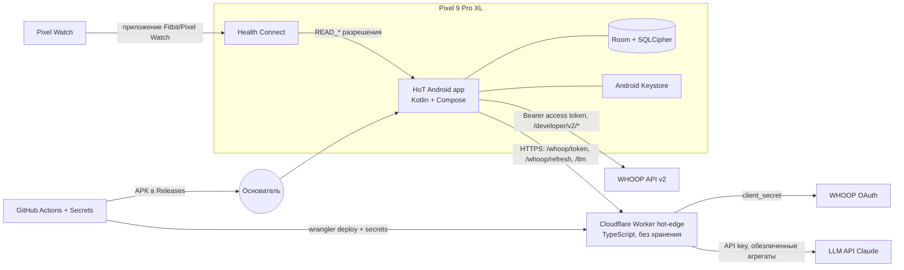

# A14 Архитектура MVP, модель данных, ADR

> **ID:** A14 · **Версия:** 0.1 · **Статус:** черновик → на ревью (13, 9, 7) · **Дата:** 2026-11-06 · **Владелец:** Агент 5
> **Входы:** TEAM.md 4.5 и 8, decisions D-003…D-005, risks R-03…R-06. A09, A10, A15 ещё не готовы: где нужны их решения, стоит «Допущение».

**Резюме.**
1. Приложение одно, нативное: Kotlin 2.4, Compose, AGP 9.5 со встроенным Kotlin, Hilt, Room с SQLCipher, WorkManager, Health Connect 1.1. Данные о здоровье хранятся только на телефоне в зашифрованной базе.
2. WHOOP подключаем только через **API v2**: v1 больше не поддерживается. Используем OAuth 2.0 с `offline` и redirect на custom scheme. Код на токены обменивает Cloudflare Worker: только у него есть client secret. Токены лежат на телефоне, Worker их не хранит.
3. Бэкенд — Cloudflare Workers на бесплатном тарифе. Он делает три вещи: обмен и обновление токенов WHOOP и прокси к LLM. В APK нет ни одного секрета. Это важно, потому что **репозиторий публичный**.
4. Каждый push собирается в GitHub Actions. Подпись одна, стабильным ключом из Secrets. Основатель ставит APK из GitHub Releases.
5. Срез 0 даёт каркас из 6 модулей, зелёный CI и подписанный APK на Pixel. Оценка: 1–1,5 дня работы Агента 13.

---

## 1. C4: контекст, контейнеры, модули

Данные WHOOP телефон берёт напрямую из API: access token выдаётся пользователю, секрет для этого не нужен. Через Worker идут только операции, которым нужен секрет.

**Модули Gradle.** Модуль создаётся в том срезе, где он впервые нужен (в скобках — номер среза).

| Модуль | Назначение | Зависит от |
|---|---|---|
| `build-logic/convention` | convention plugins: `hot.android.application`, `hot.android.library`, `hot.compose`, `hot.hilt`, `hot.room`, `hot.jvm.library` (0) | — |
| `:app` | `HotApplication`, `MainActivity`, навигация, Hilt-граф (0) | все `feature`, `core` |
| `:core:model` | чистый Kotlin: доменные модели, `Domain` (6 направлений), `Source` (0) | — |
| `:core:security` | ключи Keystore, `CryptoBox` (AES-GCM), `SecretStore` для токенов (0) | model |
| `:core:database` | Room + SQLCipher, DAO, миграции, схемы в `schemas/` (0) | model, security |
| `:core:ui` | тема Material 3, компоненты по A13 (0) | model |
| `:domain:engine` | чистый Kotlin/JVM: петля дня, «Карта дня», движок правил (0 — заглушка, 2 — логика) | model |
| `:core:network` | OkHttp, Retrofit, `EdgeApi` для Worker (1) | model |
| `:integration:whoop` | OAuth, `WhoopApi` v2, мапперы в `:core:model` (1) | network, security, database |
| `:integration:healthconnect` | `HealthConnectClient`, мапперы (4) | model, database |
| `:core:content` | загрузчик `content/` (YAML → модели правил и практик) (2) | model |
| `:feature:{today,checkin,journal,practices,week,assistant,settings}` | экраны + ViewModel | core, domain |

**Пакеты.** Корень — `com.healthofatitan.app`, внутри модуля `…<module>.{ui,data,domain,di}`. Новое направление экосистемы подключается так: набор правил в `content/<domain>/`, при необходимости `:feature:<domain>`. Ядро при этом не меняется.

Структура репозитория: `android/` (Gradle-проект), `backend/edge/` (Worker), `content/` (правила и тексты экспертов; копируются в assets при сборке), `.github/workflows/`.

## 2. Стек и версии

Версии на 2026-11-06. **Источники:** Maven Central (метаданные), developer.android.com: stable channel и AGP 9.5.0 release notes. Помечено `проверить` то, что не удалось сверить напрямую: Google Maven из облачной среды закрыт (`dl.google.com` → 403).

| Компонент | Версия | Примечание |
|---|---|---|
| Gradle | 9.8.2 | AGP 9.5 требует ≥ 9.6.0 [Факт: release notes] |
| AGP | **9.5.0** (окт. 2026) | встроенный Kotlin: плагин `org.jetbrains.kotlin.android` не применяем; max API 37; JDK ≥ 17 |
| JDK в CI | 21 (Temurin) | — |
| Kotlin (KGP) + Compose compiler plugin | **2.4.21** | `org.jetbrains.kotlin.plugin.compose`, версия = Kotlin |
| KSP | 2.3.13 | KSP2, для Room и Hilt |
| Compose BOM | **2026.09.00** | последний в BOM mapping; Compose UI 1.12.1 [проверить при сборке] |
| Material 3 | из BOM (stable 1.4.x) | — |
| Activity / Lifecycle / Navigation | 1.13.0 / 2.11.0 / 2.10.2 | Navigation Compose с type-safe маршрутами |
| Core KTX | 1.19.1 | — |
| Hilt (Dagger) / androidx.hilt | **2.60.1** / 1.4.0 | `hilt-navigation-compose`, `hilt-work` |
| Room | **2.8.5** | KSP, `exportSchema = true` |
| SQLCipher | **`net.zetetic:sqlcipher-android` 4.20.0** | + `androidx.sqlite` 2.7.1, `SupportOpenHelperFactory` |
| DataStore | 1.3.0 | настройки; токены — только в зашифрованном виде |
| WorkManager | **2.12.0** | — |
| Health Connect | **`androidx.health.connect:connect-client` 1.1.0** | — |
| Browser (Custom Tabs) | 1.10.0 | OAuth WHOOP |
| Сеть | Retrofit 3.0.0, OkHttp 5.5.1, kotlinx-serialization-json 1.12.0 | совместимость Retrofit 3 и OkHttp 5 [проверить] |
| Coroutines | 1.11.0 | — |
| Тесты | JUnit 4.13.2, Robolectric 4.17, Turbine 1.2.1, Compose UI test (BOM) | — |
| SDK | `minSdk 34`, `compileSdk 37`, `targetSdk 36` | minSdk 34 = Health Connect входит в систему; targetSdk поднимем, когда проверим поведение API 37 |
| Worker | TypeScript, wrangler 4.158.0, Vitest; без фреймворка | — |

Не берём: `security-crypto` (EncryptedSharedPreferences устарел в 1.1.0) — вместо него свой `CryptoBox` на Keystore, около 60 строк. AppAuth — WHOOP требует client secret, так что выгода от него невелика, а последний релиз (0.11.1) старый.

## 3. Модель данных (Room)

**Классы чувствительности:**
- **S0** — публичный контент.
- **S1** — технические данные.
- **S2** — личные данные, но не о здоровье.
- **S3** — данные о здоровье (особая категория).
- **S4** — особо чувствительные: ментальное состояние, свободный текст, диалоги, кризисные флаги.
- **SEC** — секреты.

**Правила:**
- S3 и S4 хранятся только в SQLCipher.
- S2–S4 не пишутся в Logcat, crash-отчёты и аналитику.
- В LLM S3 уходит только обезличенными агрегатами.
- Передача S4 в LLM — только после решения Агента 7 (R-03).
- SEC хранится только в Keystore или в зашифрованном `SecretStore`.

| Сущность | Ключевые поля | Класс |
|---|---|---|
| `SleepSession` | `id`, `source`(WHOOP/HC), `sourceId`(UUID), `start`, `end`, `tzOffset`, `isNap`, `lightMin`, `deepMin`, `remMin`, `awakeMin`, `performancePct`, `efficiencyPct`, `respiratoryRate`, `scoreState` | S3 |
| `Recovery` | `cycleId`, `sleepId`, `date`, `recoveryScore`, `hrvRmssdMs`, `restingHr`, `spo2Pct`, `skinTempC`, `scoreState` | S3 |
| `Cycle` | `id`, `start`, `end`, `strain`, `kilojoule`, `avgHr`, `maxHr` | S3 |
| `Workout` | `id`, `source`, `sourceId`, `sport`, `start`, `end`, `strain`, `avgHr`, `maxHr`, `kilojoule`, `distanceM`, `hrZonesJson` | S3 |
| `DailyActivity` | `date`, `source`, `steps`, `avgHr`, `restingHr` (Pixel Watch через HC) | S3 |
| `CheckIn` | `id`, `date`, `kind`(MORNING/EVENING), `energy`, `mood`, `stress` (1–10), `dayRating`, `note` | S4 |
| `DayCard` | `date`, `color`(GREEN/YELLOW/RED), `inputsJson`, `ruleSetVersion`, `explanationKey` | S3 |
| `PlanItem` | `id`, `date`, `domain`, `contentId`, `ruleId`, `ruleVersion`, `status`, `completedAt` | S2 |
| `FoodEntry` | `id`, `ts`, `text`, `summary`; фото — во внутреннем хранилище, удаляется после разбора | S3 |
| `PracticeLog` | `id`, `practiceId`, `ts`, `durationSec`, `before`, `after` | S4 |
| `AssistantMessage` | `id`, `threadId`, `role`, `text`, `ts`, `crisisFlag` | S4 |
| `WeeklyReport` | `weekStart`, `json`, `goal` | S3 |
| `ConsentRecord` | `type`, `version`, `grantedAt`, `revokedAt` | S2 |
| `SyncState` | `source`, `lastSyncAt`, `cursor`, `lastError` | S1 |

**Время.** Храним `Instant` в UTC (epoch ms) вместе с `tzOffset`. День петли — локальная дата пользователя. Дубли между WHOOP и HC сводятся по правилам A15 (Агент 9): данные храним с источником, а при чтении выбираем по приоритету.

**Шифрование.** При первом запуске создаётся случайный ключ БД (32 байта). Его оборачивает AES-GCM-ключ Keystore, без требования аутентификации пользователя: иначе фоновая синхронизация не сможет открыть базу. Обёрнутый ключ лежит в файле приложения. «Удалить все данные» стирает базу, ключи и токены, а затем отзывает доступ WHOOP. Резервное копирование отключено: `android:allowBackup="false"`, правила `dataExtractionRules`.

## 4. OAuth и API WHOOP

| Параметр | Значение | Статус |
|---|---|---|
| Версия API | **v2**; «The v1 API is no longer supported». В v2 `sleepId` и `workoutId` — UUID, в webhooks по умолчанию модель v2 | [Факт: developer.whoop.com, v1-v2-migration] |
| Authorize | `https://api.prod.whoop.com/oauth/oauth2/auth` | [Факт: developer.whoop.com/docs/developing/oauth] |
| Token | `https://api.prod.whoop.com/oauth/oauth2/token` | [Факт: там же] |
| Данные | `https://api.prod.whoop.com/developer` + `/v2/cycle`, `/v2/recovery`, `/v2/activity/sleep`, `/v2/activity/workout`, `/v2/user/profile/basic`, `/v2/user/measurement/body` | пути `/v2/*` — [Факт: migration guide]; префикс `/developer` и `user/*` — [проверить в API reference] |
| Скоупы | `offline read:recovery read:cycles read:sleep read:workout read:profile read:body_measurement` | `offline` нужен для refresh token [Факт]; точные имена `read:*` — [проверить в Dashboard] |
| `state` | случайная строка ≥ 8 символов, проверяется при возврате | [Факт: «must be eight characters»] |
| Redirect URI | **custom scheme `com.healthofatitan.app://oauth/whoop`**, регистрируется в Dashboard | в документации есть пример `whoop://example/redirect`, значит custom scheme допустим [Факт]; HTTPS не обязателен |
| Токены | `expires_in` ≈ 3600 с; refresh **ротируется**: каждый refresh выдаёт новый refresh token, старый токен недействителен | [Факт] |
| PKCE | в документации не упомянут — не полагаемся на него | [Факт: отсутствует] |
| Лимиты | ориентир 100 запросов в минуту и 10 000 в день; пагинация `limit ≤ 25` + `nextToken` | [Оценка, проверяет Агент 9 в A15] |

**Поток:**
1. `:feature:settings` → «Подключить WHOOP». Приложение генерирует `state`, сохраняет его и открывает Custom Tab с параметрами `authorize?response_type=code&client_id=…&redirect_uri=…&scope=…&state=…`. `client_id` не секрет: он попадает в `BuildConfig` из GitHub Secret `WHOOP_CLIENT_ID`.
2. WHOOP возвращает `com.healthofatitan.app://oauth/whoop?code=…&state=…` в `OAuthRedirectActivity` (`singleTask`, intent-filter по схеме). Если `state` не совпадает — отказ.
3. Приложение отправляет `POST {EDGE}/whoop/token {code, redirect_uri}`. Worker добавляет `client_id`, `client_secret` и `grant_type=authorization_code`, вызывает token endpoint и возвращает ответ WHOOP как есть. Worker ничего не хранит и не логирует.
4. Приложение кладёт `access_token`, `refresh_token` и `expires_at` в `SecretStore`: файл, зашифрованный `CryptoBox`.
5. Обновление: за 5 минут до истечения или по ответу 401 — `POST {EDGE}/whoop/refresh {refresh_token}`. Работает в режиме single-flight через `Mutex`, чтобы два параллельных refresh не «сожгли» ротируемый токен. Новая пара токенов записывается атомарно. Если refresh не удался (`invalid_grant`), приложение просит переподключиться.
6. Первая загрузка — история за 90 дней (A15). Дальше `PeriodicWorkRequest` раз в 2 часа, при открытии приложения и утром. Webhooks в MVP не используем (ADR-06).

Формат тела token-запроса: по RFC 6749 это `application/x-www-form-urlencoded`. В примере WHOOP его не видно — проверяет тест среза 1 на реальном аккаунте.

**Риск custom scheme.** Схему может перехватить другое приложение. Меры: проверка `state`; код одноразовый; на устройстве один владелец. Перед внешними пользователями переходим на верифицированный App Link `https://<edge>/whoop/callback`, где Worker отдаёт `/.well-known/assetlinks.json`.

## 5. Бэкенд: Cloudflare Workers

| Вариант | Плюсы | Минусы |
|---|---|---|
| **Cloudflare Workers (выбор)** | бесплатно: около 100 тыс. запросов в день, 10 мс CPU на запрос (ожидание сети не считается) [Оценка по тарифу, перепроверить]; деплой одной командой; TypeScript знаком ИИ | данные проходят вне РФ; в РФ возможны ограничения доступа к Cloudflare [Гипотеза → проверить с телефона основателя в срезе 1] |
| Yandex Cloud Functions | хостинг в РФ (152-ФЗ) | нужен платёжный аккаунт, сложнее IAM, CI-деплой длиннее |
| Supabase Edge / Vercel Functions | бесплатный тариф, простой деплой | лишние сущности (БД, проект), те же проблемы с РФ |

**Эндпоинты:**
- `POST /whoop/token`, `POST /whoop/refresh` — без авторизации: без одноразового кода или refresh token они бесполезны. Rate limit по IP.
- `POST /llm` — требует `Authorization: Bearer <WHOOP access token>`. Worker проверяет токен вызовом `GET /v2/user/profile/basic` и сравнивает `user_id` с секретом `ALLOWED_WHOOP_USER_IDS`, затем ограничивает число запросов в день. Так LLM-прокси защищён **без секретов в APK**. Список легко расширить на 5–20 знакомых.
- `GET /health` — проверка доступности.

**Секреты.** Workflow `backend-deploy.yml` (push в `backend/**`) вызывает `cloudflare/wrangler-action` и передаёт `secrets: WHOOP_CLIENT_ID, WHOOP_CLIENT_SECRET, ALLOWED_WHOOP_USER_IDS, ANTHROPIC_API_KEY` из GitHub Secrets, а также `CLOUDFLARE_API_TOKEN` и `CLOUDFLARE_ACCOUNT_ID`. Wrangler записывает их как Worker secrets. В `wrangler.toml` — только несекретные `vars` (например, `LLM_MODEL`, дневной лимит). Логи Worker не содержат тел запросов.

Если приложение вызовут из РФ, а сервер Anthropic отклонит запрос по региону, проверяем Smart Placement Worker. Это вопрос среза 6.

## 6. CI и установка

**`android-ci.yml`** (push и PR в `main`):
1. `checkout`.
2. `setup-java` 21.
3. `gradle/actions/setup-gradle` с кешем.
4. `./gradlew :app:lintDebug testDebugUnitTest assembleRelease`.
5. Upload artifact.
6. На push в `main` — публикация APK в GitHub Release `build-<run_number>` (pre-release).

Все actions закрепляются по SHA последнего релиза.

**Подпись.** Debug-ключи в CI каждый раз разные, а приложение с другой подписью не ставится поверх старого: пришлось бы удалять его вместе с данными. Поэтому **все устанавливаемые сборки подписываются одним release-ключом**:
- Секреты `HOT_KEYSTORE_BASE64`, `HOT_KEYSTORE_PASSWORD`, `HOT_KEY_ALIAS`, `HOT_KEY_PASSWORD`.
- `signingConfigs.release` читает их из env. Если секретов нет — локальная сборка без подписи, CI падает с понятной ошибкой.
- Release-сборка в MVP: `isMinifyEnabled = false` (включим R8 в Ф4). `isDebuggable = false`.

Ключ создаётся один раз: `keytool -genkeypair -v -keystore hot.jks -keyalg RSA -keysize 4096 -validity 10000 -alias hot`. Это делает основатель в GitHub Codespaces (3 команды) или агент с доступом администратора репозитория через `gh secret set`, не выводя ключ в чат. Резервная копия `hot.jks` — в менеджере паролей основателя. **Потеря ключа = переустановка с потерей данных.**

**Публичный репозиторий** (проверено: страница открывается анонимно). Следствия:
- APK в Releases виден всем. Поэтому в APK нет секретов, а `client_id` секретом не является.
- Actions на публичном репозитории бесплатны без лимита минут.

**Установка на Pixel:**
1. Открыть `github.com/mrfreshval-web/health-of-a-titan/releases` в Chrome на телефоне.
2. Скачать `hot-<N>.apk`.
3. Разрешить Chrome «Установку неизвестных приложений».
4. Установить.

Обновления ставятся так же, поверх. Можно автоматизировать через Obtainium: он отслеживает GitHub Releases. Google объявил обязательную верификацию разработчиков для sideload-приложений с 2026–2027 годов: статус для РФ и Pixel проверить; `adb install` остаётся запасным путём.

## 7. ADR (кратко)

| # | Решение | Альтернативы | Почему | Пересмотреть |
|---|---|---|---|---|
| ADR-01 | Нативный Android, одна Activity, MVVM + UDF, Hilt | KMP, Flutter | D-004; лучшая поддержка Health Connect; ИИ хорошо знает стек | перед iOS (Ф5): вынести `:domain:engine` и `:core:model` в KMP — они уже чистый Kotlin |
| ADR-02 | Local-first: данные о здоровье только на устройстве, в Room + SQLCipher с ключом в Keystore | серверная БД | снимает большую часть 152-ФЗ и GDPR на этапе «для себя», бесплатно | перед синхронизацией между устройствами или внешними пользователями (Ф4, хостинг в РФ) |
| ADR-03 | WHOOP API v2, custom scheme redirect, обмен и refresh в Worker, токены на телефоне | секрет в APK; токены на сервере | секрет нельзя класть в APK публичного репо; сервер без состояния проще и безопаснее | Ф4: App Links и webhooks |
| ADR-04 | Cloudflare Workers без хранилища; LLM-доступ через проверку WHOOP-токена и allowlist | Yandex Cloud Functions, Supabase | бесплатно, быстро, без секретов в клиенте | при недоступности из РФ или перед внешними пользователями |
| ADR-05 | Правила и тексты экспертов — в `content/` (YAML) с `version`; движок в чистом JVM-модуле; каждый `PlanItem` хранит `ruleId@version` | правила в коде | эксперты меняют контент без кода, есть аудит и тесты | при появлении A/B и удалённого обновления правил |
| ADR-06 | Синхронизация WHOOP опросом через WorkManager, без webhooks | webhooks → Worker → FCM | webhooks требуют сервер с состоянием и FCM | после G2, если задержка данных мешает |
| ADR-07 | Один release-ключ для всех сборок, APK в GitHub Releases | Firebase App Distribution; debug-сборки | обновление без потери данных, ноль сервисов | при переходе в Google Play (Play App Signing) |
| ADR-08 | Модули создаются по мере надобности; convention plugins с первого дня | один модуль; полная разбивка сразу | баланс скорости и будущей модульности экосистемы | — |

## 8. План среза 0 для Агента 13

**Цель:** каркас, который собирается в CI в подписанный APK, ставится на Pixel и открывает пустой экран «Сегодня» с зашифрованной базой.

| # | Шаг | Критерии приёмки |
|---|---|---|
| 1 | `android/`: Gradle wrapper 9.8.2, `settings.gradle.kts`, `gradle/libs.versions.toml` с версиями из раздела 2, `build-logic/convention` | `./gradlew help` проходит в CI; версии только в каталоге |
| 2 | Модули `:app`, `:core:model`, `:core:ui`, `:core:security`, `:core:database`, `:domain:engine`; `applicationId = com.healthofatitan.app`, minSdk 34, compileSdk 37, targetSdk 36 | `./gradlew assembleDebug` зелёный; граф зависимостей — как в разделе 1 |
| 3 | Тема M3 (dynamic color), `MainActivity` + NavHost с 7 заглушками экранов (раздел 4.5 TEAM) и нижней навигацией; строки — только в `strings.xml` (ru, задел на `values-en`) | Robolectric или Compose UI-тест: навигация открывает все 7 экранов |
| 4 | `:core:security`: `KeyManager` (AES-GCM в Keystore), `CryptoBox`, `SecretStore`; `:core:database`: `HotDatabase` на SQLCipher, сущности `SyncState` и `ConsentRecord`, `exportSchema` | unit-тест roundtrip `CryptoBox` (JVM-фейк ключа); instrumented-тест «база не открывается без ключа» описан для ручной проверки; файл БД не читается `sqlite3` |
| 5 | Манифест: `allowBackup=false`, `dataExtractionRules`, `usesCleartextTraffic=false`; Health Connect `<queries>` и privacy-policy activity-alias (без запроса прав) | lint без ошибок; в манифесте нет лишних разрешений |
| 6 | `.github/workflows/android-ci.yml`: lint, unit-тесты, `assembleRelease` с подписью из Secrets, upload artifact, pre-release на push в `main`; `concurrency` и кеш Gradle | PR зелёный; на `main` появляется Release с APK; при отсутствии секретов шаг подписи даёт понятную ошибку |
| 7 | `WHOOP_CLIENT_ID` и `EDGE_BASE_URL` → `BuildConfig` из env или `local.properties`; `local.properties.example`; `.gitignore` (`*.jks`, `local.properties`) | `grep` по репо не находит секретов; сборка без них проходит с пустыми значениями |
| 8 | `backend/edge/`: Worker с `GET /health`, Vitest, `backend-deploy.yml` (wrangler-action, secrets); `/whoop/*` — заглушки 501 | `npm test` зелёный в CI; после деплоя `/health` отвечает 200 |
| 9 | `android/README.md`: сборка, секреты (список имён), установка на Pixel за 4 шага, сценарий ручной проверки | основатель ставит APK, приложение запускается, 7 вкладок открываются, после переустановки поверх данные не теряются |

**Не входит в срез 0:** OAuth WHOOP (срез 1), Health Connect permissions (срез 4), LLM (срез 6).
**Что нужно от основателя до шага 6–8:**
- создать keystore и 4 секрета подписи;
- Cloudflare-аккаунт, секреты `CLOUDFLARE_API_TOKEN` и `CLOUDFLARE_ACCOUNT_ID`;
- проверить, что redirect URI в WHOOP Dashboard = `com.healthofatitan.app://oauth/whoop`.

**Ограничение среды:** из облачной среды недоступен Google Maven (`dl.google.com` → 403). Поэтому Android-сборка проверяется **только в GitHub Actions**: локальный `./gradlew` в сессии агента не сработает. Работа идёт так: PR → CI → чтение логов.
