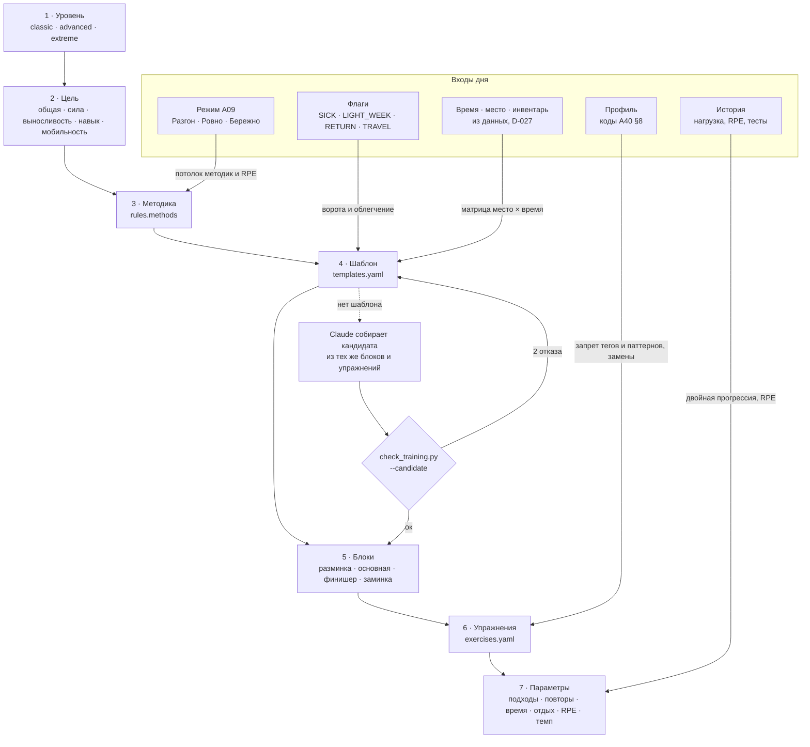

# A40 · Система тренировок: три уровня, конфигуратор по слоям, библиотека с Титаном, интерактивный плеер

> **Версия:** v0.1 · **Статус:** черновик → на ревью (3 — вложено в §11; 9, 10, 4, 14, 13) · **Дата:** 2026-11-07
> **Владелец:** Агент 12 (тренер) · **Рецензент с вето:** Агент 3 · **Участники:** 2 (рынок, §1), 9 (носимые, §7.4), 4 и 15 (Титан, макеты, §6 и §10), 14 (MVP и оценка, §12), 13 (реализация, §4 и §12)
> **Входы:** A19 (тренировка дня, скрининг, стоп-сигналы), A09 (режимы Разгон / Ровно / Бережно), A25 (Заряд, Весы, нагрузка), A35 (WHOOP API, сверка плана с фактом, «Печать»), A37 и D-031 («Титаниум»), A01, A26, `content/haiku/` (образец «библиотека + правила + генерация + валидатор»), `content/profile/constraints.yaml` (A41, ветка `claude/nutrition-system`)
> **Контент:** `content/training/` — `SCHEMA.md`, `exercises.yaml` (74 упражнения), `templates.yaml` (16 шаблонов), `rules.yaml`, `scripts/check_training.py` (0 ошибок)
> **Макеты:** `docs/design/training/` и `/mnt/project-files/brand/training/` (§10)

## Резюме
1. **Три уровня — по цене усилия, а не по виду спорта.**
   - **Классика**: функциональный тренинг, фитнес (гантели, круговая в зале), оздоровительная гимнастика, кардио Zone 2. RPE ≤ 8, без отказа.
   - **Продвинутый**: силовая с периодизацией, кроссфит-подход (AMRAP, EMOM, на время), ВИИТ, база калистеники. RPE ≤ 9, интервалы только в Разгон.
   - **Экстрим**: навыки калистеники и стрит-воркаута, гимнастическая сила, спринты, «Чиппер Титана». Максимальное усердие, вход только через тесты и явное согласие.
   - Переход между уровнями идёт по тестам подготовленности (§3) и только с подтверждением пользователя.
2. **Мобильность и растяжка везде (правило M-ALL).** В каждой тренировке есть разминка с мобильностью и заминка с растяжкой, а облегчённая версия их не убирает. Ещё 4 отдельных шаблона мобильности открыты всем уровням. Это правило проверяет валидатор: шаблон без растяжки в библиотеку не попадёт.
3. **Конфигуратор устроен как хокку.** Цепочка слоёв: уровень → цель → методика → шаблон → блоки → упражнения → параметры. Детерминированный движок собирает тренировку из YAML: одинаковые входы всегда дают одинаковую тренировку. Claude подключается, только когда шаблона нет, и собирает сессию из тех же кирпичей. Валидатор отклоняет его вариант, если тот нарушает уровень, режим, профиль или M-ALL.
4. **Связь с показателями.**
   - Режим дня (A09) задаёт потолок: в Разгон доступны все методики уровня, в Ровно RPE ≤ 7 и без интервалов, в Бережно только Zone 2 и мобильность.
   - Весы, сон и флаги (`LIGHT_WEEK`, `RETURN`, `TRAVEL`) могут только облегчить тренировку.
   - WHOOP после тренировки ставит «Печать» и даёт фактическую нагрузку (A35).
5. **Библиотека с Титаном.** Каждое упражнение содержит технику, ошибки, подсказки, дыхание, противопоказания кодами профиля, замены и 2–4 ключевые позы. Анимацию делаем **скелетом Титана в Compose** («линия света» на пропорциях знака v2), а не Lottie: один риг на все 74 упражнения, позы задаются данными, цвет режима и тема применяются бесплатно (§6).
6. **Интерактивный плеер.** Таймеры подходов и отдыха, тактильный отсчёт, голос с подсказками из библиотеки. Повторы и вес вводятся одним жестом, RPE — одним тапом. Кнопка «Мне плохо» видна всегда. **Живой пульс:** в публичном API WHOOP его нет. Есть два пути: режим WHOOP «HR Broadcast» по стандартному BLE Heart Rate Service и приложение на Pixel Watch через Health Services (§7.4).
7. **MVP ≈ 24 дня Агента 13** (§12): движок, плеер, тесты, риг Титана и анимации 30 самых частых упражнений, BLE-пульс WHOOP. Остальные 44 анимации и приложение для часов — на этапе 2.

---

## 1. Разбор рынка (Агент 2)

| Продукт | Как устроены тренировки | Что сильно | Слабое место для нашего пользователя | Что берём / чего избегаем |
|---|---|---|---|---|
| **Fitbod** | Алгоритм собирает силовую тренировку по истории, инвентарю и «восстановлению» каждой мышечной группы; прогрессивная перегрузка по истории подходов `[Факт: help.fitbod.me]` | автоматическая прогрессия, замена упражнения в один тап, учёт инвентаря | «восстановление мышц» считается по объёму, без сна и HRV; нет уровней методик, почти только силовая | берём замены и прогрессию по истории; восстановление берём из WHOOP, а не из оценки по объёму |
| **Future** | Живой тренер удалённо составляет план, приложение ведёт по нему, связь с Apple Watch `[Факт: sensai.fit, 2026]` | доверие и подотчётность | дорого (порядка $150–200 в месяц `[Оценка]`), масштаб упирается в людей | берём «почему так» под каждой тренировкой; человека заменяем правилами и прозрачностью |
| **Freeletics** | ИИ-коуч, тренировки с весом тела; после каждой сессии спрашивает о сложности и подстраивает следующую `[Факт: freeletics.com]` | обратная связь после тренировки, «боги» — именные тренировки на время | слабая связь с восстановлением; ощущение «через силу» у новичков | берём именные тренировки («Чиппер Титана») и оценку после сессии; темп задаёт режим дня |
| **Nike Training Club** | Видеобиблиотека тренировок и программ, бесплатно с 2020 года `[Факт: nike.com/ntc-app]` | качество видео, широкий охват (йога, сила, мобильность) | нет персонализации под состояние; видео нельзя перекрасить и переозвучить | берём мобильность как полноправную категорию; видео не снимаем (§6) |
| **Apple Fitness+** | Видеозанятия с тренерами; метрики Apple Watch выводятся поверх видео в реальном времени, Burn Bar сравнивает с другими `[Факт: apple.com/apple-fitness-plus]` | живой пульс на экране, эффект «я в классе» | только экосистема Apple; сравнение с другими давит на часть аудитории | берём живой пульс в плеере (§7.4); сравнение с другими не берём (A26, Агент 10) |
| **WHOOP Strength Trainer** | С 2023 г. записывает упражнения, подходы, повторы и вес и добавляет «мышечную нагрузку» в Strain `[Факт: WHOOP press, businesswire 25.04.2023]` | связь силовой с восстановлением и Strain | конструктор тренировок без методик и уровней; подходы, повторы и вес **не отдаются** в публичный API (A35) | наш плеер сам хранит подходы и вес; WHOOP даёт Strain и пульс, а мы — структуру и технику |
| **Caliber** | Бесплатный трекер силовых и Strength Score; платный коучинг с человеком `[Факт: caliberstrong.com]` | понятная метрика силы, хорошая логика прогрессии | только силовая, нет мобильности и состояния | берём простой индекс силы как идею этапа 2; без процентов «к идеалу» |
| **Ladder** | Командные программы под тренера, занятия «повторяй за видео» с таймером `[Факт: sensai.fit, 2026]` | ритм и таймеры, ощущение команды | мало подстройки под состояние | берём ведение по таймеру: следующий шаг всегда понятен без чтения |
| **Centr** | Программы от Криса Хемсворта, видео, питание `[Факт: centr.com]` | образ героя (Тор), который тянет за собой | герой-человек задаёт «идеал тела» | у нас герой — Титан-скульптура, а не тело-образец (A37 §3) |
| **Peloton** | Занятия, приложение Strength+, подсчёт повторов камерой на новом оборудовании `[Оценка: проверить]` | живая энергия занятий, рейтинги | железо и подписка; лидерборды | подсчёт повторов камерой — кандидат этапа 3 |
| **Thenx** | Программы калистеники по навыкам (выход силой, передний вис, стойка) с уровнями от новичка до продвинутого `[Факт: thenx.com]` | лестницы навыков с регрессиями | нет связи с восстановлением; травмы запястий и локтей у новичков | берём лестницы навыков в Экстрим и обязательную подготовку запястий и лопаток |

**Чего нет ни у кого и что мы делаем первыми:** один продукт, в котором уровень методик (от классики до экстрима) связан с утренним состоянием по WHOOP, мобильность встроена в каждую тренировку и проверяется правилом, а библиотека анимирована фирменным героем в цветах режима.

---

## 2. Три уровня (Агенты 12 и 3)

### 2.1 Принцип разделения
Уровень показывает, **сколько усердия, навыка и восстановления** требует методика, а не какой это вид спорта. Поэтому калистеника есть в двух уровнях: её база (подтягивания, брусья, пайк) относится к Продвинутому, а навыки (выход силой, передний вис, стойка на руках) — к Экстриму. Гимнастика тоже стоит в двух местах: оздоровительная — в Классике, гимнастическая сила — в Экстриме.

| | **Классика** | **Продвинутый** | **Экстрим** |
|---|---|---|---|
| Обещание | Сильное тело на каждый день | Мощность и выносливость | Максимальное усердие |
| Методики (`rules.methods`) | функциональный тренинг, фитнес-силовая с гантелями, фитнес-круг в зале, оздоровительная гимнастика, кардио Zone 2 | силовая с периодизацией (волна 3+1, EMOM), кроссфит-подход (AMRAP, EMOM, на время), ВИИТ (4×4, 30/90), калистеника-база | стрит-воркаут-навыки, гимнастическая сила, спринты в гору, «Чиппер Титана» на время |
| Техники | суперсеты антагонистов, круговая, темп 3-0-1-0, разговорный тест | RPE-авторегуляция, EMOM, AMRAP с потолком, интервалы по зонам, тяжёлые повторы без отказа | лестницы навыков, изометрия (вис, уголок, стойка), негативы, спринт с полным отдыхом |
| Потолок RPE (в Разгон) | 8, без отказа | 9; отказ только в последнем подходе подсобных | 10 в кондиции с потолком времени; навыки — никогда не до отказа |
| Тренировок в неделю | 2–4, из них силовых ≥ 2, мобильности ≥ 2 | 3–5, «тяжёлых» ≤ 2 | 4–6, «тяжёлых» ≤ 3, мобильности ≥ 3 |
| Вход | любой; при «да» в скрининге — щадящий режим внутри Классики | скрининг чистый, 6 недель на Классике, ≥ 2 тренировок в неделю в 5 из 6 недель, тесты §3 | скрининг чистый, явное согласие, 8 недель на Продвинутом, тесты §3 |
| Шаблоны | `tpl-cl-functional-home`, `tpl-cl-db-strength`, `tpl-cl-gym-circuit`, `tpl-cl-zone2` | `tpl-ad-strength-emom`, `tpl-ad-metcon-amrap`, `tpl-ad-hiit-4x4`, `tpl-ad-calisthenics` | `tpl-ex-street-skill`, `tpl-ex-handstand-legs`, `tpl-ex-hill-sprints`, `tpl-ex-titan-chipper` |
| Упражнений в библиотеке | 45 (включая 20 на мобильность, растяжку и дыхание) | 17 | 12 |

### 2.2 Наполнение по уровням (кратко)
- **Классика.** Шесть движений человека (присед, наклон, выпад, толчок, тяга, перенос) плюс кор. Работаем в 2–3 повторах от отказа. Кардио — Zone 2 с разговорным тестом. Оздоровительная гимнастика — это шаблоны мобильности плюс функциональная база в медленном темпе.
- **Продвинутый.** Штанга и трэп-гриф, гиря (махи, взятие), ВИИТ 4×4 мин в Z4 по протоколу Helgerud 2007, AMRAP с потолком по времени. Калистеника-база (подтягивания, брусья, пайк, лодочка) готовит к навыкам.
- **Экстрим.** Навык делаем свежим и в начале, ни одного повтора с поломанной техникой. Спринт 8–15 с с отдыхом до полного восстановления дыхания. «Чиппер» — длинная работа на время с потолком 35 мин.

### 2.3 Связь уровня и режима дня
Уровень показывает, **что человек умеет**, а режим — **что телу можно сегодня**. Экстрим в день Бережно превращается в мобильность для калистеников (`tpl-mob-calisthenics-prep`), а не в «лёгкий экстрим». Таблица версий записана в каждом шаблоне (`modes`).

### 2.4 Правило M-ALL «мобильность и растяжка везде»
- Первый блок — разминка ≥ 3 мин, в ней хотя бы одно упражнение `mobility`; второй частью идёт подводка к главному движению.
- Последний блок — заминка ≥ 3 мин, в ней хотя бы одна растяжка `stretch`, в конце растяжка или дыхание (`ex-breath-long-exhale`).
- `lighter` и любые модификаторы **не убирают** разминку и заминку: в лёгкий день сокращается основная часть.
- В неделю: Классика и Продвинутый — ≥ 2 отдельные сессии мобильности, Экстрим — ≥ 3 (`rules.mobility_everywhere`).
- Отдельные шаблоны: «Утренний разворот» 10 мин, «Восстановление» 25 мин, «Глубокая растяжка» 20 мин, «Подготовка калистеника» 15 мин.
- Всё это проверяет валидатор (`check_training.py`), в том числе для сессий, которые собрал Claude.

### 2.5 Противопоказания и красные флаги
- **Ворота до выбора тренировки** (`rules.gates`, порядок важен):
  - `EMERGENCY` скрывает тренировки;
  - `SICK` оставляет прогулку и мобильность ≤ 20 мин в Z1;
  - «скоро к врачу» оставляет только мобильность;
  - скрининг не пройден: только Классика, RPE ≤ 6, без тяжёлого веса, натуживания, спринтов и положения вверх ногами;
  - беременность и роды за последние 6 месяцев: программы нет, совет обсудить нагрузки с врачом;
  - `ED_CARE`: без лишних сессий, без «сожжённых калорий» и без чипперов;
  - после стоп-сигналов F1–F5 (A19 §6.2) тренировки скрыты до отметки «врач разрешил».
- **Внутри тренировки** кнопка «Мне плохо» всегда на экране и ведёт к стоп-сигналам A19 §6.2. Голос и текст не говорят «дотерпи»; в стоп-словах валидатора есть «до рвоты», «терпи боль» и «no pain no gain».
- **На уровне упражнения** противопоказания записаны кодами профиля (§8), а свойства движения — тегами риска (`risk_tags`). Профиль и режим запрещают теги, а не отдельные упражнения, поэтому новое упражнение безопасно сразу, как только у него есть теги.
- **Чего продукт не делает.** Не ставит диагнозов, не «лечит» боль упражнениями, не даёт реабилитацию. При острой травме (`*_injury`) область не тренируется, и продукт советует обратиться к врачу или физиотерапевту.

### 2.6 Прогрессия и разгрузка
- **Двойная прогрессия** (сила, кор, мощность): все подходы на верхней границе повторов при RPE ≤ цели → следующая ступень веса (+1–2 кг на гантели, +2,5 кг на штангу) или следующая прогрессия упражнения.
- **RPE-авторегуляция внутри тренировки:**
  - подход тяжелее цели на 2 → −10 % веса или −2 повтора;
  - подход легче цели на 2 → +1 повтор.
- **Навыки:** к следующей ступени (`progressions`) переходим после трёх тренировок подряд с целевым объёмом без потери техники.
- **Кардио:** Zone 2 растёт на +5 мин в неделю до 60 мин. В интервалах сначала растёт время работы, потом число повторов.
- **Объём за неделю** растёт не больше чем на 10 %.
- **Разгрузка:**
  - по плану: Классика — раз в 6 недель, Продвинутый и Экстрим — раз в 4, объём −40 %, RPE ≤ 7;
  - по сигналам: `LIGHT_WEEK`, 3 дня Бережно за 7 дней, медиана RPE ≥ 9 две недели подряд;
  - текст: «Неделя разгрузки: тело растёт, когда отдыхает».

---

## 3. Подготовленность: тесты, вход и переход (Агенты 12 и 3)

| Тест | Как | Продвинутый | Экстрим | Не проводим при |
|---|---|---|---|---|
| `ft-pushups` | отжимания подряд, тело — прямая | 15 | 30 | травма плеча, запястья |
| `ft-pullups` | подтягивания из полного виса, без раскачки | 3 | 10 | травма плеча, боль в локте |
| `ft-squat-60` | приседания за 60 с | 35 | 45 | травма колена |
| `ft-plank` | планка на предплечьях | 60 с | 120 с | травма поясницы, давление |
| `ft-sit-reach` | наклон сидя | до голени | до носков | травма поясницы |
| `ft-step-3min` *(необязательный)* | степ 30 см, 96 уд/мин метронома, 3 мин; падение пульса за 60 с | 20 уд | 30 уд | сердце, боль в груди, обмороки, скрининг не пройден |

Пороги взяты по мотивам норм ACSM и NSCA и помечены `[Оценка]`. Агент 3 сверяет их, а к дню 60 их проверяют на первых пользователях. Пол и возраст в пороги не вшиты: тесты определяют не «норму», а готовность к методикам уровня.

**Правила перехода** (`rules.level_transition`):
- **Вверх.** Нужны все тесты на порог следующего уровня, срок на текущем уровне и регулярность. Тогда появляется карточка «Готов к Продвинутому?»; сам продукт уровень не меняет. Первые 2 недели на новом уровне идут облегчённые версии.
- **Вниз.** Предлагаем, если за 8 недель трижды был флаг `RETURN`, медиана RPE ≥ 9 держится 3 недели или пользователь просит сам. Текст: «Сменим ритм на пару недель: это шаг для силы, а не назад».
- **Повторный тест** раз в 6 недель или по кнопке. Тест — это отдельная тренировка в плеере (макет `t6-test.png`) с разминкой и заминкой по M-ALL.
- **Экстрим** требует явного согласия одним тапом: «Понимаю риски, слушаю стоп-сигналы». Без согласия действует код `extreme_not_consented` и уровень не выше Продвинутого.

---

## 4. Конфигуратор: слои, движок, генерация (Агенты 12 и 13)

### 4.1 Слои

### 4.2 Движок (детерминированный, `:domain:training`)
1. **Ворота** `rules.gates`: первое сработавшее правило главнее.
2. **Потолок** `regime_caps[режим]` пересекается с уровнем пользователя: получаем допустимые методики и максимальный RPE.
3. **Модификаторы** `rules.modifiers` TM-01…TM-12 только облегчают (A19 TR-01…TR-09 и новые).
4. **Недельная очередь** (A19 §1.2, шаг 2) выбирает тип: силовая, интервалы, Zone 2 или мобильность. Счётчик мобильности не опускается ниже нормы M-ALL.
5. **Шаблон** выбираем по уровню, методике, месту, времени и инвентарю, затем берём его версию по режиму (`modes`: `full`, `lighter` или `swap`).
6. **Фильтр упражнений по профилю.** Упражнение с запрещённым тегом или паттерном меняем по цепочке: `alt` в шаблоне → `swaps` → `regressions` → то же `pattern` без запрещённых тегов → пропуск.
7. **Параметры** берём из шаблона, иначе из `default` упражнения, и корректируем прогрессией (§2.6).
8. **Объяснение.** Под карточкой — строка «Почему так» с id сработавших правил, как в A09.

Каждая тренировка хранит `templateId@version` и id сработавших правил, поэтому её всегда можно воспроизвести.

### 4.3 Матрица место × время
Работает как A19 §3.2, но на новых шаблонах. Место и инвентарь выводятся из данных (D-027): геолокация зала после двух посещений, инвентарь из прошлых тренировок. Чип «Где ты?» остаётся подтверждением в один тап.

### 4.4 Генерация Claude по правилам
- **Когда:** нет шаблона под время × место × инвентарь × профиль, или у пользователя ≥ 3 кода профиля и замен не хватает.
- **Вход:** уровень, режим, место, инвентарь, минуты, коды профиля, последние 3 тренировки (id, без медицинских данных) и выдержка из `rules.generation`.
- **Что Claude может** (`rules.generation.may`): выбрать упражнения из библиотеки для существующих блоков; подобрать параметры в пределах ±1 ступени от `default`; написать `why_ru`.
- **Что не может:** придумывать упражнения, поднимать RPE, убирать разминку или заминку, говорить о весе тела, калориях и лечении.
- **Проверка:** `check_training.py --candidate session.yaml --request request.yaml` (примеры в `content/training/_tests/`). Отклоняется сессия, в которой есть хоть одно из:
  - уровень выше пользовательского;
  - методика или RPE выше потолка режима или профиля;
  - запрещённый тег или паттерн;
  - код пользователя в противопоказаниях упражнения;
  - место, инвентарь или время не совпадают;
  - нарушено M-ALL;
  - стоп-слово.
- **Отказ:** после двух неудач движок берёт ближайший шаблон. Сгенерированная сессия, которую пользователь выполнил трижды, уходит Агенту 12 кандидатом в библиотеку.

---

## 5. Связь с показателями (Агенты 12, 9, 3)

| Показатель | Откуда | Что делает в тренировке |
|---|---|---|
| **Режим дня** (A09 §2) | ORS, сон, Весы, самочувствие | потолок методик и RPE (`regime_caps`); версия шаблона (`modes`) |
| **Заряд** (A25) | восстановление WHOOP относительно личной нормы | показывается в плеере и на карточке; через режим определяет облегчение; на старте тренировки: «Заряд 44 · Ровно → версия L1» |
| **Весы / нагрузка** (A25 I2, A35) | Strain WHOOP, острая и хроническая нагрузка | TM-01 (лёгкая неделя), TM-02 (острая > 1,5 × хронической → Ровно на день, подаётся как тренд, а не прогноз травмы), TM-10 (потолок дня набран → растяжка) |
| **Сон** | WHOOP | TM-05: < 6 ч → интервалы превращаются в Zone 2, силовая облегчается, без максимальной скорости и риска падения |
| **Пульс в тренировке** | BLE HR (§7.4) или WHOOP workout после тренировки | зоны в кардио и ВИИТ; восстановление пульса в отдыхе; тест `ft-step-3min` |
| **RPE** | один тап после последнего подхода упражнения | авторегуляция и прогрессия; медиана RPE запускает разгрузку |
| **Факт** (A35) | WHOOP workout: время, Strain, зоны | «Печать»: кольцо замыкается вокруг Титана; плеер сопоставляет подходы с WHOOP-тренировкой по времени |
| **Свет по сферам** (A37 §8) | выполненные блоки | сфера «тело» наливается; после силовой загораются группы мышц Титана (`titanZones`) |

---

## 6. Библиотека упражнений и анимация Титана (Агенты 12, 4, 15, 13)

### 6.1 Схема
Схема полностью описана в `content/training/SCHEMA.md` §2. В каждом упражнении есть:
- техника 2–5 шагов, ошибки, подсказки для голоса, дыхание;
- уровень, категория, паттерн, мышцы, инвентарь, место, тип измерения;
- теги риска и противопоказания кодами профиля;
- регрессии, прогрессии и замены;
- `animation: {view, loop, props, poses[{key, ru}]}`.

Состав сейчас: 74 упражнения — 11 мобильности, 8 растяжек, 1 дыхательное, 25 силовых, 8 на кор, 4 кардио, 4 на мощность, 5 кондиционных, 8 навыков.

### 6.2 Формат анимации: Lottie или скелет в Compose

| Критерий | **Lottie** (After Effects → JSON) | **Скелет Титана в Compose** (`TitanPose`) |
|---|---|---|
| Стиль «линия света» | рисуется вручную в каждом файле; свечение — растровыми эффектами или вручную | один рендерер: линия-градиент, стеклянная выбивка, свечение цветом режима (A37 §3) |
| Тема и режим | нужны отдельные файлы или динамические свойства по слоям | бесплатно: цвета из токенов `:core:ui` |
| Производство | 1–2 дня аниматора на упражнение `[Оценка]`, 74 × ≈ 100–150 дней | позы — данные: 2–4 ключевых кадра по 12 суставов; ≈ 1–2 ч на упражнение `[Оценка]` |
| Размер | 30–150 КБ на файл | < 2 КБ JSON на упражнение |
| Ракурс, зеркало, темп | заново в AE | параметры: `view`, отражение для другой стороны, темп из `tempo` (3-0-1-0 — спуск 3 с) |
| Синхронизация с плеером | проигрывание по времени | кадры привязаны к фазам повтора: «вниз», «пауза», «вверх» идут в такт голосу и тактильному сигналу |
| Выразительность | выше: пальцы, мимика, инвентарь любой сложности | ниже: стилизованная фигура; инвентарь — простые формы (`props`) |
| Доступность | «удалить анимацию» — нужен статичный кадр | итоговый кадр = ключевая поза, без доработки |

**Решение: скелет Титана в Compose** для всех упражнений. Lottie оставляем на 3–5 «героических» моментов, где нужна выразительность: «Печать», переход на новый уровень, первый выход силой.

Риг:
- 12 суставов: голова, шея, плечи, локти, кисти, таз, колени, стопы;
- длины сегментов взяты из пропорций Титана знака v2 (`brand/mark-v2/source/geom.json`);
- тело рисуется капсулами из «линии света» на стеклянной выбивке, как фигура в знаке.

Кадр задаётся углами суставов: `{"key":"bottom","joints":{"hip":-95,"knee":110,…},"root":[x,y]}`. Интерполяция идёт пружиной M3 Expressive. Колонны и кольцо остаются сценой вокруг фигуры.

### 6.3 Конвейер производства
1. **Агент 12** записывает в YAML ключевые позы словами (`animation.poses[].ru`) — уже сделано для 74 упражнений.
2. **Агент 4** выставляет углы в веб-редакторе поз: HTML на том же рендерере, что в макетах, экспорт в JSON `content/training/poses/<id>.json`. Тренер проверяет каждую позу по скриншоту.
3. **Валидатор** проверяет, что `key` в JSON совпадают с YAML, углы лежат в анатомических пределах сустава (например, колено 0–150°), а стопы на опоре не «проваливаются» в пол.
4. **Агент 13** собирает `TitanPoseView`, который читает JSON и проигрывает фазы в такт темпу.
5. **Агент 15** проверяет стиль на листе-контакте всех поз: одна линия, один свет, один герой.

---

## 7. Интерактивный плеер (Агенты 4, 12, 9, 13)

### 7.1 Состояния
`Обзор → Разминка → [Подход → Ввод → Отдых]×N → … → Заминка → Итог («Печать»)`

Плюс постоянная кнопка «Мне плохо». Плеер работает офлайн. Состояние хранится локально, поэтому звонок или блокировка экрана тренировку не теряют. Во время тренировки активна живая карточка уведомления (Android 16 Live Updates) с текущим подходом и таймером отдыха на экране блокировки и AOD.

### 7.2 Таймеры и тайминги

| Событие | Как | Значение по умолчанию (`rules.player`) |
|---|---|---|
| Старт упражнения | 3-2-1 голосом и тремя тиками | `countdown_s: 3` |
| Подход на время | кольцо вокруг Титана заполняется; за 3 с до конца три тика | — |
| Подход на повторы | Титан ведёт темп по `tempo`; счёт голосом по желанию | — |
| Смена стороны | пауза и голос «другая сторона» | `per_side_switch_s: 5` |
| Отдых | кольцо убывает, дыхательная волна 4–6 с; «+15 с» одним тапом; «Готов» — раньше | сила 90 с, тяжёлая 180 с, кор 45 с, мощность 120 с, навык 150 с, кондиция 60 с |
| Отдых по пульсу (если есть BLE HR) | «Готов» подсвечивается, когда пульс упал до порога (≈ 65 % от макс. или на 30 уд от пика) | Экстрим и ВИИТ |
| Конец отдыха | двойной тик и голос со следующим упражнением и первой подсказкой из `cues_ru` | — |
| EMOM / AMRAP | большой таймер раунда, тик в начале каждой минуты | — |

### 7.3 Ввод одним жестом
- **Подход «как в плане»** — один тап «Готово». Повторы и вес подставлены из плана.
- **Повторы** — вертикальный свайп по числу: вверх +1, вниз −1, с тактильным щелчком на каждом шаге.
- **Вес** — горизонтальный свайп по весу с шагом инвентаря (гантели 1–2 кг, штанга 2,5 кг). Долгое нажатие открывает поле ввода.
- **RPE** — один тап после последнего подхода упражнения, шкала 6–10 из трёх Титанов (легко · рабоче · тяжело, как в A37 §6) и уточнения числом.
- **Заменить** — кнопка ⇄ показывает 2–3 варианта из `alt` и `swaps`, уже отфильтрованных профилем.
- **Пропустить** — без укора; вариант «больно» открывает стоп-сигнал F6.

### 7.4 Живой пульс: что можно (Агент 9)

| Источник | Есть ли живой пульс | Как | Метка |
|---|---|---|---|
| WHOOP API v2 | **нет**: только итоги тренировки (Strain, средний и макс. пульс, зоны) после синхронизации | — | [Факт: A35 §1] |
| WHOOP «HR Broadcast» | **да**, если пользователь включил режим в приложении WHOOP | стандартный BLE Heart Rate Service `0x180D`, характеристика `0x2A37`; Android подключается как к любому нагрудному датчику; режим может выключаться после обновлений прошивки | [Факт: справка VEX, разбор протокола; проверить на WHOOP 5.0 в спайке] |
| Pixel Watch | **да**, через собственное приложение Wear OS | Health Services `ExerciseClient` даёт пульс в реальном времени, приложение на часах шлёт его в телефон через Data Layer | [Факт: developer.android.com/health-and-fitness/health-services] |
| Health Connect | нет (запись после факта) | — | [Факт] |
| Любой нагрудный датчик (Polar, Garmin HRM) | да | тот же BLE `0x180D` | [Факт] |

**Решение.** В MVP делаем BLE `0x180D`, который покрывает и WHOOP Broadcast, и нагрудные датчики. Подсказка в онбординге плеера: «Включи HR Broadcast в приложении WHOOP». Приложение для Pixel Watch — этап 2. Без живого пульса плеер работает на RPE и таймерах, а после тренировки подтягивает зоны из WHOOP. Пульс на запястье при силовых и интервалах бывает неточным (A19 §2), поэтому в силовых главный ориентир — RPE, и плеер так и пишет.

### 7.5 Голос и тактильность
- **Голос.** Русский TTS на устройстве, фразы берутся из `cues_ru`, `technique_ru[0]` и `breathing_ru`. События: начало блока, начало подхода, середина, 10 с до конца, конец отдыха. Голос выключается одной кнопкой, и всё дублируется тактильно.
- **Тактильность** (`rules.player.haptics`): начало подхода — один тик; последние 3 с — три тика; конец отдыха — двойной; личный рекорд — тяжёлый щелчок.
- **Музыка** — системная. Плеер приглушает её на время голоса (audio focus ducking).

---

## 8. Профиль: коды ограничений (Агенты 12 и 3, общий профиль A41)

Тренировки и питание пользуются **одним профилем особенностей** — `content/profile/constraints.yaml` (A41, ветка `claude/nutrition-system`). В нём есть:
- `injury_regions` × `injury_status`;
- `movement_limits`;
- `life_stage`;
- `medical_flags`;
- скрининг A19 §6.1.

Тренировочные коды **выводятся** из профиля по правилам `rules.profile_codes`. Пользователь их не видит, а упражнения ссылаются только на них.

| Код | Откуда в общем профиле | Что запрещает |
|---|---|---|
| `neck_pain` | injury `neck`: recovering, chronic_stable | inversion, overhead_load |
| `shoulder_pain` / `shoulder_injury` | `shoulder`: хроническое / острое | overhead_load; при острой ещё grip_hang, wrist_load и совет физиотерапевта |
| `elbow_pain` | `elbow` | grip_hang |
| `wrist_pain` / `wrist_injury` | `wrist_hand` | wrist_load; при острой ещё grip_hang |
| `lower_back_pain` / `lower_back_injury` | `lower_back` | heavy_load, паттерн olympic; при острой ещё high_impact, valsalva, паттерн hinge |
| `hip_pain` | `hip` | deep_knee_flexion |
| `knee_pain` / `knee_injury` | `knee` | deep_knee_flexion, high_impact; при острой ещё max_speed, паттерны jump и lunge |
| `ankle_pain` / `ankle_injury` | `ankle_foot` | high_impact; при острой ещё max_speed, паттерны jump и locomotion |
| `no_impact`, `no_overhead`, `no_deep_knee_flexion`, `no_floor_work`, `no_high_intensity`, `no_breath_hold` | `movement_limits` (одноимённые) | соответствующие теги; `no_high_intensity` — без ВИИТ, спринтов и чипперов, RPE ≤ 7 |
| `hypertension` | `medical_flags.heart_bp_meds`, скрининг S1 | valsalva, heavy_load, inversion; RPE ≤ 7; совет обсудить интенсивность с врачом |
| `heart_condition` | `heart_bp_meds`, S1 | ВИИТ, спринты, чипперы, max_speed, valsalva; RPE ≤ 6 |
| `chest_pain_exertion` | S2 | тренировки скрыты, маршрут к врачу |
| `fainting_dizziness` | S3 | inversion, max_speed, fall_risk |
| `eye_pressure` | самоотчёт (глаукома, давление в глазах) | inversion, valsalva |
| `hernia` | самоотчёт | valsalva, heavy_load, паттерн core_flex |
| `pregnancy` | `life_stage`: pregnancy, postpartum_6m | программы нет, маршрут к врачу |
| `screening_not_cleared` | любое «да» в S1–S9 без отметки «врач разрешил» | ворота TG-04 |
| `extreme_not_consented` | нет тапа согласия на Экстрим | уровень не выше Продвинутого |

**Предложение Агенту 12 по A41.** Добавить в общий профиль самоотчёты `eye_pressure` и `hernia` в раздел `medical_flags` с `mode: filter_only` и `training`-эффектом. Тогда все коды будут выводиться из одного файла. Пока они записаны в `rules.profile_codes` как `self_report`.

---

## 9. Вау-фишки и тайминги (Агенты 4, 14, 15, 12)

| # | Фишка | Что видит пользователь | Тайминг |
|---|---|---|---|
| 1 | **Титан показывает** | каждое упражнение показывает фигура-«линия света» в цвете режима: ключевые позы в такт темпу | поза → поза пружиной `0.8/380`; в темпе 3-0-1-0 спуск ровно 3 с |
| 2 | **Подход одним жестом** | тап — «как в плане», свайп по числу — ±1 с щелчком | щелчок 10 мс на шаг; число докатывается за 400 мс |
| 3 | **Дыхание отдыха** | кольцо отдыха убывает и «дышит» волной вдох 4 с / выдох 6 с; к концу теплеет | волна 10 с; за 3 с до конца три тика |
| 4 | **Пульс в кольце** | живой пульс с WHOOP Broadcast рисует дугу вокруг Титана цветом зоны; в отдыхе видно, как пульс падает | обновление раз в 1 с, сглаживание 3 с |
| 5 | **«Готов» по пульсу** | в ВИИТ и Экстриме кнопка «Готов» загорается, когда пульс восстановился | порог из §7.2 |
| 6 | **Свет по мышцам** | на итоге загораются группы мышц Титана, которые работали сегодня | 6 × 120 мс, от ног к голове (A37 §9.6) |
| 7 | **Печать тренировки** | плеер закрывает кольцо, а когда WHOOP подтвердит — расходятся лучи и звучит двойной тик | 600 мс; подтверждение WHOOP — по вебхуку `workout.updated` |
| 8 | **Тренировка из Заряда** | на старте: «Заряд 44 · Ровно → облегчённая версия» и «почему» одной строкой; «Не согласен» — вниз без вопросов | карточка 1 с; пересборка < 100 мс без сети |
| 9 | **Тест Титана** | раз в 6 недель тест как отдельная тренировка; итог — ступень на «лестнице» из колонн | 6 тестов ≈ 15 мин |
| 10 | **Заминка «Закат»** | на заминке интерфейс теплеет и тускнеет, голос замедляется, последняя минута — дыхание | переход 2 с; дыхание 60–90 с |
| 11 | **Живая карточка на блокировке** | подход, таймер отдыха и следующее упражнение видны на экране блокировки и AOD | Android 16 Live Updates, обновление раз в 1 с |
| 12 | **Рекорд без конфетти** | новый лучший результат — тяжёлый щелчок и тонкая золотая линия под числом | 400 мс |

---

## 10. Макеты (Агенты 4 и 15)
Стиль «Титаниум» (A37, D-031): тёмная тема, Geist, стекло, одна «линия света». Генератор — `docs/design/training/src/build.js`. Он переиспользует `titan.js` и `art.js` из `docs/design/concept-v3/src/` (ветка `claude/concept-v3`) и добавляет рендерер скелета Титана (`pose.js`) — прототип будущего `TitanPoseView`.

| Файл | Экран |
|---|---|
| `t1-levels.png` | выбор уровня: Классика, Продвинутый, Экстрим; закрытый уровень показывает, какие тесты нужны |
| `t2-exercise.png` | карточка упражнения: Титан в трёх ключевых позах, техника, ошибки, замены, противопоказания одной строкой |
| `t3-player-set.png` | плеер во время подхода: Титан ведёт темп, кольцо подходов, живой пульс, ввод одним жестом |
| `t4-rest.png` | отдых: дыхательное кольцо, пульс падает, «+15 с», следующее упражнение |
| `t5-summary-seal.png` | итог: «Печать», свет по мышцам, RPE тремя Титанами |
| `t6-test.png` | тест подготовленности: отжимания, счётчик, лестница уровней |
| `_training.png` | общий лист |

Копии лежат в `/mnt/project-files/brand/training/`. Первым показывать `_training.png`, вторым — `t3-player-set.png`.

---

## 11. Ревью внутри сессии

### 11.1 Агент 3 (медицина) — **одобрено с правками, правки внесены**
| Пункт | Правка |
|---|---|
| Экстрим | вход — только при чистом скрининге, по тестам и с явным согласием; навыки не делаются до отказа; спринты — только в Разгон, с полной разминкой |
| Вверх ногами (стойка, отжимания в стойке, передний вис) | обязательные противопоказания `hypertension` и `eye_pressure` (правило валидатора) |
| ВИИТ и спринты | запрещены при `heart_condition`, `no_high_intensity` и непройденном скрининге; в Ровно заменяются на Zone 2 |
| Тесты | без теста на максимум веса; степ-тест — необязательный и с противопоказаниями; пороги `[Оценка]` |
| Формулировки | нет «лечит», «реабилитация», «диагноз»; при острой травме — «к врачу или физиотерапевту»; стоп-слова в валидаторе |
| Беременность | программы нет, только совет обсудить с врачом (как A19 и A41) |
| **Открыто** | пороги тестов и RPE-потолков проверить к дню 60; формулировки `stop_ru` в тестах — финальная вычитка |

### 11.2 Агент 10 (психология)
Без сравнения с другими и без лидербордов. Пропуск не укоряем. В `ED_CARE` скрыты калории и лишние сессии, нет чипперов. Переход вниз подаётся как «шаг для силы». «Рекорд» — только личный и без конфетти. **Открыто:** вычитать голосовые фразы плеера.

### 11.3 Агент 9 (носимые)
Живого пульса в WHOOP API нет. BLE `0x180D` через Broadcast надо проверить на WHOOP 5.0 в спайке (0,5 дня). Pixel Watch через Health Services — этап 2. Сверка подходов плеера с WHOOP-тренировкой идёт по окну времени (A35 §4).

---

## 12. Оценка и MVP (Агенты 14 и 13) `[Оценка]`

| Работа | Дни | MVP |
|---|---|---|
| Контент: 74 упражнения, 16 шаблонов, правила, валидатор | готово | ✓ |
| `:domain:training`: парсер YAML, ворота, потолки, модификаторы, профиль, замены, прогрессия, тесты на сценарии | 5 | ✓ |
| Плеер: состояния, таймеры, ввод одним жестом, RPE, голос (TTS), тактильность, Live Updates, офлайн | 7 | ✓ |
| BLE HR `0x180D` (WHOOP Broadcast и датчики), спайк на WHOOP 5.0 | 2,5 | ✓ |
| `TitanPoseView` (риг, рендер «линии света», фазы по темпу) и редактор поз | 4 | ✓ |
| Позы 30 самых частых упражнений (мобильность, растяжка, база Классики) | 3 | ✓ |
| Тест подготовленности, выбор уровня, переход | 2 | ✓ |
| Итог и «Печать» со светом по мышцам | 1 | ✓ |
| Генерация Claude плюс валидатор кандидата на бэкенде | 2 | этап 2 |
| Позы остальных 44 упражнений | 4 | этап 2 |
| Приложение для Pixel Watch (Health Services) | 6 | этап 2 |
| **Итого MVP** | **≈ 24,5** | |

Что входит в MVP:
- все три уровня в библиотеке;
- Экстрим открыт по тестам; упражнения без готовой позы показывают Титана в ключевой позе-плакате, без движения;
- генерация Claude выключена, поэтому тренировки идут только из шаблонов.

Контент, движок и плеер не зависят друг от друга и идут параллельно.

---

## 13. Вопросы основателю (3)
1. **Вход в Экстрим.** Нужны и тесты, и явный тап согласия, или достаточно тестов? *Рекомендация: и то и другое: согласие защищает пользователя и нас (Агент 7).*
2. **[Решено D-034: да]** **Живой пульс в MVP.** Делаем BLE-пульс через WHOOP Broadcast сразу (+2,5 дня), а приложение на Pixel Watch на этапе 2? *Рекомендация: да.*
3. **[Решено D-034: скелет + Lottie топ-20 у аниматора сразу]** **Анимации.** Все упражнения делаем скелетом Титана в Compose, а Lottie только для 3–5 героических моментов? Или заказываем иллюстратору Lottie для топ-20 упражнений (≈ 30–40 дней аниматора)? *Рекомендация: скелет, он даёт единый стиль и в 20 раз дешевле.*

---

## Источники
- Fitbod — How Fitbod Creates Your Workout: https://help.fitbod.me/hc/en-us/articles/360004429814-How-Fitbod-Creates-Your-Workout ; алгоритм: https://fitbod.me/blog/fitbod-algorithm
- WHOOP Strength Trainer, пресс-релиз 25.04.2023: https://www.businesswire.com/news/home/20230425005456/en/WHOOP-Introduces-Strength-Trainer-Becomes-First-Wearable-to-Measure-Muscular-Load ; https://www.whoop.com/thelocker/introducing-strength-trainer-a-new-way-to-quantify-the-impact-of-your-strength-training/
- Future, обзор 2026: https://www.sensai.fit/blog/future-app-review-2026 ; Ladder, обзор 2026: https://www.sensai.fit/blog/ladder-app-review-2026
- Freeletics: https://www.freeletics.com ; Nike Training Club: https://www.nike.com/ntc-app ; Apple Fitness+: https://www.apple.com/apple-fitness-plus/ ; Caliber: https://caliberstrong.com ; Centr: https://centr.com ; Peloton: https://www.onepeloton.com ; Thenx: https://thenx.com
- WHOOP HR Broadcast (включение, ограничения): https://vexfitness.freshdesk.com/support/solutions/articles/80001147512-broadcast-heart-rate-whoop ; BLE Heart Rate Service 0x180D у WHOOP: https://www.mintlify.com/bWanShiTong/reverse-engineering-whoop-post/control/heart-rate-broadcast
- Health Services on Wear OS: https://developer.android.com/health-and-fitness/health-services
- Helgerud J. et al. Aerobic high-intensity intervals improve VO2max more than moderate training. Med Sci Sports Exerc 2007;39(4):665–671 (протокол 4×4).
- ACSM's Guidelines for Exercise Testing and Prescription, 11th ed. (2021) — тесты отжиманий и гибкости, RPE; NSCA Essentials of Strength Training and Conditioning, 4th ed. — периодизация, разгрузка.
- Helms E. et al. Application of the repetitions in reserve-based RPE scale for resistance training. Strength Cond J 2016;38(4):42–49.
- Warburton D. et al. PAR-Q+ (2011–2023) — основа скрининга A19 §6.1.
- Airbnb Lottie: https://airbnb.io/lottie/

## Передача
**Сделано:**
- `A40`;
- `content/training/`: 74 упражнения, 16 шаблонов, правила, схема, валидатор с режимом кандидата и примерами;
- 6 макетов и общий лист.

**Решения:**
- три уровня по цене усилия;
- M-ALL в валидаторе;
- конфигуратор из 7 слоёв: детерминированный движок плюс Claude под валидатором;
- запреты по тегам риска, а не по id;
- скелет Титана в Compose вместо Lottie;
- BLE `0x180D` для живого пульса;
- коды профиля выводятся из общего профиля A41.

**Открыто:**
- ревью Агентов 3 и 10 (пороги, голосовые фразы);
- спайк WHOOP 5.0 Broadcast;
- добавить `eye_pressure` и `hernia` в A41;
- три вопроса основателю (§13).
