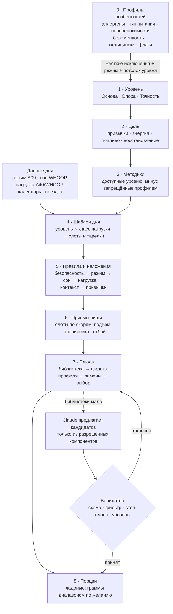

# A41 · Система питания: три уровня, конфигуратор и профиль особенностей

> **Версия:** v0.1 · **Статус:** черновик → на ревью (3 — вето; 10 — РПП и слова; 7 — данные здоровья; 2, 4, 13, 14) · **Дата:** 2026-11-07
> **Владелец:** Агент 12 · **Рецензент с вето:** Агент 3 · **Входы:** A19 (§4, §6, §7 — вето), A09 (режимы дня, якоря), A25 (грань «Топливо»), A26 §3 и §5, A31 и D-026 (фото), D-010, D-027, A04 (шкала доказательности), A37 «Титаниум» (D-031), A40 (тренировки, параллельная ветка)
> **Контент:** `content/nutrition/` (схема, 120 компонентов, 52 блюда, 10 шаблонов дня, 27 методик, 25 правил, стоп-слова, тесты) · `content/profile/` (общий профиль особенностей с тренировками) · проверка `python3 scripts/check_nutrition.py`
> **Макеты:** `/mnt/project-files/brand/nutrition/` (`n1…n5`, общий лист `_nutrition.png`), исходник `docs/design/nutrition/src/`

## Резюме

1. **Три уровня питания** в паре с уровнями тренировок (A40): **«Основа»** — тарелка и привычки без подсчёта; **«Опора»** — тарелки по нагрузке дня и еда вокруг тренировок; **«Точность»** — углеводы под нагрузку, диапазоны макросов по желанию, топливо для длинных сессий. Уровень выбирает человек; безопасность и профиль могут его только **понизить**.
2. **Калории не показываем по умолчанию** ни на каком уровне — это вето Агента 3 (A19 §7 №1) и D-010. Методика «Энергия дня (ккал) диапазоном» описана, но **заблокирована** до ревью Агентов 3 и 10; основатель разрешил её диапазоном на «Точности» (D-032). В справочнике нет поля `kcal`, валидатор это проверяет.
3. **Конфигуратор из 7 слоёв**: профиль (жёсткие исключения) → уровень → цель → методика → шаблон дня → приёмы пищи → блюда → порции. Каждый слой — закрытый YAML-список с понятными условиями; агенты набирают контент, валидатор не пропускает ошибки.
4. **Профиль особенностей — общий с тренировками**: 14 аллергенов ЕС + 9 США (16 кодов), непереносимости, 10 типов питания, физиология, беременность и кормление, 10 медицинских флагов, травмы (`knee_injury`, `lower_back_pain`…). Аллергены и тип питания — **жёсткий фильтр**, который применяется первым и проверяется на 14 тестовых профилях; медицинские флаги включают **безопасный режим** без назначений и с «обсуди с врачом».
5. **Движок детерминированный** (`:domain:engine`, без сети и ИИ). Claude только описывает план и предлагает блюда, когда библиотеки мало; каждое его блюдо проходит тот же валидатор (10 тестов-кандидатов: «веганское» блюдо с йогуртом, «детокс», граммы при бережном режиме — отклоняются).
6. **В приложении:** план на «Сегодня» (приёмы на линии дня), карточка блюда с щитом аллергенов и заменами, фото тарелки с откликом «по тарелке» без калорий, вечерняя отметка в 1 тап. 8 вау-фишек (§11).
7. **Оценка:** контент готов как черновик; реализация ≈ 4–5 недель одного разработчика (Агент 13), ревью 3/10/7 ≈ 1 неделя. MVP — «Основа» и «Опора» всем, «Точность» — за флагом (вопрос 3).

---

## 1. Рынок: что делают другие и что берём

| Продукт | Подход | Что берём | Чего не делаем | Источник |
|---|---|---|---|---|
| **MyFitnessPal** | Дневник калорий и макросов, огромная база продуктов от пользователей, сканер штрихкода и Meal Scan в Premium | Штрихкод для упаковок, память повторяющихся блюд | Калории как центр, база без проверки (ошибки в записях пользователей), «осталось N ккал» | myfitnesspal.com/premium `[Факт, проверить цены]` |
| **Cronometer** | Точный учёт 80+ микронутриентов по проверенным базам (NCCDB, USDA) | Проверенная база как источник `per` в компонентах (USDA FDC) | Ежедневный учёт микроэлементов — нагрузка, которую выдерживают единицы | cronometer.com `[Факт]` |
| **MacroFactor** | Адаптивный расчёт расхода по тренду веса, еженедельный пересмотр макросов, «нейтральный к соблюдению» дизайн без красного и упрёков; прощает неполный лог | Нейтральный язык, «неполный день — штатное состояние», еженедельный пересмотр | Тренд веса как главный вход (при РПП — вред), калории как цель | macrofactorapp.com; help.macrofactorapp.com (A03b §2.4) `[Факт]` |
| **Noom** | Психологические уроки (КПТ), цветовая маркировка продуктов, программа с препаратами GLP-1 | Короткие объяснения «почему», работа с привычками | Цвета «плохих» продуктов, цели по весу, препараты | noom.com; отзывы — A03a `[Факт]` |
| **Lifesum** | Готовые планы-диеты, «оценка жизни», рецепты | Готовые планы на день из библиотеки | Диеты-пресеты (кето и т. п.) как стиль жизни | lifesum.com `[Факт]` |
| **Yazio** | Счётчик калорий + трекер интервального голодания | — | Голодание как рекомендация (вето A19 №2) | yazio.com `[Факт]` |
| **ZOE** | Домашние тесты (глюкоза CGM, микробиом, жиры крови) → личные оценки продуктов; «30 растений в неделю» | Идея «разнообразие растений» (методика `fiber_plants`) | Оценки продуктов числом, дорогие тесты, медицинские выводы без врача | zoe.com `[Факт]` |
| **Carbon Diet Coach** | Еженедельные чек-ины, адаптивные макросы (Л. Нортон) | Ритм еженедельного пересмотра | Макросы по умолчанию | joincarbon.com (A03b §2.6) `[Факт]` |
| **WHOOP** | Нагрузка, сон, восстановление; дневник привычек, WHOOP Coach | **Нагрузка и сон как входы плана питания** — этого у приложений питания нет | — | whoop.com; A09 §4 `[Факт; проверить, есть ли у WHOOP свой журнал еды в 2026]` |
| **Oura** | Функция приёмов пищи с фото и связка с CGM Dexcom Stelo | Фото как быстрый ввод | Глюкоза без медицинского контекста | ouraring.com/blog `[Факт, проверить даты]` |
| **USOPC / UCCS Athlete's Plate** | Три тарелки «лёгкий / средний / тяжёлый день» для спортсменов | Основа уровня «Опора» (`athlete_plates`) | — | uccs.edu (Sport Nutrition Graduate Program) `[Факт, проверить URL]` |
| **Precision Nutrition** | Порции ладонью, кулаком, горстью, пальцем | Порции на всех уровнях (`hand_portions`) | — | precisionnutrition.com `[Факт]` |

**Свободное место** `[Оценка]`. Приложения питания не знают нагрузку и сон, носимые устройства не знают еду. Никто не собирает **план еды на сегодня из нагрузки WHOOP, режима дня и профиля особенностей** без подсчёта калорий. Фото-ввод занижает энергию примерно на треть (A03b §2.4, тезис NUTRITION 2026), поэтому ценность фото — в форме тарелки, а не в цифре.

---

## 2. Принципы

1. **Добавляем, а не запрещаем.** Нет «плохих» продуктов, «срывов» и «читмилов» (стоп-слова, Агент 10).
2. **Сначала безопасность, потом цель.** Профиль особенностей применяется первым; безопасность только упрощает план.
3. **Сначала данные, потом вопрос** (D-027). Нагрузку берём из тренировок и WHOOP, время — из якорей сна, вес — из профиля WHOOP. Спрашиваем только то, чего нет в данных: аллергии, тип питания, уровень.
4. **Без цифр по умолчанию.** Порции ладонью. Граммы — диапазоном и по желанию. Калории — заблокированы (§3).
5. **Объясняем.** У каждого правила есть `why_ru` и уровень доказательности.
6. **Никаких диагнозов и лечебных диет.** При медицинском состоянии — безопасный режим и маршрут к врачу.

---

## 3. Позиция по калориям

**Сейчас (по A19 §7 и D-010, без изменений):**
- Подсчёт калорий и дефицит **не по умолчанию** ни на одном уровне (вето Агента 3 №1).
- Целей по весу, «быстрого похудения» и интервального голодания как рекомендации нет (вето №2).
- Дозировок добавок и кофеина в мг нет (вето №3).
- В справочнике компонентов нет поля `kcal`; валидатор падает, если оно появится.

**Когда калории допустимы (только как опция высшего уровня и только после решения основателя):**
- Методика `energy_reference` «Энергия дня диапазоном» записана в `methods.yaml` со статусом `blocked`. Валидатор не даёт поставить её в шаблон дня, пока статус не снят.
- Условия, при которых Агент 12 предлагает её разблокировать: уровень «Точность»; включает сам человек (`opt_in`); показывается **диапазон** расхода по WHOOP рядом с **диапазоном** съеденного (оценка ±20–50 %, A26 §5) — никогда одно число, никогда «осталось», никогда «дефицит»; скрыто при `ed_care`, беременности, кормлении, диабете, болезни почек и «других хронических»; выключается одним тапом и автоматически — при сигналах РПП (§6.4).

**Защита от РПП (Агент 10):** при флаге `ed_history`, сигналах A19 §6.3 или `underweight_reported` режим `ed_care`: уровень не выше «Основы», все числа скрыты, фото-отклик выключен по умолчанию, из грани «Топливо» убраны цифры, подсказка H-ED и маршрут к Агенту 10 и специалисту.

**Что меняется только решением основателя:** снятие блокировки `energy_reference` (вопрос 1), окна питания 8–10 часов `tre_window_8_10` (вопрос 2). Без ревью Агентов 3 и 10 решение не выносится.

---

## 4. Три уровня

Названия — от образа Титана: сначала **основа** (на чём стоит), потом **опора** (что держит нагрузку), потом **точность** (как работает тонкий механизм). В паре с уровнями тренировок A40: Классика ↔ «Основа», Продвинутый ↔ «Опора», Экстрим ↔ «Точность». Пара — подсказка, а не правило: можно тренироваться на Экстриме и есть на «Основе».

| | **«Основа»** `base` | **«Опора»** `structured` | **«Точность»** `precise` |
|---|---|---|---|
| Одной строкой | Тарелка и привычки, ничего не считаем | Тарелка меняется под нагрузку дня, еда вокруг тренировки | Углеводы и белок под нагрузку диапазонами, топливо для длинных сессий |
| Что видит человек | 3 приёма + перекус, тарелка «половина овощей, четверть белка, четверть крупы», порции ладонью | Тарелки «лёгкий / рабочий / тяжёлый день», приём до и после тренировки, ужин под завтрашнюю нагрузку | То же + горсти углеводов по классу нагрузки; по желанию — граммы белка и углеводов **диапазоном** |
| Методики | `plate`, `hand_portions`, `protein_each_meal`, `fiber_plants`, `hydration_cues`, `caffeine_cutoff`, `late_meal_gap`, `regular_meals`, `mindful_hunger`, `less_upf` | + `athlete_plates`, `peri_workout_timing`, `protein_distribution`, `sodium_sweat`; по желанию `protein_g_per_kg`, `tre_12`, `meal_prep` | + `carb_periodization`, `during_training_carbs`; по желанию `macro_ranges`; заблокированы `energy_reference`, `tre_window_8_10` |
| Числа | нет | время; граммы белка — по желанию | время, граммы диапазоном — по желанию |
| Шаблоны дня | 2 (обычный, с тренировкой) | 3 (лёгкий, рабочий, тяжёлый) | 5 (отдых, лёгкая, рабочая, тяжёлая, длинная) |
| Блюд в библиотеке | 41 | 48 | 42 |
| Вход | всем, по умолчанию | выбор человека; подсказка, если тренировки ≥ 3 раз в неделю по WHOOP или уровень тренировок «Продвинутый» (NR-53) | выбор человека + ≥ 4 недель на «Опоре» с вечерней отметкой ≥ 50 % дней + SCOFF < 2 + нет флагов безопасного режима |
| Переход вверх | только выбором человека, никогда «наградой» | то же | — |
| Переход вниз (временно, автоматически) | — | `ed_care`, медицинский флаг, `SICK`, «Бережно» 3+ дня подряд → план «Основы» на эти дни, уровень сохраняется | то же + нет веса → граммы заменяются ладонями (NR-54) |
| Кому не подходит | — (подходит всем; при РПП — только этот уровень, без цифр) | РПП сейчас или в прошлом; болезнь почек; беременность и кормление; ЖКТ-болезни; после бариатрии | всё из колонки «Опора» + диабет (схему углеводов ведёт врач) + подростки (`under_18` — без программы) |

### 4.1 Критерии «входа» — откуда берутся

- Тренировки в неделю, нагрузка, сон — WHOOP (D-027), не вопрос.
- SCOFF (5 вопросов) — один раз при выборе «Точности», формулировки Агента 10; ≥ 2 → уровень не открывается, бережное объяснение и маршрут (A19 §6.3).
- Вес — профиль WHOOP или ручной ввод, только если человек включает граммы.

### 4.2 Понижение — не наказание

Текст при автопонижении: «Сегодня план попроще — так легче восстановиться. Твой уровень на месте». Никаких «ты не справился».

### 4.3 Цели (слой 2)

`habits` «Ровные привычки», `energy` «Энергия на день» — на всех уровнях; `training_fuel` «Топливо под тренировки», `recovery` «Восстановление» — с «Опоры». **Целей по весу нет** (вето №2; валидатор проверяет). Цель меняет приоритет методик и тегов блюд, а не порции безопасности.

---

## 5. Методики и техники

Полный список с источниками — `content/nutrition/methods.yaml`. Шкала A04: **A** — метаанализы и руководства, **B** — РКИ и сильные когорты, **C** — малые или механистические, **D** — практика и форма подачи.

| Методика | С уровня | По умолчанию | Доказ. | Источник (кратко) |
|---|---|---|---|---|
| Тарелка | Основа | вкл | A / D | DGA 2020–2025, Harvard Plate |
| Порции ладонью | Основа | вкл | C / D | Precision Nutrition |
| Белок в каждом приёме | Основа | вкл | A | Morton 2018 |
| Клетчатка и растения | Основа | вкл | A | Reynolds 2019 |
| Вода по признакам | Основа | вкл | C | A19 K18 |
| Кофейный рубеж от отбоя | Основа | вкл | B | Drake 2013 |
| Алкоголь и сон | Основа | вкл | A / B | A19 N16 |
| Ужин не впритык ко сну | Основа | вкл | C | A19 N15 |
| Регулярные приёмы | Основа | вкл | A (REDs) | Mountjoy 2023 |
| Голод и сытость | Основа | вкл | C | Агент 10 |
| Средиземноморский тип | Основа | по выбору | A | PREDIMED 2018 |
| Меньше ультрапереработанного | Основа | вкл | B | Hall 2019 |
| День после короткой ночи | Основа | вкл | A | Al Khatib 2017 |
| Поездки; ресторан и фастфуд | Основа | вкл | D | A19 N10–N13 |
| Тарелки под нагрузку | Опора | вкл | A / D | Thomas 2016; USOPC |
| Еда вокруг тренировки | Опора | вкл | A | Thomas 2016; Schoenfeld 2013 |
| Белок по приёмам | Опора | вкл | B | Schoenfeld & Aragon 2018 |
| Белок на кг диапазоном | Опора | выкл, по желанию | A | Morton 2018; Jäger 2017 |
| Ночной перерыв ≈ 12 ч (ритм, не голодание) | Опора | выкл, по желанию | C | обзоры TRE; ревью 3 |
| Соль и вода после пота | Опора | вкл | B / C | Thomas 2016 |
| Заготовки на 2–3 дня | Опора | по выбору | D | практика |
| Углеводы под нагрузку | Точность | вкл | A | Thomas 2016; Burke 2011 |
| Топливо во время длинной тренировки | Точность | вкл | A | Jeukendrup 2014 |
| Макросы диапазоном | Точность | выкл, по желанию | A / C | Thomas 2016; A26 §5 |
| Окно питания 8–10 ч | Точность | **заблокировано** | B | TREAT 2020; Liu 2022 |
| Энергия дня (ккал) диапазоном | Точность | **заблокировано** | C | A26 §5 |

**Нет ни на каком уровне** (`methods.yaml → excluded`): очень низкокалорийные диеты, голодание больше суток, имитация голодания (из A26 «Экстрим» убрано до ревью 3), цели по весу, лечебные диеты, дозировки добавок.

### 5.1 Тарелки (`templates.yaml → plates`)

| Тарелка | Овощи | Белок | Крупа / картофель | Жир | Порции ладонью |
|---|---|---|---|---|---|
| Тарелка (Основа) | ½ | ¼ | ¼ | немного | ладонь · горсть · 2 кулака · палец |
| Лёгкий день | ½ | ¼ | ⅕ | немного | ладонь · ½ горсти · 2 кулака · палец |
| Рабочий день | 0,4 | ¼ | 0,3 | немного | ладонь · горсть · 1,5 кулака · палец |
| Тяжёлый день | ¼ | ¼ | 0,45 | немного | ладонь · 2 горсти · кулак · палец |

Белок постоянен; нагрузка меняет крупу и фрукты (Thomas 2016).

---

## 6. Профиль особенностей

Схема — `content/profile/SCHEMA.md`, данные — `content/profile/constraints.yaml`. Один профиль на питание и тренировки.

### 6.1 Аллергены — жёсткий фильтр

Объединение **14 аллергенов ЕС** (Регламент 1169/2011, Прил. II) и **9 основных в США** (FALCPA 2004 + FASTER Act 2021, кунжут с 2023):

| Код | Аллерген | ЕС 14 | США 9 |
|---|---|---|---|
| `gluten` | Злаки с глютеном | ✓ | — |
| `wheat` | Пшеница (всегда вместе с `gluten`) | — | ✓ |
| `crustacean` | Ракообразные | ✓ | ✓ |
| `mollusc` | Моллюски | ✓ | — |
| `egg` | Яйца | ✓ | ✓ |
| `fish` | Рыба | ✓ | ✓ |
| `peanut` | Арахис | ✓ | ✓ |
| `tree_nut` | Орехи | ✓ | ✓ |
| `soy` | Соя | ✓ | ✓ |
| `milk` | Молоко (белок) | ✓ | ✓ |
| `sesame` | Кунжут | ✓ | ✓ |
| `celery` | Сельдерей | ✓ | — |
| `mustard` | Горчица | ✓ | — |
| `sulphite` | Сульфиты | ✓ | — |
| `lupin` | Люпин | ✓ | — |
| `coconut` | Кокос (не основной, но частый запрос) | — | — |

**Строгость:** «избегаю» — «может содержать» допускается с пометкой; «аллергия» — исключается; «тяжёлая реакция» — исключается, плюс предупреждение для ресторанов, без генерации блюд Claude и карточка «держи при себе назначенное врачом». Под фильтром всегда дисклеймер: «HoT подбирает блюда без отмеченных аллергенов по составу рецепта… всегда проверяй этикетку».

**Как работает фильтр.** Аллергены блюда **выводятся из компонентов**, а не берутся из текста. Блюдо с запрещённым компонентом движок пробует спасти заменой (`swaps`: миндаль → тыквенные семечки, хлеб → хлеб без глютена) той же роли на тарелке; если замены нет — блюдо не показывается. Фильтр никогда не ослабляется ради разнообразия: при нехватке блюд — соседний уровень, затем универсальная тарелка из разрешённых компонентов.

### 6.2 Непереносимости, тип питания, физиология

- **Непереносимости:** лактоза (убирает компоненты с высокой лактозой; твёрдый сыр, греческий йогурт, кефир помечены как `low`), чувствительность к глютену, к кофеину (рубеж на 2 ч раньше), «не ем острое», чувствительный ЖКТ (только маршрут к специалисту, сами ничего не исключаем).
- **Тип питания:** ем всё, пескетарианство, вегетарианство, веганство, халяль, кошер (плюс правило «мясо не с молочным»), без глютена, без свинины, без говядины, без алкоголя. Комбинируются. Метки халяль и кошер значат «в рецепте нет исключённого», HoT ничего не сертифицирует.
- **Физиология:** возраст (`under_18` — без программы), вес и рост (по желанию, из WHOOP), пол для справочных текстов, отметка цикла (сигнал REDs → врач), сменная работа (шаблоны от якорей сна), трудно жевать или глотать (мягкие блюда + врач).
- **Нелюбимое:** до 20 продуктов, мягко снижает приоритет, безопасность не трогает.

### 6.3 Беременность, кормление и медицинские состояния — безопасный режим

| Состояние | Режим | Потолок уровня | Что запрещено | Что показываем |
|---|---|---|---|---|
| Беременность / роды за 6 мес | safe | Основа | окна питания, граммы, макросы, периодизация | H-PREG: общие привычки, «питание сейчас лучше вести с врачом» |
| Кормление грудью | safe | Основа | окна, макросы, периодизация | H-LACT: «еды и воды нужно больше обычного, мы не урезаем» |
| РПП сейчас или в прошлом | ed_care | Основа | все числа, окна, макросы, граммы, энергия | H-ED, маршрут к Агенту 10 и специалисту |
| Диабет / преддиабет | safe | Опора | окна, периодизация углеводов, энергия | H-MED: «схему питания ведёт врач» |
| Болезнь почек | safe | Основа | белок на кг, макросы, белок по приёмам | «норма белка и соли — только от врача», подсказки «больше белка» скрыты |
| Целиакия | filter_only | без ограничения | глютен и «может содержать глютен» | H-MED |
| Сердце / давление на лекарствах | safe | без ограничения | окно 8–10 ч | кофеин — только нейтрально |
| Хроническая болезнь ЖКТ | safe | Основа | окна, «больше клетчатки» | H-MED |
| После бариатрической операции | safe | Основа | порции ладонью, окна | H-MED |
| Антикоагулянты | filter_only | без ограничения | — | «резкие перемены в зелени — обсудить с врачом» |
| Врач говорил о недостатке веса | ed_care | Основа | числа, окна, энергия | H-MED |

Продукт **не ставит диагноз и не назначает диету**: он не составляет «диабетическое», «почечное» или «low-FODMAP» меню. Он делает план проще и безопаснее и предлагает подготовить вопросы к визиту (по образцу «кейса для врача» A31/D-026).

### 6.4 Красные флаги и сигналы РПП

`ed_care` включается без галочки, если: SCOFF ≥ 2; правило N19 «может не хватать еды» срабатывает 10 из 14 дней (NR-51); слова из стоп-списка в чате с наставником («отработать», «сжечь», «заслужил»); ИМТ < 18,5 по введённым весу и росту; пропал цикл на фоне нагрузки выше нормы 3+ дня (NR-04 → врач). Текст выключения цифр — Агента 10; кризисный протокол (D-029) работает поверх.

### 6.5 Хранение и согласие (Агент 7)

- Аллергии, непереносимости, тип питания, физиология, этап жизни, медицинские флаги — **данные о здоровье** (класс **S4** A25 §6): SQLCipher на телефоне; не в логах, аналитике, пушах, виджетах. Халяль и кошер могут раскрывать религию — тоже S4.
- **Отдельное явное согласие** на одном экране, по категориям, до первого поля (стиль WA MHMDA и ст. 9 GDPR). Без согласия — только «Основа» без фильтров и с предупреждением «аллергены не учитываются».
- В Claude уходят **только коды исключений** и `safe_mode: true`; названия медицинских флагов, вес, история еды — нет.
- Облачная синхронизация — отдельное согласие; удаление — по категории и целиком; экспорт — да.
- Бренды в блюдах — только как примеры мест, без рекламы (A19 §7).

---

## 7. Конфигуратор

| Слой | Файл | Условие | Кто настраивает |
|---|---|---|---|
| 0. Профиль | `profile/constraints.yaml` | применяется **первым**; только сужает | человек (согласие) + сигналы (§6.4) |
| 1. Уровень | `methods.yaml → levels` | потолок из профиля | человек |
| 2. Цель | `methods.yaml → goals` | без целей по весу | человек; по умолчанию `habits` |
| 3. Методики | `methods.yaml → methods` | `from_level` ≤ уровень, не `blocked`, не в `forbid_methods` | по умолчанию; `opt_in` — человек |
| 4. Шаблон дня | `templates.yaml → templates` | ровно один на уровень × класс нагрузки | движок по нагрузке |
| 5. Правила | `rules.yaml`, `templates.yaml → overlays` | порядок = приоритет; наложения только упрощают | движок по данным дня |
| 6. Приёмы | `templates.yaml → slots` | якоря A09 §7a | движок |
| 7. Блюда | `meals.yaml` | фильтр профиля, уровень, слот, контекст, теги правил, нелюбимое | движок; человек — «заменить» |
| 8. Порции | `plates` + `components.per` | граммы только при `numbers != none` и не при `hide_numbers` | движок |

**Как агенты набирают контент.** Агент 12 добавляет компоненты, блюда, шаблоны; Агент 3 — методики и медицинские флаги; Агент 10 — тексты и стоп-слова; Агент 7 — классы хранения. Условия заранее понятны: закрытые списки, обязательные поля, выведенные аллергены, тесты профилей. Ошибка не проходит `check_nutrition.py` (сейчас: 0 ошибок, 5 предупреждений для ревью — слова «вес», «ккал», «голодание», «дефицит», «диетолог» в описаниях методик и профиля).

---

## 8. Связь с режимом дня, WHOOP, сном и тренировками

### 8.1 Входы (`rules.yaml → facts`)

| Вход | Откуда | Что меняет |
|---|---|---|
| Режим дня «Разгон / Ровно / Бережно» | A09 §2 | Бережно → наложение `OV-gentle`: три приёма без пропусков, «урезать не нужно» (NR-10); Разгон + тяжёлая тренировка → приём до и тяжёлая тарелка после (NR-11) |
| Флаги `SICK`, `TRAVEL`, `LIGHT_WEEK`, `ED_CARE` | A09 §2 | наложения «Болею», «В дороге»; «лёгкая неделя — меньше нагрузки, а не еды» |
| Сон < 6 ч | WHOOP | завтрак с белком, мягкие блюда, N05 (NR-20) |
| Отбой | якоря A09 §7a | кофейный рубеж (отбой − 9 ч; −11 ч при чувствительности), ужин за 2–3 ч до сна |
| Нагрузка вчера выше нормы (strain z ≥ 1) | WHOOP | сегодня рабочие тарелки даже в день отдыха — восполняем (NR-36) |
| Класс нагрузки сегодня и завтра | A40 → факт WHOOP | шаблон дня; ужин под завтрашнюю тяжёлую/длинную сессию (NR-34/35) |
| Начало и длительность тренировки | A40 / календарь / WHOOP | слоты «до», «во время» (≥ 75 мин), «после»; поздняя тренировка — ужин и восстановление в одном приёме (NR-37) |
| Жара, длинная потная сессия | погода телефона | соль и вода (NR-33) |
| Плотный календарь | календарь | `OV-no-time`: обед за 5 минут (NR-41) |
| Пропуски приёмов + высокая нагрузка | вечерняя отметка + A25 TRL | +перекус, затем маршрут (NR-50/51) |

### 8.2 Контракт с тренировочной системой (A40)

Тренировки отдают питанию **только факты**, питание ничего не пишет в тренировки:
`training.level` (`classic | advanced | extreme`), `training.today.load` и `training.tomorrow.load` (`rest | light | moderate | hard | long`), `training.today.start`, `training.today.duration_min`. Классы нагрузки: `light` — мобильность, прогулка, Zone 2 < 45 мин; `moderate` — силовая или Zone 2 45–75 мин; `hard` — интервалы, силовая RPE ≥ 8 или нагрузка WHOOP выше личной нормы; `long` — ≥ 90 мин. Плановый класс заменяется фактом WHOOP после тренировки. Профиль особенностей (`content/profile/`) — общий: травмы читает A40, аллергены — питание.

### 8.3 Грань «Топливо» (A25)

Вечерняя отметка «по тарелке / частично / просто поел» питает FUEL ① «≥ половины приёмов по тарелке». При `ed_care` питание из бака убирается (A25 §4).

---

## 9. Движок и генерация Claude

**Детерминированный движок** (`:domain:engine`, Kotlin, чистые функции, без сети и ИИ, ADR-14):
1. свёртка профиля → режим, потолок, исключения, запрещённые методики;
2. выбор шаблона по уровню и классу нагрузки;
3. правила по порядку приоритета; наложения;
4. для каждого слота — блюда библиотеки: фильтр профиля → замены → уровень и слот → теги правил и контекст → нелюбимое и повторы за 3 дня → выбор;
5. порции по тарелке дня; граммы — только если разрешено.
План воспроизводим: те же данные — тот же план. Тесты движка = тесты `_tests/profiles.yaml` + сценарии A09 §8.

**Claude** (по ADR-14 и D-026): (а) объясняет план своими словами в рамках `why_ru`; (б) предлагает блюда, когда библиотеки мало (редкое сочетание исключений, просьба о новом, меню ресторана по фото); (в) описывает фото тарелки. Claude получает уровень, слот, тарелку, контекст, **коды исключений** и **уже отфильтрованный список компонентов**; возвращает JSON по схеме блюда. Валидатор (`check_nutrition.py --candidates`) проверяет схему, компоненты, выведенные аллергены против объявленных, фильтр профиля, уровень, стоп-слова и отсутствие цифр при бережном режиме. При анафилаксии генерация отключена. Отклонённое блюдо заменяется тарелкой из библиотеки, человек ошибку не видит.

---

## 10. Как это в приложении

**«Сегодня».** На линии дня (A37) рядом с тренировкой — узлы приёмов пищи по якорям: «Завтрак 07:30 · Обед 13:00 · До тренировки 17:15 · После 19:30 · Ужин 20:30». Сверху — тарелка дня («Рабочий день»), одной строкой «почему»: «Вечером силовая — обед с горстью крупы, после — белок и рис». Чипы обстоятельств пересобирают план без ИИ: «Нет времени», «В дороге», «Ем вне дома», «Болею».

**Карточка блюда.** Название, тарелка-диаграмма (доли), порции ладонью, время, контекст, **щит аллергенов** (пиктограммы того, чего нет, и пометка «проверено по твоему профилю»), автозамены («миндаль → тыквенные семечки»), кнопки «Заменить» и «Не предлагать». Граммы — только на «Точности» по желанию, диапазоном.

**Фото тарелки (A31/D-026).** Камера с кругом-трафаретом тарелки. Детерминированная часть — сопоставление с запланированным блюдом и тарелкой дня; Claude нейтрально описывает видимое («курица, рис, огурцы»), подтверждение в 1 тап. Отклик — **форма тарелки**, а не калории: «Белок ✓ · Крупа ✓ · Овощей можно больше — добавь горсть в ужин». Никаких оценок «хорошо/плохо». При `ed_care` фото-отклик выключен по умолчанию.

**Вечерняя отметка в 1 тап** (вечерняя колода, ≤ 3 тапа по D-027): «Еда сегодня: по тарелке · частично · просто поел». Пропуск — штатное состояние.

**Профиль особенностей.** Экран «Я › Еда и тело»: согласие → аллергены сеткой пиктограмм (тап — «избегаю / аллергия / тяжёлая реакция») → тип питания чипами → «есть ли состояния, о которых врач говорил в связи с едой» (список §6.3) → травмы (для тренировок). Всё, что видно из данных (вес, рост), подписано источником.

---

## 11. Вау-фишки

1. **Тарелка Титана меняется с нагрузкой.** Утром тарелка «Рабочий день», после тяжёлой тренировки по WHOOP сектор крупы плавно растёт — план еды реагирует на тело, а не на дневник.
2. **Ужин под завтрашнюю тренировку.** «Завтра длинная сессия — сегодня к ужину двойная горсть пасты». Заглядывание вперёд, которого нет ни у одного приложения питания.
3. **Щит аллергенов с автозаменами.** На карточке — пиктограммы того, чего в блюде гарантированно нет, и строка «миндаль → тыквенные семечки». Человек с аллергией видит, что продукт помнит о нём в каждом блюде.
4. **Фото тарелки без калорий.** Круг тарелки подсвечивает сектора «белок / овощи / крупа» и даёт один шаг. Быстрее дневника и без чувства, что тебя оценивают.
5. **Кофейный рубеж от твоего сна.** Последний кофе — время от твоего отбоя (из якорей), а не «до 14:00»; в капсуле статуса — обратный отсчёт.
6. **Меню ресторана по фото.** Сфотографируй меню — Claude выберет 2 варианта по коду профиля и тарелке дня, с пометкой «уточни у официанта». Валидатор проверяет и это.
7. **Один тап вечером.** «По тарелке / частично / просто поел» — и грань «Топливо» обновлена.
8. **Список покупок на 3 дня** из плана («Заготовки»), сразу без исключённого профилем.

---

## 12. Макеты («Титаниум», A37)

`/mnt/project-files/brand/nutrition/` и копия в `docs/design/nutrition/` (412×915 @2x), исходник `docs/design/nutrition/src/build.js` (стили и пиктограммы A37 + 16 пиктограмм аллергенов и 4 порции ладонью):

| Файл | Экран |
|---|---|
| `n1-levels.png` | выбор уровня: три карточки «Основа / Опора / Точность», пара с уровнем тренировок, что видно и что нет |
| `n2-profile.png` | профиль особенностей: согласие, сетка 16 аллергенов пиктограммами, тип питания, безопасный режим |
| `n3-day-plan.png` | план питания на «Сегодня»: тарелка дня, приёмы на линии дня вокруг тренировки, кофейный рубеж |
| `n4-meal-card.png` | карточка блюда: тарелка-диаграмма, порции ладонью, щит аллергенов, автозамена, почему |
| `n5-plate-photo.png` | фото тарелки с откликом: сектора, подтверждение в 1 тап, один шаг |
| `_nutrition.png` | общий лист |

Первым показывать `_nutrition.png`, затем `n3-day-plan.png`.

---

## 13. Оценка и MVP

| Работа | Кто | Оценка |
|---|---|---|
| Ревью контента: методики и флаги (3), тексты и стоп-слова (10), хранение и согласие (7) | 3, 10, 7 | ≈ 1 неделя параллельно |
| Парсинг YAML в `:domain:engine`, свёртка профиля, фильтр с заменами, выбор шаблона, правила | 13 (+5) | 6–8 дней |
| Экраны: выбор уровня, профиль и согласие, план на «Сегодня», карточка блюда, вечерняя отметка | 13, 4 | 7–9 дней |
| Фото тарелки (камера, Claude-описание, подтверждение) по архитектуре D-026 | 13 | 4–5 дней |
| Хранение S4, экспорт и удаление по категориям | 13, 7 | 2 дня |
| Тесты (профили, сценарии, кандидаты), CI с `check_nutrition.py` | 13 | 2–3 дня |
| **Итого** | | **≈ 4–5 недель одного разработчика** |

**MVP:** «Основа» и «Опора» всем; профиль особенностей полностью (аллергены, тип питания, безопасный режим); план на «Сегодня» с нагрузкой WHOOP; карточка блюда; вечерняя отметка. **После MVP:** «Точность» для всех (до этого — флаг для основателя, вопрос 3), меню ресторана по фото, список покупок, штрихкод. Заблокированные методики — только по решениям 1 и 2.

**Риски** (в `docs/risks.md` — после ревью): ошибка в составе блюда → пропуск аллергена (смягчение: выведенные аллергены, тесты, дисклеймер, «может содержать»); числа как триггер РПП (смягчение: без чисел по умолчанию, `ed_care`, сигналы); давление рынка «покажите калории» (смягчение: решение 1, прозрачная позиция); источники `[проверить]` в `methods.yaml` (смягчение: ревью Агента 3 до релиза).

---

## 14. Вопросы основателю (3)

1. **Калории на «Точности».** Разрешить методику «Энергия дня диапазоном» как opt-in после ревью Агентов 3 и 10 — или оставить заблокированной? *Рекомендация: оставить заблокированной в MVP; вернуться после G2 по данным, просят ли пользователи.* **Решено (D-032): да, диапазоном, opt-in, после ревью Агентов 3 и 10.**
2. **Окно питания 8–10 часов.** Разрешить как эксперимент на 4 недели на «Точности» (с выходом в любой день, не в день тяжёлой тренировки) — или только «ночной перерыв ≈ 12 ч» как ритм сна? *Рекомендация: только ≈ 12 ч; эффект окна не больше, чем у обычного ограничения (Liu 2022), а риск для РПП выше.*
3. **«Точность» в MVP.** Открыть всем в MVP или сначала только тебе (флаг) до ревью Агента 3 граммов и периодизации? *Рекомендация: флаг для тебя в MVP, всем — после ревью.*

---

## Источники

- Thomas DT, Erdman KA, Burke LM. ACSM/AND/DC Joint Position: Nutrition and Athletic Performance. *Med Sci Sports Exerc* 2016.
- Morton RW et al. Protein supplementation and resistance training: meta-analysis. *Br J Sports Med* 2018.
- Jäger R et al. ISSN Position Stand: protein and exercise. *JISSN* 2017.
- Burke LM et al. Carbohydrates for training and competition. *J Sports Sci* 2011.
- Jeukendrup A. A step towards personalized sports nutrition: carbohydrate intake during exercise. *Sports Med* 2014.
- Mountjoy M et al. 2023 IOC consensus statement on REDs. *Br J Sports Med* 2023.
- Reynolds A et al. Carbohydrate quality and human health. *Lancet* 2019.
- Hall KD et al. Ultra-processed diets cause excess calorie intake. *Cell Metab* 2019.
- Drake C et al. Caffeine effects on sleep taken 0, 3, or 6 hours before bed. *J Clin Sleep Med* 2013.
- Al Khatib HK et al. Effects of partial sleep deprivation on energy balance. *Eur J Clin Nutr* 2017.
- Estruch R et al. PREDIMED (повторная публикация). *NEJM* 2018.
- Lowe DA et al. TREAT trial. *JAMA Intern Med* 2020; Liu D et al. Calorie restriction with or without TRE. *NEJM* 2022.
- Schoenfeld BJ, Aragon AA, Krieger JW. Nutrient timing revisited. *JISSN* 2013; Schoenfeld & Aragon. How much protein per meal. *JISSN* 2018.
- Регламент (ЕС) 1169/2011, Приложение II; FALCPA 2004; FASTER Act 2021 (США).
- U.S. Dietary Guidelines for Americans 2020–2025; Harvard Healthy Eating Plate; USOPC/UCCS Athlete's Plates; Precision Nutrition hand portions.
- Сайты продуктов: myfitnesspal.com, cronometer.com, macrofactorapp.com, noom.com, lifesum.com, yazio.com, zoe.com, joincarbon.com, whoop.com, ouraring.com (доступ 2026-11; цены и функции сверить Агенту 2).
- Внутренние: A03b §2.4 (фото-ввод −33 %), A19, A25, A26, A09, D-010, D-026, D-027, D-029, D-031.

## Передача

- **Артефакт:** A41 v0.1, черновик; контент `content/nutrition/`, `content/profile/`, валидатор `scripts/check_nutrition.py` (0 ошибок, 5 предупреждений для ревью).
- **Ревью:** Агент 3 — методики, источники `[проверить]`, медицинские флаги и безопасный режим (вето); Агент 10 — тексты `why_ru`, `hints`, стоп-слова, сигналы `ed_care`, SCOFF; Агент 7 — S4, согласие, передача кодов в Claude, халяль и кошер; Агент 2 — цены и функции конкурентов; Агент 4 — макеты; Агент 13 — оценка; Агент 14 — MVP-объём.
- **Связь с A40:** контракт §8.2 и общий профиль `content/profile/` (коды травм `injury_presets`).
- **Решения основателю:** §14, три вопроса.
