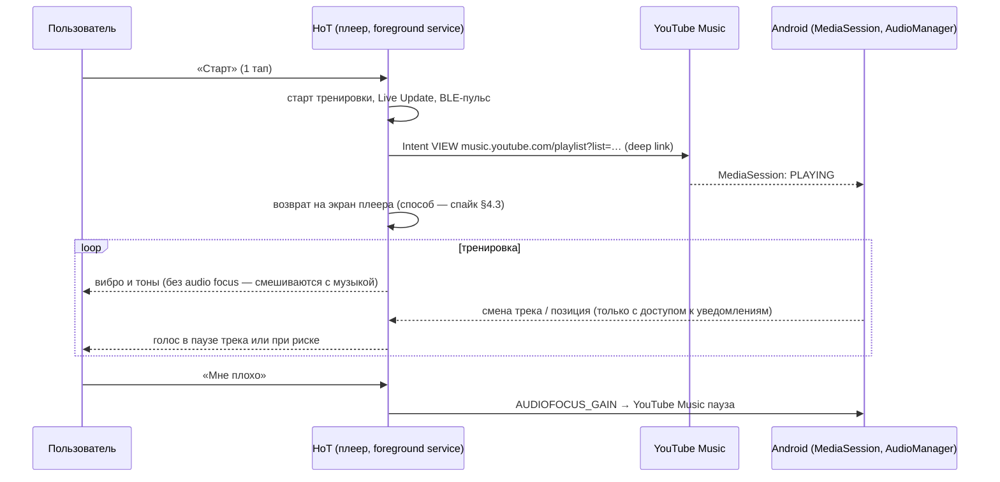

# A43 · Звук тренировки: «музыка священна», сигналы вместо болтовни, YouTube Music фоном

> **Версия:** v0.1 · **Статус:** черновик → на ревью (3, 10, 7 — вложено в §10; 13, 5) · **Дата:** 2026-11-07
> **Владелец:** Агент 14 (продакт) · **Соавторы:** 2 (рынок, §2), 9 и 5 (Android и архитектура, §4–§5), 3 и 12 (что и когда сообщать, §6), 10 (тон, flow, персоны, §7), 4 (сценарий и макеты, §8), 16 (фразы, §7.3), 13 (оценка, §9)
> **Входы:** A40 §7 (плеер, голос, тактильность, BLE-пульс), D-034 (живой пульс через BLE `0x180D`, отдых по пульсу, дуга пульса вокруг Титана — ветка `claude/d032-kcal`, ещё не в main), A38 (Сенсей / Бро / Дворецкий, §5.3 мат в голосе), A37 и D-031 («Титаниум»), A19 §6.2 (стоп-сигналы), A07 §4 (кризисный протокол), A14 (архитектура, local-first)
> **Запрос основателя (07.11):** запуск плейлистов YouTube Music под пульс; озвучка показателей, чтобы не дёргать телефон; «можно мой любимый плейлист или воркаут — как делают другие?»; «через редирект, фоном, пользователь сам выбирает — надо анализировать и изучать»; и главное: **«приглушать сильно или прерывать музыку не надо… на самом любимом месте всё прерывается… кайф обломали… в следующий раз Титана уже не откроешь»**.
> **Макеты:** `docs/design/workout-sound/` (исходник `src/build.js`) и `/mnt/project-files/brand/workout-sound/`

## Суть
1. **Принцип №1 — «музыка священна».** По умолчанию HoT **не ставит музыку на паузу и не приглушает её**. Обычные события тренировки (старт подхода, конец отдыха, «готов» по пульсу) мы передаём вибрацией и короткими тонами поверх музыки. Голос звучит только в трёх случаях: в паузе между треками, по запросу (двойной стук по спинке Pixel или кнопка на экране блокировки) и при риске («пульс выше плана», «Мне плохо»). Уровни: **Тишина / Только важное (по умолчанию) / Тренер**.
2. **Музыка — «редирект и фон».** HoT открывает выбранный плейлист в YouTube Music по ссылке (deep link). Музыка играет фоном в приложении пользователя, а HoT остаётся плеером тренировки. Пауза и «следующий трек» по-прежнему работают с наушников, как обычно. Варианты выбора в один тап: «Как играет», «Мой плейлист» по ссылке, «Воркаут HoT» под тип тренировки, «Тишина» (§3).
3. **Честно про YouTube Music.** Публичного API воспроизведения у YouTube Music нет, BPM треков недоступен [Факт, §4]. «Музыку под пульс» в прямом смысле, с подбором трека по темпу, у нас без своего каталога не сделать. И она почти не нужна: эффект синхронизации с темпом доказан для циклического кардио, а в силовых работает музыка, которую человек любит (§6.3). Поэтому подбор у нас **по типу тренировки и фазе**, а не по BPM.
4. **«Анализировать и изучать» — по желанию и только на телефоне.** С разрешения пользователя («доступ к уведомлениям») HoT читает название и исполнителя текущего трека из MediaSession. Он связывает их с повторами, RPE и пульсом подходов и показывает «Твои треки силы». Данные не уходят на сервер, а экран прямо говорит, что это связь, а не причина (§5). Это же разрешение даёт «паузы между треками» для голоса.
5. **Без рук.** Live Update на экране блокировки: таймер, пульс, «Готов», «+15 с», «Мне плохо» без разблокировки. Кнопки наушников остаются за музыкой: перехватывать их мы не будем и не можем надёжно. Взгляд на часы и вибрация на запястье — этап 2, с приложением для Pixel Watch.
6. **Безопасность не торгуется.** «Пульс выше плана» сообщается вибрацией и голосом даже в режиме «Тишина», но без паузы музыки. «Мне плохо» — единственный случай, когда HoT сам ставит музыку на паузу: по нажатию человека, а не по своему решению. Громкость мы никогда не повышаем.
7. **MVP ≈ 9 дней Агента 13** (из них ≈ 2 дня уже заложены в A40 §7.5, прирост ≈ 7 дней). «Треки силы», Pixel Watch и Spotify — этап 2. Сначала однодневный спайк на Pixel 9 Pro XL проверяет 6 мест, которые мы не можем проверить по документации (§4.3).

---

## 1. Принцип «музыка священна» (Агенты 10, 14, 3)

**Почему это главный принцип.** Основатель описал механизм отказа точно: прерывание в пике трека ломает состояние потока. После этого проще выключить голос, а ещё проще — не открывать Титана. Для продукта это худший исход: умный плеер, который выключили, хуже простого таймера.

- **Психология (Агент 10).** Музыка в тренировке регулирует возбуждение и настроение и уводит внимание от дискомфорта [Факт: Terry et al. 2020]. Прерывание в момент пика — это микропровал ожидания. Пиковые и последние моменты сильнее всего окрашивают память об опыте [Факт: эффект «пик — конец», Kahneman 1993], поэтому одна неудачная вставка голоса портит всю тренировку. Автономия (теория самодетерминации) — человек сам решает, что звучит. Отсюда правило: **звук HoT — гость в музыке пользователя, а не хозяин**.
- **Медицина (Агент 3).** Перебивать музыку ради безопасности стоит только в двух случаях. Первый — **пульс устойчиво выше плана** (§6.2). Второй — **«Мне плохо»**, его запускает сам человек. Всё остальное (повторы, техника, зона) не критично, и его можно передать вибрацией, экраном или паузой между треками.
- **Продукт (Агент 14).** Главная метрика звука — **доля тренировок, где звук HoT не выключали** (цель ≥ 85 % к дню 30). Вторая — жалобы «перебил музыку»: цель — ноль.

### 1.1 Альтернативы голосу: сравнение

| # | Канал | Что передаёт | Мешает музыке? | Реально на Android / Pixel | Когда хорош | Ограничения |
|---|---|---|---|---|---|---|
| 1 | **Вибрация телефона** (паттерны) | старт подхода, последние 3 с, конец отдыха, «выше плана» | нет | да: `VibrationEffect.Composition`, примитивы `CLICK`, `TICK`, `THUD`, `SPIN`; Pixel 9 — хороший привод [Факт: developer.android.com/develop/ui/views/haptics] | телефон в кармане шорт или на скамье под рукой | в рюкзаке и на полу не ощущается; на штанге и в беге смазывается [Оценка] |
| 1б | **Вибрация Pixel Watch** | то же, на запястье | нет | да, через своё приложение Wear OS (этап 2) | всегда ощущается | нужно приложение для часов; WHOOP вибрацией сторонних приложений не управляет [Факт: в публичном API WHOOP такого нет, A35] |
| 2 | **Тоны (earcons) поверх музыки** | те же события короткими звуками 120–300 мс | почти нет: подмешиваются без приглушения | да: если **не запрашивать audio focus**, звук просто смешивается с музыкой [Факт: developer.android.com/media/optimize/audio-focus] | наушники | слышимость зависит от громкости музыки; «−3 дБ для музыки» мы задать не можем (см. ниже) |
| 3 | **Голос в естественных паузах** | пульс и зона, «дальше: жим лёжа», итог блока | нет, если ждать конца трека | частично: позиция и длина трека доступны через `MediaController` (`PlaybackState.position`, `METADATA_KEY_DURATION`), но только с доступом к уведомлениям [Факт: `MediaSessionManager.getActiveSessions`] | несрочные сообщения | у YouTube Music бесшовные переходы и автомикс, поэтому «пауза» — это 1–3 с на границе трека [проверить в спайке]; если граница не наступила до дедлайна, сообщение уходит в тон и на экран |
| 3б | **Голос по запросу** | «скажи пульс / сколько осталось» | только когда сам попросил | двойной стук по спинке Pixel (Quick Tap → «открыть приложение») или кнопка «🔊» в Live Update [Факт: Quick Tap умеет открывать приложение, androidcentral.com; проверить работу при заблокированном экране] | хочу знать сейчас | кнопки наушников заняты музыкой, перехват ненадёжен (§4.2) |
| 4 | **Голос только для риска** | «пульс выше плана — сбавь», «Мне плохо» | да, коротко; это осознанная цена | да: `AUDIOFOCUS_GAIN_TRANSIENT_MAY_DUCK` (система приглушает музыку) или без фокуса поверх музыки | безопасность | частота: «выше плана» не чаще раза в 2 мин (§6.2) |
| 5 | **Экран блокировки / Live Update / AOD** | таймер, пульс, следующий шаг, кнопки | нет | да: Live Updates (Android 16, `ProgressStyle`) на Pixel 9 [Факт: developer.android.com, Live Updates; A40 §7.1] | взгляд на скамье, между подходами | нужно достать телефон или держать его на виду |
| 5б | **Взгляд на Pixel Watch** | то же на часах | нет | этап 2 (Wear OS, Tiles и Ongoing Activity) | всегда | приложение для часов |
| 6 | **Уровни «Тишина / Только важное / Тренер»** | рамка для всех каналов | по умолчанию нет | да, наша настройка | — | — |

**Что мы контролируем в громкости — честно.**
- Без запроса audio focus наш звук просто смешивается с музыкой: музыка не тише, наш звук не громче [Факт].
- С `AUDIOFOCUS_GAIN_TRANSIENT_MAY_DUCK` **система** приглушает чужой плеер на фиксированную величину. Насколько, выбирает Android, а не мы [Оценка: заметно, около −12…−15 дБ; проверить на Pixel]. Поэтому «−3 дБ» средствами Android сделать нельзя. Можно сделать «0 дБ, наш звук поверх» или «системное приглушение».
- `AUDIOFOCUS_GAIN_TRANSIENT` ставит YouTube Music на паузу и потом возобновляет его, а `AUDIOFOCUS_GAIN` ставит на паузу без возобновления [Факт].
- Android 15: запросить фокус можно, только когда HoT на экране или работает foreground service [Факт: audio-focus guide]. Плеер тренировки и так работает как foreground service (A40 §7.1).
- Свой звук делаем разборчивым без громкости: тоны в диапазоне 1,5–3 кГц, где музыка обычно реже; голос с подъёмом «присутствия» 2–4 кГц и компрессией [Оценка Агента 9].

### 1.2 Уровни (настройка «Звук тренировки», макет w5)

| Событие | **Тишина** | **Только важное** (по умолчанию) | **Тренер** |
|---|---|---|---|
| Старт подхода | вибро | вибро | вибро + голос «Подход 2. Десять» |
| Темп повтора (по `tempo`) | — | — | тихий тик на фазу |
| Последние 3 с (подход на время, отдых) | вибро ×3 | вибро ×3 + тон | вибро ×3 + тон |
| Отдых кончился / «готов» по пульсу (D-034) | вибро ×2 | вибро ×2 + тон «готов» | голос «Готов. Дальше: жим лёжа» |
| Пульс и зона | экран | голос **в паузе между треками** (если есть доступ к трекам), иначе экран | голос при смене зоны (не чаще раза в 60 с) |
| Подсказка по технике | экран | экран | голос, 1 раз на упражнение, в первом подходе |
| **Пульс выше плана** | вибро «тревога» + голос | вибро «тревога» + голос | вибро «тревога» + голос |
| **«Мне плохо»** | пауза музыки + голос | пауза музыки + голос | пауза музыки + голос |
| Музыка приглушается | никогда | только для «выше плана» | на время голоса (выключается) |
| По запросу (стук / 🔊) | голос | голос | голос |

### 1.3 Паттерны вибрации и тонов

| Событие | Вибрация (Pixel) | Тон | Правило |
|---|---|---|---|
| Старт подхода | один `CLICK` | — | |
| Последние 3 с | `TICK` · `TICK` · `TICK`, раз в секунду | три коротких «тик» 1,8 кГц, 80 мс | совпадает с A40 `rules.player.haptics.last_3s` |
| Конец отдыха / готов | `CLICK`–`CLICK` (двойной) | восходящая квинта, 2 ноты по 120 мс | |
| Смена стороны | `SPIN` | — | |
| Личный рекорд | `THUD` | короткий «звон» 250 мс | только экран и вибро во время подхода, голос — в итоге |
| **Выше плана** | 4 × `THUD` длинной серией | нисходящие 2 ноты, затем голос | не путается ни с чем другим |

Тоны записываются один раз (Агент 4 со звукорежиссёром) с громкостью около −18 LUFS и не меняются по персонам. Пользователь запоминает 3 звука, а не 30.

---

## 2. Как это делают другие (Агент 2)

| Продукт | Музыка | Голос / подсказки | Под темп или пульс | Что берём / чего избегаем |
|---|---|---|---|---|
| **Apple Fitness+** | музыка вшита в занятие, подобрана тренером; плейлисты занятий можно сохранить в Apple Music; фильтр занятий по жанру [Факт: apple.com/apple-fitness-plus] | живой тренер в видео; метрики часов поверх видео | нет подбора по BPM; темп задаёт тренер | своя лицензия на музыку — нам недоступна; берём «метрики на экране, а не в ухе» |
| **Peloton** | лицензированная музыка в каждом занятии, фильтр по жанру; плейлист занятия можно добавить в Apple Music или Spotify [Факт: support.onepeloton.com, проверить актуальность] | инструктор говорит поверх музыки — это часть шоу | каденс задаёт инструктор под ритм трека | «говорить поверх музыки» работает, только когда голос и есть шоу; у нас — нет |
| **Strava** | с 2023 г. управление Spotify прямо на экране записи [Факт: techcrunch.com, 12.04.2023] | голосовые оповещения о дистанции и темпе (настраиваются) [Факт] | нет | берём «пульт музыки на экране тренировки» (у нас — по желанию, §5) |
| **Nike Run Club** | любая музыка пользователя; PowerSong — любимый трек для рывка по кнопке [Факт: nike.com/nrc-app, проверить актуальность PowerSong] | Guided Runs — аудиотренер; отчёт голосом каждый км | нет | идея «трек силы» → «Твои треки силы» (§5.3), но на данных, а не вручную |
| **Garmin** | музыка на часах (Spotify, Deezer) или телефона | голосовые подсказки через телефон: круг, пульс, темп, оповещения [Факт: Garmin Forerunner 945 manual, «Playing Audio Prompts»] | оповещения о зоне пульса | берём оповещения о выходе из диапазона пульса, но редко и с гистерезисом |
| **WHOOP** | своей музыки нет | голосового коучинга в тренировке нет; HR Broadcast по BLE [Оценка: проверить на WHOOP 5.0] | — | наш голос и звук закрывают пробел WHOOP |
| **RockMyRun** | DJ-миксы, лицензированные; MyBeat подстраивает темп микса под шаги или пульс [Факт: rockmyrun.com, yahoo.com/tech] | минимально | **да**, потому что владеет миксом и меняет его темп | без своего каталога невозможно; для силовых не нужно |
| **Fit Radio** | DJ-миксы по активности и BPM, тренерские пробежки [Факт: fitradio.com] | аудиотренер в отдельных программах | по BPM микса | то же: каталог свой |
| **Spotify Running** (2015–2018) | подбирал треки под каденс бегуна [Факт: закрыт в 2018] | — | да | показатель: даже Spotify не удержал «музыку под темп» как отдельный режим |

**Вывод.**
1. Продукты, которые подбирают музыку под темп или пульс, **владеют музыкой** (лицензированные миксы).
2. Продукты, которые работают с чужой музыкой, только **открывают её и управляют ею** (Strava, Garmin, NRC).
3. Ни у кого из второй группы нет принципа «не перебивать музыку»: голос у них перебивает всегда. Это наше отличие.

---

## 3. Варианты музыки (Агенты 14, 9, 2)

| Вариант | Как работает | Реально на Android с YouTube Music | Плюсы | Минусы | Решение |
|---|---|---|---|---|---|
| **А. «Как играет»** | HoT ничего не запускает, музыка уже играет | да, ничего не нужно | ноль касаний, ноль риска | нет связи с тренировкой | **MVP**, выбор по умолчанию, если музыка уже играет |
| **Б. «Мой плейлист» по ссылке** | пользователь один раз делится плейлистом из YouTube Music («Поделиться» → HoT); на «Старт» HoT открывает его по ссылке `music.youtube.com/playlist?list=…` | да: ссылка открывается в YouTube Music (App Links) [Факт: приложение обрабатывает `music.youtube.com`]; приём ссылки — `ACTION_SEND` с текстом [Факт] | любимая музыка = лучший эффект (§6.3) | приложение YouTube Music выходит на передний план (§4.1, решаем в спайке); для фона нужен YouTube Premium [Факт: фоновое воспроизведение — функция Premium] | **MVP**, основной вариант |
| **В. «Воркаут HoT» под тип тренировки** | кураторские публичные плейлисты YouTube Music, выбранные командой: Сила, ВИИТ / метконы, Zone 2, Мобильность и заминка | да, те же ссылки | работает с первого дня, «данные первыми, не спрашивать» | вкус команды ≠ вкус пользователя; плейлист могут удалить или изменить — проверка ссылок раз в месяц | **MVP**, по умолчанию, если своего плейлиста нет |
| **Г. По фазам** (разминка → работа → заминка) | HoT переключает плейлист при смене фазы | частично: каждое переключение — новый deep link, а значит, YouTube Music снова выходит на передний план и трек меняется посреди песни | заминка звучит спокойнее | **противоречит принципу §1**: смена трека посреди песни — то самое «обломали» | **MVP: только одна смена — на заминку, и только на границе трека**; по умолчанию выключено |
| **Д. По уровню нагрузки или пульсу** | при пульсе в Z4–Z5 включать «энергичный» плейлист | технически как Г; BPM трека не известен | красиво звучит | ломает музыку посреди трека; без BPM это «угадайка» | **не делаем** |
| **Е. Spotify** | Spotify App Remote SDK: `play("spotify:playlist:…")` без выхода из HoT, метаданные трека, пауза и следующий трек [Факт: spotify.github.io/android-sdk/app-remote-lib] | да, но: нужен Spotify Premium; приложение в режиме разработки — ограниченный круг пользователей, массовый выпуск требует одобрения Spotify [проверить: правила квот 2025]; `audio-features` (темп) закрыт для новых приложений с 27.11.2024 [Факт: developer.spotify.com/blog/2024-11-27-changes-to-the-web-api] | управление без «переброски» в другое приложение | основатель на YouTube Music; BPM всё равно нет | **этап 2**, если появятся пользователи Spotify |
| **Ж. «Тишина»** | только сигналы | да | — | — | **MVP** |

**Рекомендация для MVP.** Экран выбора (макет w2) появляется один раз при первом «Старт», дальше HoT запоминает выбор. Порядок «данные первыми»:
1. если музыка уже играет — «Как играет»;
2. если есть свой плейлист — «Мой плейлист»;
3. иначе — «Воркаут HoT» под тип сегодняшней тренировки.

«Сменить» — один тап на экране старта (w1).

---

## 4. Что технически реально (Агенты 9 и 5)

### 4.1 Схема «редирект и фон»

| Шаг | Механизм | Реально на Android 15 / Pixel 9 Pro XL? | Ограничение |
|---|---|---|---|
| 1. Открыть плейлист | `Intent(ACTION_VIEW, "https://music.youtube.com/playlist?list=…")` с `setPackage("com.google.android.apps.youtube.music")` | **да** [Факт: стандартный App Link] | YouTube Music выходит на передний план; автостарт воспроизведения по ссылке на плейлист [проверить: иногда открывает страницу без «Play»] |
| 1б. Запуск без интерфейса | `MediaStore.INTENT_ACTION_MEDIA_PLAY_FROM_SEARCH` с `EXTRA_MEDIA_FOCUS` и названием плейлиста | **неясно** [проверить]: так работает Ассистент, но поведение YouTube Music с этим интентом не документировано | ищет по названию, а не по ID |
| 1в. Запуск через MediaController | `TransportControls.playFromUri(uri)` у активной сессии YouTube Music | **неясно** [проверить]: зависит от того, поддерживает ли сессия `ACTION_PLAY_FROM_URI`; нужен доступ к уведомлениям | сессия есть, только если YouTube Music недавно играл |
| 1г. MediaBrowser к YouTube Music | подключиться к его `MediaBrowserService` (через него работает Android Auto) | **скорее нет** [Оценка]: сервис пускает только разрешённые пакеты (Auto, Wear, Ассистент) | — |
| 2. Вернуть HoT на экран | (а) `startActivities([ytIntent, playerIntent])` — HoT сверху стека; (б) Live Update: тап возвращает в плеер; (в) открыть ссылку до входа в плеер, на экране «Обзор» | (а) [проверить]: начнёт ли YouTube Music играть под нашей активностью; (б) **да**; (в) **да** | ограничения запуска активности из фона (BAL) ужесточены в Android 14–15 [Факт: developer.android.com/guide/components/activities/background-starts]; «вернуть себя» таймером нельзя |
| 3. Музыка играет фоном | YouTube Music сам держит фоновое воспроизведение | **да** с YouTube Premium [Факт] | без Premium музыка остановится при уходе из YouTube Music → показываем подсказку один раз |
| 4. Пауза / следующий трек из HoT | `MediaController.getTransportControls().pause()/skipToNext()` | **да**, но только с доступом к уведомлениям (`NotificationListenerService`) [Факт: `getActiveSessions` требует его] | без разрешения кнопки музыки только на экране блокировки и в наушниках — это нормально |
| 5. Что играет (название, исполнитель, позиция) | `MediaController.getMetadata()`, `PlaybackState` | **да**, с тем же разрешением [Факт] | BPM, жанра и энергии нет [Факт]; Android 15 скрывает «чувствительные» уведомления от недоверенных слушателей — медиасессий это не касается [Факт: Android 15 behavior changes, проверить] |
| 6. Сигналы поверх музыки | `SoundPool` / `AudioTrack` без запроса фокуса, `USAGE_ASSISTANCE_SONIFICATION` | **да** [Факт] | громкость следует за потоком; проверить, что на Bluetooth-наушниках тоны идут в тот же A2DP-поток без задержки > 200 мс |
| 7. Голос | `TextToSpeech` ru-RU офлайн (Google TTS), `USAGE_ASSISTANCE_NAVIGATION_GUIDANCE` + `CONTENT_TYPE_SPEECH` | **да**; офлайн-голос ru-RU нужно скачать в настройках TTS [Факт] | проверяем наличие голоса при первом запуске плеера; если голоса нет — только сигналы |
| 8. Приглушение (только «Тренер» и «выше плана») | `AUDIOFOCUS_GAIN_TRANSIENT_MAY_DUCK` | **да**; глубину выбирает система [Факт] | Android 15: только из foreground service / активного экрана [Факт] |
| 9. Пауза при «Мне плохо» | `AUDIOFOCUS_GAIN` | **да**, без разрешений [Факт] | музыка не продолжит сама — и правильно |
| 10. Кнопки наушников для HoT | своя `MediaSession` | **нет, надёжно не выйдет**: медиакнопки уходят последней активной сессии, то есть YouTube Music [Факт: media button routing] | не воюем за кнопки: наушники остаются пультом музыки |
| 11. «Скажи пульс» по запросу | Quick Tap (двойной стук по спинке) → «Открыть приложение» HoT → во время тренировки HoT произносит статус | **да, с оговоркой** [Факт: Quick Tap открывает выбранное приложение; проверить при блокировке] | пользователь один раз настраивает Quick Tap; подсказка с прямой ссылкой в настройки |
| 12. Анализ BPM аудио | `AudioPlaybackCapture` (захват чужого звука) | **не делаем**: каждый раз нужно согласие на «запись экрана»; приложение может запретить захват; это сомнительно по условиям YouTube [Оценка Агента 7] | — |

### 4.2 Архитектура (Агент 5)
- **`:feature:workout-sound`** (Android): `SoundCoach` — очередь событий плеера (A40 §7.1) → политика канала → вибро, тон или голос.
- **`SoundPolicy`** — чистый Kotlin, тестируется без Android. Вход: событие, уровень (Тишина / Важное / Тренер), состояние музыки (играет ли, сколько осталось до конца трека, известно ли это), наушники или динамик. Выход: канал, приоритет, дедлайн.
- **`MusicBridge`** — запуск deep link, приём ссылки по «Поделиться», необязательный `MediaController` (если дан доступ к уведомлениям).
- **`TrackLog`** (этап 2) — локальная таблица Room: тренировка, подход, трек, исполнитель, пульс, повторы, RPE. Не синхронизируется и не входит в облачный бэкап (A14, local-first).
- **Очередь голоса с дедлайном.** Несрочное сообщение (пульс, «дальше…») ждёт границы трека до дедлайна (например, до конца отдыха). Если граница не наступила, сообщение уходит тоном или на экран, но голос не звучит. Срочное («выше плана») не ждёт.
- **Правила звука — в YAML:** `content/training/sound.yaml` (события, каналы по уровням, фразы по персонам, частоты), с валидатором по образцу `check_training.py`: стоп-слова, ≤ 6 слов, у каждого события есть немой канал.

### 4.3 Спайк на Pixel 9 Pro XL (1 день, до разработки)
1. Ссылка на плейлист сразу начинает играть или открывает страницу? Проверить с `?list=…` и с `&play=1` [Оценка: параметр может не поддерживаться].
2. `startActivities([yt, hot])`: играет ли YouTube Music, если его активность сразу перекрыта HoT.
3. `MEDIA_PLAY_FROM_SEARCH` с `setPackage(YouTube Music)`: запускает ли воспроизведение без интерфейса.
4. Глубина системного приглушения YouTube Music при `MAY_DUCK` (замер в дБ на выходе) и ставит ли он себя на паузу вместо приглушения.
5. Задержка тона по Bluetooth (Pixel Buds Pro 2) и разборчивость тона поверх громкой музыки на 60 % громкости.
6. Граница трека: насколько надёжно ловится смена `METADATA` и сколько длится «тишина» при автомиксе.

**Тестовые плейлисты основателя (07.11)** — для пунктов 1–3 и 6 (параметры `si` и `drli` из ссылок убраны):
- «Воркаут» (пример подборки, вариант В): `https://music.youtube.com/playlist?list=PLChOO_ZAB22WuyDODJ3kjJiU0oQzWOTyb`
- «Мой» (личный плейлист, вариант Б): `https://music.youtube.com/playlist?list=PLKdEoFKHy9wVRP5iDoyuzjfhIX-i1bsBI`

Если пункты 1–3 не проходят, остаётся вариант (в) из §4.1: музыка стартует на экране «Обзор», в плеер человек возвращается одним тапом по Live Update. Это 1 лишнее касание за тренировку.

---

## 5. «Анализировать и изучать»: что играло и как это связано с результатом (Агенты 9, 7, 3, 10)

### 5.1 Что можно узнать законно
- **Можно** с явного согласия на «доступ к уведомлениям»: название, исполнитель, альбом, длительность, позиция и состояние (играет или пауза) **текущей медиасессии** [Факт: MediaController API].
- **Нельзя или не делаем:** BPM, жанр, «энергию» (YouTube их не отдаёт); историю прослушиваний YouTube (нет API, а парсинг через `ytmusicapi` нарушает условия YouTube [Оценка Агента 7]); звук трека (§4.1, шаг 12).
- **Стоп-кран Агента 7.** Доступ к уведомлениям технически даёт видеть **все** уведомления. Поэтому:
  - читаем только `MediaSession` выбранного плеера и только во время тренировки;
  - содержимое уведомлений не читаем и не храним;
  - объясняем это одним экраном до системного запроса;
  - разрешение можно отозвать одним тапом, вместе с ним стираются треки;
  - в Google Play декларируем, зачем оно нужно [проверить политику Google Play для `NotificationListenerService`].
  - Если установка не из Play, Android 13+ требует «разрешить ограниченные настройки» — для основателя это одна подсказка.

### 5.2 Где хранится
Только на телефоне (Room, шифрование как у остального локального хранилища A14). Не уходит на сервер, Claude и в аналитику. В экспорте данных — отдельным файлом.

### 5.3 Как используем: «Твои треки силы» (макет w6, этап 2)
- **Метрика трека.** Для подходов, сделанных под трек, считаем среднее «повторы минус план» и среднее отклонение RPE. Показываем трек, только если под ним сделано **≥ 8 подходов** в ≥ 3 тренировках [Оценка Агента 3: меньше — шум].
- **Формулировка (Агент 10):** «С ними ты делаешь больше повторов при том же RPE». Подпись «Связь, не причина» обязательна. Никаких «этот трек делает тебя сильнее».
- **Действие:** «Собрать „Мой Титан · Сила“» — список треков, которые человек сам добавит в плейлист YouTube Music. Автоматически создать плейлист мы не можем без OAuth к YouTube Data API и проверки Google; это этап 3, если будет спрос.
- **Пульс × трек** — только для кардио Zone 2. Пример: «под эти 5 треков ты держишь Z2 ровнее». В силовых пульс отражает отдых и нагрузку, а не музыку.

---

## 6. Что и когда сообщать (Агенты 3 и 12)

### 6.1 События и частота
- **Бюджет голоса** в «Только важное» — ≤ 1 фразы за 3 мин, не считая «выше плана» и запросов. В «Тренере» — ≤ 1 фразы за 20 с.
- **Длина фразы** ≤ 6 слов, числа произносятся словами («сто восемь»).
- **Не озвучиваем:** калории (стоп-слово A40 и A19), «осталось сжечь», сравнение с другими, оценку тела.
- **RPE голосом не спрашиваем:** один тап на экране в отдыхе (A40 §7.3) или в итоге.
- **Зоны** считаются от макс. пульса из профиля WHOOP [Факт: в WHOOP API v2 есть `max_heart_rate` в body measurement; проверить] или 208 − 0,7 × возраст (Tanaka 2001) с пометкой «оценка».

### 6.2 «Пульс выше плана» — что это и что это не
- **Порог.** Пульс выше потолка зоны шаблона на ≥ 10 уд/мин **дольше 30 с**, или ≥ 95 % макс. пульса дольше 60 с в режиме Ровно или Бережно и в Классике [Оценка Агента 3, сверить на первых пользователях]. Гистерезис: повтор не раньше чем через 2 мин и только если пульс снова вырос.
- **Фраза:** «Пульс выше плана. Сбавь темп». Без «опасно», «сердце», «аритмия» — **никаких диагнозов** (красная линия). Резкий скачок или «пила» пульса чаще означают потерю контакта датчика. Тогда фраза «Пульс не ловится» звучит один раз, а сигнал о высоком пульсе не подаётся.
- **«Мне плохо»:** кнопка в плеере и в Live Update (без разблокировки) → музыка на паузу (`AUDIOFOCUS_GAIN`) → голос: «Остановись. Сядь. Как ты?» → экран стоп-сигналов A19 §6.2 F1–F8. Если выбран сигнал из красных — кризисный протокол A07 §4 и карточка экстренной помощи, как везде. **Голосовой ввод «мне плохо» в MVP не делаем:** постоянное прослушивание микрофона дорого по батарее, ненадёжно в шуме зала и создаёт ложное ощущение защиты. Кнопка остаётся главным путём (Агенты 3 и 10).

### 6.3 Музыка и результат: что говорит наука
- **Метаанализ 139 исследований:** музыка улучшает аффект (g ≈ 0,48), физическую производительность (g ≈ 0,31), снижает воспринимаемое усилие (g ≈ 0,22) и немного улучшает экономичность (g ≈ 0,15) [Факт: Terry, Karageorghis et al., Psychological Bulletin 2020, 146(2)].
- **Синхронная музыка** (шаг или педаль в такт) даёт больший эффект в **циклических** нагрузках. Пример: на велоэргометре потребление O₂ ниже примерно на 7 % [Факт: Bacon, Myers & Karageorghis 2012, проверить цифру]. В силовых и интервалах важнее, что музыка **нравится** и поднимает возбуждение [Факт: Karageorghis & Priest 2012, обзор].
- **Вывод для HoT.** Отсутствие BPM в YouTube Music почти не мешает нашим силовым и функциональным тренировкам. Для Zone 2 на этапе 3 можно добавить метроном каденса тихим тоном поверх музыки — без замены трека.

### 6.4 Слух (Агент 3)
- **Громкость** мы никогда не повышаем. Сигналы и голос идут на той же громкости, что и музыка, без усиления.
- **Безопасный порог.** ВОЗ: безопасно около 80 дБ до 40 ч в неделю [Факт: WHO Safe Listening, 2019/2022]. Android 14+ считает дозу звука (CSD) для наушников и предупреждает сам [Факт: source.android.com, sound dose; проверить поддержку на Pixel 9].
- **Совет в онбординге плеера:** «Наш звук слышен и на 50–60 % громкости — сильнее можно не делать». Так мы не провоцируем громкость ради разборчивости.
- **Бег на улице.** В «Тренере» есть совет про режим прозрачности наушников, без запретов.

---

## 7. Тон и персоны (Агенты 10 и 16)

### 7.1 Принципы
- **Гость в музыке:** одна фраза, без вступлений («Итак…», «Отлично!»), без вопросов, на которые нельзя ответить руками.
- **Функциональные фразы** (пульс, время, «готов», «выше плана») **одинаковы для всех персон**: безопасность и ясность важнее стиля. Персона звучит только в трёх местах — начало тренировки, конец блока в паузе трека и финал.
- **Бережный режим A38 §6** снимает характер со всех фраз.
- **Мат Бро в голосе** — по решению основателя A38 §5.3. До решения его нет. Даже с опцией 18+ мат не звучит в «выше плана», «Мне плохо» и при выводе звука на динамик без наушников.

### 7.2 Перегрузка
- «Только важное» по умолчанию.
- После 3 тренировок, где пользователь сам выключал звук, HoT предлагает «Тишину». Предлагает один раз и сам ничего не меняет.

### 7.3 Фразы (Агент 16, ревью 10 и 3)

| Событие | Сенсей | Бро | Дворецкий |
|---|---|---|---|
| Старт тренировки | «Начинаем. Дыши ровно.» | «Погнали. Музыка твоя — работа наша.» | «Тренировка начата. Музыка за вами.» |
| Готов (по пульсу) | «Пульс сто пять. Готов.» | «Пульс сто пять. Готов.» | «Пульс сто пять. Готов.» |
| Дальше (в паузе трека) | «Дальше — жим лёжа, четыре по десять.» | «Дальше жим, четыре по десять.» | «Следующее — жим лёжа, четыре по десять.» |
| Конец блока | «Блок сделан. Спина держит.» | «Блок закрыт. Красава.» | «Блок завершён. Превосходно.» |
| Выше плана (все одинаково) | «Пульс выше плана. Сбавь темп.» | = | = |
| Пульс не ловится | «Пульс не ловится. Веду по таймеру.» | = | = |
| Мне плохо | «Остановись. Сядь. Как ты?» | = | = |
| Финал | «Печать поставлена. Хорошая работа.» | «Печать есть. Ты сегодня Титан.» | «Печать поставлена. Отдыхайте с достоинством.» |

---

## 8. Сценарий и макеты (Агенты 14 и 4)

### 8.1 От старта до конца (минимум касаний)
1. **«Сегодня» → «Тренировка» → экран старта (w1).** Титан с дугой пульса (D-034), строка «Звук»: музыка (выбор запомнен) и уровень «Только важное». **Один тап «Старт»** запускает таймеры, Live Update, BLE-пульс и музыку.
2. **Первый раз** — лист «Музыка» (w2): 4 варианта в один тап, «По фазам» (по умолчанию только заминка, на границе трека), «Добавить свой: „Поделиться“ → HoT». Spotify помечен «этап 2».
3. **Подход (w3).** Музыка играет как есть, на 100 %. Темп и конец подхода передаются вибрацией и тиками. Голос молчит, а несрочное ждёт паузы между треками («через 0:48»). Пульт музыки виден, только если дан доступ к трекам.
4. **Экран блокировки (w4).** Live Update: отдых, пульс, «готов при 105», дальше; кнопки «Готов», «+15 с», «Мне плохо». Ниже — обычные системные кнопки YouTube Music. Разблокировать не нужно.
5. **Отдых.** Пульс дошёл до порога → двойная вибрация и тон «готов». Голос «Пульс сто пять. Готов.» звучит только в «Тренере» или если трек как раз кончился.
6. **Заминка.** Если включено «По фазам», плейлист заминки стартует на ближайшей границе трека.
7. **Итог.** «Печать» (A40 t5): финальная фраза персоны звучит в паузе трека или после остановки музыки. Музыку мы не останавливаем — она принадлежит человеку.
8. **Настройки (w5).** «Музыка священна»: три уровня и матрица «событие × вибро / тон / голос»; «Пульс выше плана» и «Мне плохо» закрыты замком.
9. **Этап 2 — «Твои треки силы» (w6).**

### 8.2 Макеты
| Файл | Экран |
|---|---|
| `w1-start.png` | Старт в один тап: Титан, дуга пульса, музыка и уровень звука |
| `w2-music-picker.png` | Выбор музыки в один тап, фазы, «Поделиться → HoT» |
| `w3-set-signals.png` | Подход: музыка 100 %, сигналы вместо голоса, отложенный голос |
| `w4-lockscreen.png` | Экран блокировки: Live Update и медиа-контролы YouTube Music |
| `w5-sound-settings.png` | Тишина · Только важное · Тренер, матрица каналов |
| `w6-power-tracks.png` | «Твои треки силы» (этап 2, только на телефоне) |
| `_workout-sound.png` | Лист со всеми экранами |

Названия треков на макетах вымышлены, логотипы сторонних сервисов не рисуются.

---

## 9. MVP и оценка (Агенты 14 и 13) `[Оценка]`

| # | Работа | Дней Агента 13 | MVP |
|---|---|---|---|
| 1 | Спайк §4.3 на Pixel 9 Pro XL | 1 | да |
| 2 | `SoundPolicy` (чистый Kotlin): уровни, каналы, бюджет, дедлайны, гистерезис «выше плана» + юнит-тесты | 1,5 | да |
| 3 | Вибро-паттерны и тоны (`SoundPool`, без фокуса), запись 4 тонов (Агент 4) | 1 | да |
| 4 | Голос: TTS ru-RU, проверка голоса, атрибуты речи, `MAY_DUCK` только для «выше плана» и «Тренера»; `sound.yaml` + валидатор | 1,5 (≈ 1 уже в A40 §7.5) | да |
| 5 | `MusicBridge`: deep link, «Поделиться → HoT», 3 кураторских плейлиста, выбор по умолчанию, лист w2 | 1,5 | да |
| 6 | Live Update: кнопки «Готов», «+15 с», «Мне плохо», «🔊 сказать» | 1 (≈ 1 уже в A40 §7.1) | да |
| 7 | «Мне плохо» → пауза музыки → голос → стоп-сигналы | 0,5 | да |
| 8 | Экран настроек w5, Quick Tap-подсказка | 1 | да |
| | **Итого MVP** | **≈ 9** (прирост к A40 ≈ 7) | |
| 9 | Доступ к трекам: `NotificationListenerService`, `MediaController`, голос в паузе трека, пульт на экране | 2 | этап 2 |
| 10 | `TrackLog` и «Твои треки силы» | 2,5 | этап 2 |
| 11 | Pixel Watch: вибро на запястье, Tile и Ongoing Activity (вместе с HR-приложением A40 §7.4) | 4 | этап 2 |
| 12 | Записанные голоса персон (Chirp 3 HD, A38 §8.4) вместо системного TTS | 2 + генерация | этап 2 |
| 13 | Spotify App Remote | 3 | этап 2, по спросу |
| 14 | Метроном каденса Zone 2 поверх музыки | 1 | этап 3 |

**Критерии приёмки MVP:**
- в «Только важное» за 45-минутную силовую музыка ни разу не приглушена и не остановлена, кроме «выше плана» и «Мне плохо»;
- от «Старт» до играющей музыки и тикающего таймера — 1 тап (или 2, если спайк провален);
- «Мне плохо» с экрана блокировки — 1 тап;
- все `*_ru`-фразы проходят валидатор (стоп-слова A40, ≤ 6 слов).

---

## 10. Ревью внутри сессии
- **Агент 3 (медицина) — одобрено с условиями.** Пороги «выше плана» помечены `[Оценка]` и сверяются на первых пользователях. Без слов о сердце и диагнозах. Потеря датчика ≠ тревога. Громкость не повышаем.
- **Агент 10 (психология) — одобрено.** Умолчание «Только важное», функциональные фразы без персоны, бережный режим снимает характер. Подпись «связь, не причина» обязательна в w6.
- **Агент 7 (право) — условно.** Доступ к уведомлениям — только этап 2 и только после экрана-объяснения и проверки политики Google Play. Никакого `ytmusicapi` и захвата звука. Кураторские плейлисты — ссылки на публичные плейлисты, без копирования треков.

## 11. Вопросы основателю (3)
1. **Музыка по умолчанию.** Подключаем твой плейлист («Поделиться → HoT» один раз) или стартуем с подборкой HoT под тип тренировки? *Рекомендация:* оба — твой, если дал ссылку, иначе подборка HoT. Пришли 1–3 любимых плейлиста для теста.
2. **Голос по умолчанию.** «Только важное» (вибро и тоны, голос только в паузах трека и при риске) или «Тренер» (голос на каждый подход поверх музыки)? *Рекомендация:* «Только важное» — так музыка не прерывается.
3. **«Твои треки силы» и пауза между треками** требуют доступа к уведомлениям (видим только, что играет, только на телефоне). Включаем на этапе 2 как опцию? *Рекомендация:* да, по желанию, после экрана-объяснения; в MVP не просим.

## Источники
- Android: [Manage audio focus](https://developer.android.com/media/optimize/audio-focus) (ducking, Android 12 fade-out, Android 15 ограничение); [Haptics](https://developer.android.com/develop/ui/views/haptics); [Background activity starts](https://developer.android.com/guide/components/activities/background-starts); MediaSessionManager / MediaController, NotificationListenerService (developer.android.com reference); [Sound dose](https://source.android.com/docs/core/audio/sound-dose)
- Spotify: [App Remote SDK](https://spotify.github.io/android-sdk/app-remote-lib); [Changes to the Web API, 27.11.2024](https://developer.spotify.com/blog/2024-11-27-changes-to-the-web-api); [форум: Changes to Web API](https://community.spotify.com/t5/Spotify-for-Developers/Changes-to-Web-API/td-p/6540414/page/18)
- YouTube Music: официального API воспроизведения нет; неофициальные обёртки — [ytmusicapi (packagist)](https://packagist.org/packages/ytmusicapi/ytmusicapi), [YouTubeMusicAPI (PyPI)](https://pypi.org/project/YouTubeMusicAPI/1.5/); [Digital Music News, 2024 — YouTube против API-обёрток](https://www.digitalmusicnews.com/2024/08/11/is-youtube-cracking-down-on-api-wrapper-apps-like-musi/)
- Strava × Spotify: [TechCrunch, 12.04.2023](https://techcrunch.com/2023/04/12/strava-launches-integration-with-spotify-to-let-users-listen-to-content-while-tracking-activities/amp/), [Android Central](https://androidcentral.com/apps-software/strava-spotify-integration)
- Garmin: [Playing Audio Prompts on Your Smartphone](https://www8.garmin.com/manuals/webhelp/forerunner945/EN-US/GUID-6A3A1403-F519-4990-B5C7-718E9352006D.html)
- RockMyRun: [Yahoo Tech](https://www.yahoo.com/tech/new-in-exercise-apps-music-that-adjusts-to-the-rhythm-99509908719.html), [EvoNexus](https://evonexus.org/evonexus-company-rock-my-world-adds-new-feature-to-rockmyrun-app/)
- Pixel Quick Tap: [Android Central](https://androidcentral.com/how-customize-back-tap-gestures-google-pixel-phone), [Tom's Guide](https://www.tomsguide.com/how-to/how-to-use-quick-tap-on-google-pixel)
- Наука: Terry P.C., Karageorghis C.I. et al. (2020) Effects of music in exercise and sport: a meta-analytic review. *Psychological Bulletin* 146(2) — [USQ](https://research.usq.edu.au/item/q57x6/effects-of-music-in-exercise-and-sport-a-meta-analytic-review), [CORE PDF](https://core.ac.uk/download/362654377.pdf); Karageorghis & Priest (2012) Music in the exercise domain, *Int Rev Sport Exerc Psychol*; Bacon, Myers & Karageorghis (2012) *J Sports Med Phys Fitness* [проверить]; Tanaka et al. (2001) *JACC*; WHO (2019/2022) Safe listening; Kahneman et al. (1993) *Psychological Science*

## Передача
- **Артефакт:** A43 v0.1, макеты `docs/design/workout-sound/` (6 экранов + лист), бриф аниматору `docs/design/training/animator-brief.md`.
- **Главное:** «музыка священна» — сигналы вместо голоса по умолчанию; YouTube Music фоном по ссылке, без API и BPM; «треки силы» — по желанию и только локально.
- **Допущения:** у основателя YouTube Premium; на Pixel 9 Pro XL работают Live Updates (Android 16); WHOOP HR Broadcast включён (D-034).
- **Открытые вопросы:** §11 (основателю); спайк §4.3 (Агент 13); политика Google Play для доступа к уведомлениям (Агент 7); мат Бро в голосе — A38 §5.3 (основатель).
- **Риски:** YouTube Music меняет поведение ссылок (Р-новый, вероятность средняя); разборчивость тонов поверх громкой музыки; ложные «выше плана» из-за потери контакта датчика.
- **Следующий шаг:** спайк (1 день) → `SoundPolicy` → MVP по §9.
- **Утвердить основателю:** принцип «музыка священна» и умолчание «Только важное»; варианты музыки для MVP (А, Б, В, Ж); три вопроса §11.
