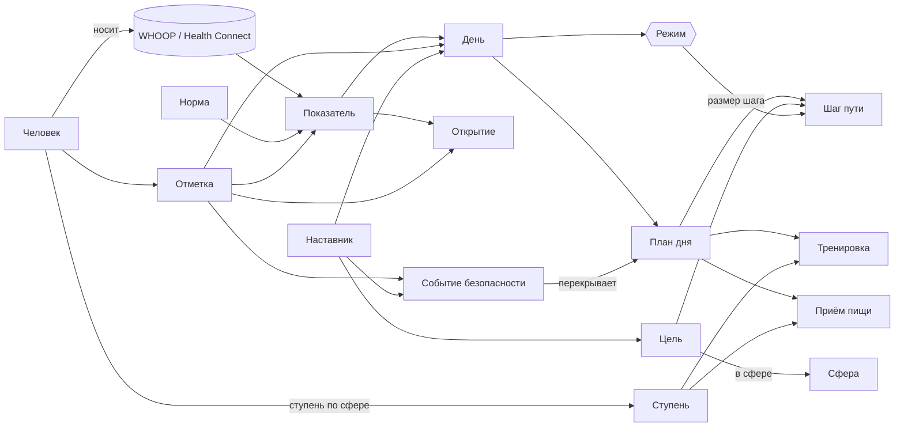

# A45 · Концепт и структура продукта: одна идея, одна модель, одно место для каждой вещи

> **ID:** A45 · **Версия:** v0.3 · **Статус:** скелет Титана принят основателем (D-051); §17 — действующая модель, глоссарий и материалы; §3, §3.3, §4, §6.1–6.2 и §12 — история · **Дата:** 2026-11-07
> **Правки по D-051 (A58 §10):** §17 «Скелет Титана» заменяет модель §3 (14 объектов, шесть сфер); глоссарий §17.5 по находкам аудита; материалы = время; три вкладки (меняет D-038, §12 и §16).
> **Владелец:** Агент 1 (CPO) · **Соавторы:** Агент 18 (глоссарий и модель), Агент 4 (информационная архитектура и визуальная грамматика), Агент 14 (этапы и бэклог), Агент 17 (Титан и движение)
> **Ревью с правом вето перед утверждением:** 10 (утро «Быстро», бережные тексты, герои возврата), 3 (переименования показателей и карточек), 7 (точки входа в помощь)
> **Основание:** запрос основателя 07.11: «концепт всего приложения обсудить… переструктурировать логику и саму структуру разложить правильно».
> **Как сделано:** четыре агента независимо разобрали артефакты A01–A44, решения D-001…D-037, разбор сборки 119 и код `android/`. Этот документ сводит их выводы; где мнения разошлись, это указано (§10).

## Резюме
1. **Диагноз.** Каждое решение D-001…D-037 по отдельности хорошее, но вместе они дали продукт без общей модели. Сейчас в нём 6 разных списков «сфер», 4 линейки «уровней», 9 значений слова «режим», 3 значения слова «Заряд» и 12 видов колец. «Титан» нарисован 7 разными способами, а свет на нём означает 6 разных вещей. Утро проходит через 4 экрана и около 10 тапов, хотя обещано 2 минуты. Вкладки «Неделя» и «Наставник» пока пустые, а «Сегодня» держит около 14 блоков.
2. **Формула.** HoT — наставник, который каждое утро сводит тело (WHOOP) и самоощущение в **один режим и один план дня**, а каждый день делает **шагом к одной цели цикла**. У продукта три предмета: **День** (что делать сейчас), **Путь** (куда я иду) и **Наставник** (голос, который держит оба).
3. **Структура.** Три вкладки: **Сегодня · Путь · Наставник**. Утро собрано в один экран. Каждая вещь живёт в одном месте. У каждого визуального приёма одно значение. В ядре 14 объектов, у каждого одно имя.
4. **Порядок.** Петлю ядра доводим до G2 в пределах 28 дней. Всё уже утверждённое остаётся, но раскрывается человеку по этапам пути и уходит в фазы 2–3 (§7). Ничего не отменяется.
5. **Что нужно от основателя:** 3 решения (§9).

---

## 1. Что сломалось: диагноз команды
| # | Проблема | Чем мешает | Источник |
|---|---|---|---|
| 1 | **Конкурирующие таксономии.** Сферы: 6 списков (TEAM, A10, A09, A26, A37/A42, грани A25). Уровни: Консервативный / Классика / Основа-Опора-Точность / L0–L3. Целей: 1–3, 2–3 или одна. Граней: 8 или 9 | Человек не может удержать модель в голове, агенты пишут каждый по своей | A10, A25, A26, A40, A41, A42, D-033 |
| 2 | **Одно слово — разные вещи.** «Режим» — 9 значений. «Заряд» — грань ECAP, ощущение в карточке и восстановление WHOOP (код сравнивает «твой Заряд» с «Заряд WHOOP»). То же с «Погодой», «Шагом», «Сверкой», «Ритуалом», «Этапом», «Кольцом» | Двусмысленность в интерфейсе и в коде | A25, A44, `Morning.kt` |
| 3 | **Одно явление — разные слова.** Вечер назван четырьмя словами, утро — шестью, наставник — тремя, итог недели — тремя | То же | D-011, A11, A18, A25, A37, A44 |
| 4 | **Визуальная грамматика перегружена.** 12 видов колец. «Титан в кольце» значит Заряд, восход, цель, ответы колоды и Печать. Свет на Титане значит восстановление, самоощущение, сферы, закрытый день, мышцы и цель. Ноги Титана — это и сфера «Тело», и «работали сегодня», и зона боли | Человек не понимает, что видит (главная претензия разбора 119) | A37, A40, A42, A44, разбор 119 |
| 5 | **Утро из четырёх экранов.** Пуш → колода из 7 карточек → раскрытие → ещё и «Рассвет» (в коде два экрана, хотя по A44 раскрытие и есть Рассвет) → «Сегодня». 4 экрана и около 10 тапов | Цель A10 «утро ≤ 2 мин» недостижима | A44 §4, `HotApp.kt` |
| 6 | **У вещей по нескольку домов.** Тренировка на «Сегодня» показана 4 раза, еда — 3. Шаги, нагрузка и отбой — и в кольцах шапки, и в теле экрана. Аватар наставника открывает **твои** настройки | Шум и «низ повторяет верх» | разбор 119, `TodayScreen.kt` |
| 7 | **Обещания без дома.** Вкладки «Неделя» и «Наставник» — заглушки. У показателей и профиля особенностей нет экрана-дома | Половина навигации пустая | `WeekScreen.kt`, `MentorScreen.kt` |
| 8 | **«Вау» обесценено.** Около 17 претендентов на большой момент и 40–50 срабатываний в неделю. Печать срабатывает дважды на одну тренировку | Героика превращается в шум | A37, A40, A42, A44, бриф аниматора |
| 9 | **Объём.** Сумма решений после D-013 — порядка 100+ дней работы при пределе MVP 28 дней | G2 уезжает, ядро петли недоделано | D-003, D-013, A37 §13, A40, A41, A44, D-030…D-035 |
| 10 | **Код дублирует путаницу.** Режим дня — 5 enum. Три сущности тренировки. Вечерняя еда пишется в две таблицы, вечер — в три | Ошибки и стоимость каждой правки | Агент 18, Д-6, Д-22–Д-24 |

**Корень один:** новые идеи прикладывали к экранам, а не к модели продукта. Поэтому A45 вводит модель (§3), а планка шеф-уровня в TEAM.md — «закон сохранения сущностей»: новое понятие только вместо старого.

---

## 2. Формула и петли
**Одной фразой:** *HoT каждое утро превращает твоё тело и самоощущение в один режим и один план дня, и каждый день становится шагом к одной цели — без допроса, без стыда, с наставником рядом.*

| Ритм | Что делает человек | Что получает | Где живёт |
|---|---|---|---|
| **День** | Утро ≤ 2 мин: 2 ответа → режим → план. Днём делает, WHOOP ставит Печать. Вечер ≈ 20 с | Знает, что делать сейчас | Сегодня |
| **Неделя** | Воскресенье: один итог недели | Неделя на кольце цели засчитана, цель следующей недели, одно открытие | Путь (событие, затем архив) |
| **Цикл, 12 недель** | Цель из данных → 3 вехи → итог цикла | «Было → стало», кольцо роста, новая цель или ступень выше | Путь |
| **Всегда** | Говорит с наставником голосом или текстом | Разбор, поддержка, помощь | Наставник |

Безопасность (кризисный протокол, CrisisGuard, помощь в 2 тапа) не меняется и стоит над всеми петлями.

---

## 3. Модель предметной области: 14 объектов ядра (Агент 18)
> **v0.3:** раздел устарел (шесть сфер, `Tier`, одна цель на цикл). Действующая модель — §17 (D-051).

Одно явление — одно имя — один код — один дом.

| # | Объект | Код | Определение | Дом |
|---|---|---|---|---|
| 1 | Человек | `Person` | Профиль особенностей, согласия, характер наставника, ступени | Настройки (под аватаром) |
| 2 | Норма | `Baseline` | Личная норма по 28 ночам; до 14 ночей — «учусь тебя» | лист из героя «Сегодня» |
| 3 | Показатель | `Metric@ver` | Расчётное значение (A25). **Грань** — показатель, видимый человеку | Путь › Неделя |
| 4 | Отметка | `CheckIn` | Ответы на карточки в фазах: утро / после ритуала / вечер / неделя. Одна таблица | Утро, Закрыть день |
| 5 | День | `Day` | Агрегат дня: режим, флаги, «почему», статус (калибровка → план готов → пересобран → закрыт) | Сегодня |
| 6 | Режим дня | `Regime` | Разгон / Ровно / Бережно. **Одно** перечисление в `:core:model`. Слово «режим» больше ни для чего | Сегодня, герой |
| 7 | План и пункт плана | `DayPlan` / `PlanItem` | Пункты по якорям: тренировка, приём пищи, сон, свет, работа, шаг пути | Сегодня, «Линия дня» |
| 8 | Тренировка | `Workout` | **Один** объект: план → сессия в плеере → подтверждение WHOOP (Печать) | экран «Тренировка» |
| 9 | Приём пищи | `Meal` | Слот дня + шаблон тарелки | карточка приёма |
| 10 | Сфера | `Sphere` | **Шесть сфер A37/A42: Тело, Сон, Еда, Разум, Работа, Связи** — единственная таксономия. Грани привязаны к сферам | Путь › Твой Титан |
| 11 | Цель (цикл) | `Goal` | 12 недель → 3 этапа → веха → цель недели → шаг пути. **Одна** активная цель | Путь |
| 12 | Ступень | `Tier` | Одна линейка из трёх ступеней по каждой сфере (§3.2) | экран сферы / тренировки / еды |
| 13 | Наставник | `Mentor` | Разговор + характер (Сенсей / Бро / Дворецкий). Слово «ассистент» не используем | вкладка Наставник |
| 14 | Событие безопасности | `SafetyEvent` | Красный флаг или кризисная проверка → Помощь. Перекрывает план | Помощь |

Производные без отдельного дома: **Открытие** (`Discovery` = показатель × отметка) и **Итог** (`Review`: неделя, веха, цикл — проекция цели).



### 3.1 Глоссарий: что переименовываем
| Было | Стало | Почему |
|---|---|---|
| «Заряд» в карточке П1 (самоощущение 1–5) | **«Бодрость»** | «Заряд» остаётся только за расчётным показателем ECAP. Раскрытие сравнивает «твоя Бодрость ↔ Заряд по WHOOP» |
| «Погода внутри» (карточка) и грань «Погода» (EMB) | карточка — **«Настроение»**, грань — «Погода» | развести ощущение и показатель |
| режим «Работа», SOS-режим, «бережный режим» наставника, режим возврата, режимы звука, безопасный режим питания, ручной режим | **«Работа»** (тема разговора), **«Помощь»**, **«бережный тон»**, **«возвращение»**, **«звук: Тишина / Важное / Тренер»**, **«осторожный профиль»**, **«без WHOOP»** | «режим» — только режим дня |
| «Сверка» про неделю, веху, цикл | **«Итог недели»**, **«Итог вехи»**, **«Итог цикла»**; «сверка» — только план против факта | одно слово — одно значение |
| «Ритуал итога» цикла | **«Итог цикла»**; «ритуал» — только утренний ритуал (кофе, душ, свет) | то же |
| этапы пути на всю жизнь 0–6 (A42 §1) / «Этап 2 Оценка» продукта | **«главы»** пути / **«фазы»** продукта; «этап» — только 4 недели цикла | то же |
| «Карта дня» (A09) / содержимое пуша | **«потолки режима»** / **«утренняя сводка»** | то же |
| «Шаги к цели» (кольцо шапки) | **«норма шагов»** для шагов телефона; «шаг» пути — только шаг к цели | «шаг» было двумя вещами |
| вечерний контроль / вечерняя колода / Вечер | **«Закрыть день»** | одно имя |
| паспорт / открытка недели | **«Итог недели»**; поделиться — «открытка» | одно имя |
| «Утренняя колонна», Рассвет, Пробуждение, раскрытие | **«Утро»** (один экран, §5) | одно имя |

Тексты для людей при переименовании — ревью Агентов 10 и 3 (CLAUDE.md).

### 3.2 Ступени: одна линейка
Одно слово **«ступень»** и три ступени по каждой сфере. Названия одни во всём продукте: **Классика · Продвинутый · Экстрим** (уже в коде `Tier`, A40, A42). Питание A41 называет свои ступени Основа / Опора / Точность. Предлагаем оставить это подписями внутри «Еды» (они про детализацию, а не про нагрузку), но в модели это те же `Tier` 1–3. Критерии входа — только из A40 и A41; A26 §3 и A42 §1 приводятся к ним. «L0–L3» — это **нагрузка дня**, а не ступень, и наружу не выходит.

### 3.3 Сферы: одна шестёрка
> **v0.3:** сферы свёрнуты в три стихии и 14 составляющих (D-046, A54). Среда — снова рычаг: модуль A16 «Среда» (D-051).

**Тело, Сон, Еда, Разум, Работа, Связи** (A37 §8, A42, код `Sphere`). Шесть «направлений» из брифа сводятся к ним: стресс и ментальное здоровье → Разум; продуктивность и карьера → Работа. **«Среда» как сфера уходит:** её действия (свет, воздух, тишина) становятся пунктами плана внутри «Сна» и «Разума», модуль Агента 11 остаётся контентом. 9 граней A25 — внутренние показатели, привязанные к сферам; наружу в MVP — режим и 2–3 грани в итоге недели. «Монограмма дня» не возвращается.

---

## 4. Навигация: три вкладки (Агенты 4, 1, 14)
```
┌──────────────┬──────────────┬──────────────┐
│   Сегодня    │     Путь     │  Наставник   │
└──────────────┴──────────────┴──────────────┘
шапка: дата · аватар «ты» (меню: Помощь › Настройки)
вне вкладок: Утро · Плеер · Помощь · Итог недели (событие) · Онбординг
```

| Вкладка | Вопрос человека | Что внутри |
|---|---|---|
| **Сегодня** | «Что делать сейчас?» | Герой (Титан, режим, Заряд со шкалой нормы, 2–3 факта: сон, нагрузка против потолка, шаги), «Почему такой день», одна карточка в фокусе, «Линия дня» (отбой — последний узел), после 18:00 «Закрыть день», строка синхронизации |
| **Путь** | «Куда я иду?» | Цель и кольцо цикла, этапы и цель недели, «Твой Титан» (6 сфер), **Неделя** (итог воскресенья, архив недель, грани — дом показателей), открытия, история целей, ступени |
| **Наставник** | «Помоги разобраться» | Разговор голосом и текстом, «Что я записал», «⋮ › Помощь» |

- **Вкладка «Неделя» уходит.** Воскресный итог — событие (пуш или карточка на «Сегодня» → полный экран), архив живёт в «Пути». Это меняет D-033 «четыре пункта» → решение §9.1.
- **Шапка:** три кольца статуса (D-029) уходят. Нагрузка и шаги становятся фактами героя, отбой — узлом «Линии дня». Это меняет D-029 → решение §9.3.
- **Аватар — это «ты», а не наставник.** Меню: «Помощь» первой строкой, затем «Настройки» (характер наставника, подключения, еда и тело, что спрашивать, звук, приватность).
- **Помощь** не дальше 2 тапов отовсюду: аватар › Помощь, «⋮ › Помощь» в чате, плитка быстрых настроек, ярлык иконки. Красная линия D-029 не меняется.
- **Вложенные экраны** подсвечивают вкладку, из которой их открыли.

### 4.1 Одно место для одной вещи
| Объект | Дом | В других местах — только ссылка |
|---|---|---|
| Режим, Заряд | герой «Сегодня» | одно слово на «Утре» |
| Сон (состав), пульс покоя | лист из факта героя | — |
| Нагрузка против потолка, шаги | факты героя | — (кольца шапки и карточка шагов уходят) |
| Отбой | последний узел «Линии дня» | — |
| Дела дня | «Линия дня» + одна карточка в фокусе | «Весь день» — лист; блок «План» уходит |
| Тренировка | экран «Тренировка» → плеер | узел на линии |
| Приём пищи | карточка приёма | узел на линии |
| Цель, этапы | Путь | узел «шаг пути» на линии |
| Твой Титан, неделя, грани, открытия | Путь | карточка-открытие на «Сегодня» раз в неделю |
| Утренние ответы и раскрытие | «Утро» | — |
| Вечер | «Закрыть день» на «Сегодня» после 18:00 | — |
| Характер наставника, WHOOP, профиль особенностей | Настройки | — |

---

## 5. День по-новому
**Утро — один экран «Утро»** (сливаем колоду, раскрытие и «Рассвет»):
1. Пуш по готовности WHOOP («утренняя сводка», D-025).
2. «Утро»: по умолчанию **«Быстро» — 2 карточки** (Бодрость, Настроение), данные скрыты (D-036 «вслепую» сохраняется).
3. На том же экране — раскрытие: восход и Титан приходит, «твоя Бодрость ↔ Заряд по WHOOP», режим, хокку, одна строка Винса, кнопка «Начать день».
4. «Сегодня», карточка в фокусе: ▶ сразу в плеер.

Итого: **1 экран, 4 тапа**; если пропустить карточки — 2 тапа (как обещал A42). Полная колода из 7 карточек — по желанию в «Что спрашивать». «После ритуала» по умолчанию выключено; стек — карточкой на «Сегодня». Это уточняет D-036 п. 3 → решение §9.3.

**Вечер — «Закрыть день», одна колода ≈ 20 с:** Тело, Настроение, Алкоголь и **«План помог сегодня?»** (вернуть: на нём держится метрика №3 A10 и North Star). Тренировку закрывает WHOOP, еду — отметка на «Сегодня» (одна таблица, а не две).

---

## 6. Визуальная грамматика и Титан (Агенты 4 и 17)
### 6.1 Один приём — одно значение
> **v0.3:** материалы и канон позы — §17.1 и §17.3. Кольцо цикла вокруг Титана и шесть дуг сфер сняты.

| Приём | Значит только | Где |
|---|---|---|
| Поза Титана | режим дня или действие | везде |
| Цвет режима (солнце, лёд, ирис) | режим дня | ирис больше не отбой и не кольца роста |
| Свет на Титане | «как ты сегодня» (до раскрытия — твоя Бодрость, после — Заряд по WHOOP) | Сегодня, Утро |
| Золото | твоё действие и прогресс: кнопка, «сейчас», цель | — |
| Кольцо с делениями вокруг Титана | цикл цели, 12 недель | только Путь |
| Шесть дуг вокруг Титана | сферы | Путь › Твой Титан |
| Кольца за спиной | история взятых циклов | Путь |
| Замыкание кольца с двойным тиком | «засчитано» (Печать, веха) | событие |
| Тонкое кольцо-таймер | идущее время | только плеер |
| Шкала с отметкой «твоя норма» | число относительно нормы | Заряд, нагрузка |
| Пунктир | нет данных или «учусь тебя» | везде |
| Части тела Титана | буквальное тело: мышцы, зоны боли | плеер, «Это боль» |
| Туман и размытие | расстояние или нет данных | приход, нет данных |

**Уходят:** кольцо Заряда вокруг Титана (Заряд — свет и шкала), отдельное кольцо-солнце, три кольца шапки и кольцо шагов, дуга пульса вокруг Титана (пульс — число и цвет зоны), кольцо в колоде (точки шагов). Связь «сфера = часть тела» (A37 §8) отменяется: сферы — дуги. В колоде A44 «туман в голове» и «тяга к делу» передаются окружением (небо, дымка), а не резкостью фигуры. Вместо двух Титанов «ты ↔ WHOOP» — один Титан и две дуги (согласовать с 10, D-036).

### 6.2 Библия Титана
**Характер:** спокойная сила, держит свой день, достоинство без бравады. **Никогда:** кулак вверх, рёв, пот, гримаса боли, грустное лицо, чёрный «погасший» Титан, проценты похожести, появление в кризисе.
**Одно тело** (канон знака R1) в трёх детализациях: герой (от 120 dp), риг упражнений (тот же профиль головы и повязка), глиф (до 48 dp).

| Состояние | Поза | Значит |
|---|---|---|
| Держит | ладони на стволах колонн, ниже капителей; плечи свободны (R1, R3) | Ровно, база |
| Разгон | руки вверх к капителям, грудь раскрыта | высокий ресурс |
| Бережно | опирается на колонну, отдыхает | восстановление, а не «плохо» |
| Приходит | из тумана, шаг, колонны расходятся | вход, свежие данные, возвращение |
| Показывает | риг без колонн | упражнение |
| Дышит | вдох 4 с / выдох 6 с | отдых, удержание, «набираю данные» |
| Взял | выпрямляется, свет заливает фигуру, кольцо уходит за спину | только героика |

### 6.3 Моушн-система
Токены `HotMotion` в `:core:ui`: micro 120 мс · short 240 · medium 400 · long 700 · hero 1500 · ritual 6–8 с; пружины standard 0,8/380, large 0,9/220, push 0,55/420 (только приход и «Взял»); дыхание 4/6 с — один токен на всё; тактильность: тик — граница фазы, двойной тик — «засчитано», тяжёлый щелчок — рекорд. Переходы: общий элемент «Утро → герой Сегодня», container transform «карточка тренировки → плеер», fade-through между вкладками, предиктивный «назад». «Удалить анимацию» — итоговый кадр без тиков. Правило: 0 своих длительностей в коде.

### 6.4 Героика: 6 моментов вместо ~17
| # | Момент | Триггер | Частота |
|---|---|---|---|
| — | Утро: Титан приходит и восходит солнце (ритуал, а не вау) | первое открытие после сна | 1 в день |
| H1 | Знакомство: полный приход | онбординг | 1 раз |
| H2 | Возвращение: Титан снова в свете | после 7+ дней тишины | ≤ 1 в 30 дней |
| H3 | Цель взята: «Взял», кольцо роста | итог цикла | ~4 в год |
| H4 | Новая ступень | после «да» на допуск | 1–2 в год |
| H5 | Первый раз (навык, первое подтягивание) | первое выполнение | несколько в год |
| H6 | Год: все кольца роста | годовщина | 1 в год |

**Признание без героики** (600 мс, двойной тик): Печать — **одна** на тренировку (сейчас две: в плеере и `SealOverlay`), веха, ступень теста. Рекорд — микро 400 мс. Синхронизация в шапке — только тонкий прогресс, без прихода и тиков.

---

## 7. Этапы раскрытия и порядок работ
Человек получает **не больше одного нового понятия в неделю** своей жизни с продуктом.

| Глава | Что видит человек | Чего ещё нет |
|---|---|---|
| **День 1** | Онбординг 6 тапов («я уже знаю тебя»). «Сегодня»: режим, тренировка, тарелка, шаг к выбранной сфере. Вечер ≈ 20 с | цели, граней, открытий, ступеней |
| **Неделя 1** | Каждое утро «Утро». Печать после тренировок. В воскресенье — первый итог недели и предложение цели «Беру» | открытий, предугадывания |
| **Месяц** | Кольцо цели наполняется. Норма откалибрована. Первые открытия. Веха 1 «было → стало» | предложений ступени, камеры |
| **Цикл** | Итог цикла, кольцо роста, новая цель или ступень выше | Экстрима без тестов и согласия (D-034) |

**Порядок работ (Агенты 1 и 14).** G2 — это петля ядра: Утро, Сегодня, Тренировка с плеером и Печатью, Тарелка, Закрыть день, Путь с целью и итогом недели, Наставник с ограничителями, Помощь. Уже утверждённое остаётся и встаёт в фазы:
- **Фаза 2:** живой пульс BLE, звук тренировки и YouTube Music, Lottie для всех упражнений, оценочный запуск (камера, тесты, анкеты), еда по фото, активное предугадывание срывов, энергия дня диапазоном (D-032, после ревью 3 и 10).
- **Фаза 3:** Экстрим, селфи-тренд, «полный совет» с UI, режим «Работа» с фото писем.

Совет пяти остаётся внутренней механикой наставника без своего интерфейса; наружу — только открытая развилка «тренер за, сон против».

---

## 8. Что меняется в коде (для ветки разработки, после решений)
Не делается в этом PR: здесь только документы. Агентам 5 и 13 после решений основателя:
1. Режим дня — одно перечисление `Regime` в `:core:model` вместо пяти (`engine.Regime`, `PathRegime`, `training.DayMode`, `nutrition.DayMode`, `HotMode`).
2. Тренировка — один объект с жизненным циклом «план → сессия → подтверждение»; сверка плеера с пунктом плана.
3. Вечер — одна таблица отметок вместо трёх; еда пишется один раз.
4. `GoalStatus` дополнить состояниями «предложена», «пауза», «поддержание» (A42).
5. Навигация на 3 вкладки, «Утро» вместо `DAWN` + `CHECKIN_REVEAL`, подсветка вкладки по источнику, `PersonaScreen` переезжает в настройки, `feature/me` → `feature/settings`.
6. Токены `HotMotion`; одна Печать; удалить ветку A36 в `HotSyncMark` и пустой `hero-record.json`.

Оценка [Оценка Агентов 4, 17, 18]: навигация и Утро ≈ 2–3 дня, модель и enum ≈ 2 дня, моушн и Печать ≈ 2 дня, позы Титана ≈ 4 дня Агента 17.

---

## 9. Решения основателя
1. **Три вкладки «Сегодня · Путь · Наставник».** Неделя становится воскресным событием и разделом «Пути». Меняет D-033. **Рекомендация: да.**
2. **Перенарезать MVP:** G2 — петля ядра (§7), всё остальное утверждённое — в фазы 2–3, ничего не отменяется. **Рекомендация: да.**
3. **Одно утро и чистая шапка:** «Утро» одним экраном с «Быстро» по умолчанию (уточняет D-036 п. 3) и снять три кольца шапки (меняет D-029; помощь в 2 тапа не меняется). **Рекомендация: да.**

Решаются командой без основателя, после ревью 3 и 10: глоссарий §3.1, одна шестёрка сфер §3.3, линейка ступеней §3.2, реестр приёмов §6.1, библия Титана и 6 героических моментов §6.2–6.4.

## 10. Где команда разошлась
| Вопрос | Позиции | Что взяли |
|---|---|---|
| Вкладка «Неделя» | 18: наполнить, чтобы у показателей был дом. 1, 4: убрать, неделя — событие | Убрать вкладку, дом показателей — «Путь › Неделя» |
| Свет на Титане | 1: свет — путь по сферам. 4, 17: свет — «как ты сегодня», сферы — дуги | Свет — «сегодня», сферы — дуги (сфера на части тела путается с мышцами и болью) |
| Имя самоощущения П1 | 4: «Самочувствие». 18: «Бодрость» | «Бодрость»: карточка про энергию, «самочувствие» шире |
| Ступени питания | 18: одна линейка T1–T3. 1: одна шкала с подписями | `Tier` 1–3 в модели, «Основа / Опора / Точность» — подписи внутри «Еды» |

## 11. Красная команда
- **«Станет беднее».** Ни одно утверждённое решение не отменено: всё переходит в фазы или раскрывается позже. Срезана только избыточность (дубли, вторые экраны, лишние кольца).
- **«Основатель любит кольца и приход».** Приход остаётся каждое утро в полном размере; кольца остаются там, где у них одно значение.
- **«Без колец шапки нагрузка и шаги не видны с других вкладок».** Они видны в 1 тап на «Сегодня»; на «Пути» и в «Наставнике» они не нужны для решения.

**Критерий отката:** если за 3 недели после сборки основатель реже открывает утро, дольше закрывает день или называет приложение «пустым» — возвращаем отдельный элемент (кольца шапки или полный приход), а не всю структуру.

## Передача
- **Артефакт:** A45 v0.1, `docs/artifacts/A45-concept-structure.md`.
- **Главное:** одна модель из 14 объектов и один глоссарий; три вкладки и одно место для каждой вещи; один приём — одно значение, 6 героических моментов.
- **Допущения:** оценки работ — без проверки Агентом 5 на коде; утро «Быстро» по умолчанию требует согласия Агента 10.
- **Открытые вопросы и кому:** 10 — «Быстро» по умолчанию, один Титан вместо двух в раскрытии, герой «Возвращение»; 3 — переименования «Бодрость» и «Настроение»; 7 — меню помощи под аватаром; 5 — порядок рефакторинга в ветке разработки; 11 — действия «Среды» внутри «Сна» и «Разума».
- **Риски:** переименования ломают связность старых артефактов (решение: A45 — источник правды, старые артефакты правятся при касании); снятие колец может ухудшить «вижу всё сразу».
- **Следующий шаг:** решения §9 → D-038…D-040 → Агент 4 делает макеты «Сегодня», «Утро», «Путь» по новому реестру → Агент 14 нарезает истории → ветка разработки.
- **Утвердить основателю:** §9, три пункта.

---

# v0.2 · Поправки после обсуждения с основателем (07.11)

> Основатель: «Сегодня — тактика, Неделя — контроль, Путь — стратегия»; наставник — кружок сверху слева, профиль и настройки — сверху справа; внизу 4 модуля; «мелочи» — в настройки, сгруппированно; каждый модуль — структура, слои, сценарии. Разделы ниже **заменяют** §4 (три вкладки) и §9.1. Ждут утверждения основателя как D-038.

## 12. Рамка модулей
> **v0.3:** четвёртая вкладка снята. Вкладок три: Сегодня · Неделя · Путь; «За плечами» — обратный план Пути (§17.3, D-051).

**Правило раскладки (Агент 18):** горизонт (когда) — нижние вкладки; имущество (что у тебя есть) — четвёртый модуль; конфигурация (как устроено) — правый кружок; голос — левый кружок.

```
┌───────────────────────────────────────────────────────┐
│ (●) Наставник                          Ты · Настройки (●)│
│                 [ контент модуля ]                      │
├─────────────┬─────────────┬─────────────┬───────────────┤
│   Сегодня   │   Неделя    │    Путь     │  За плечами*  │
└─────────────┴─────────────┴─────────────┴───────────────┘
Сегодня — тактика: состояние, «сейчас», линия дня, Закрыть день
Неделя  — контроль: дни в движении, 5 контрольных линий, перекосы, итог недели
Путь    — стратегия: цель цикла, вехи, Твой Титан, замеры, показатели долголетия
За плечами* — вне времени: Взято (достижения) · Несу (что можно взять в Путь потом) · Дано (особенности, анализы, стек, план врача) — A47
вне модулей: Утро · Плеер · Помощь (≤ 2 тапа отовсюду)
* рабочее имя, финал — после теста на 10 людях (запасные «Запас», «Под рукой»). «Тактика · контроль · стратегия» — внутренняя рамка команды, в интерфейсе не используется
```

## 13. Модуль «Неделя» — контрольный контур (панель 18, 3, 10, 12, 8)
**Недельный показатель — «Дни в движении», 0–7, метка на 4.** День в движении: выполнена тренировка или прогулка по потолку **своего** режима (любой статус пункта ≠ `OPEN`) **или** засчитан шаг пути. **Неделя с движением** = ≥ 4 дней в движении и ≥ 1 шаг пути — это North Star A10 §5.
Отвергнуты: взвешенный индекс 0–100 (по сути «балл здоровья», вето A25; прячет перекосы); бинарный итог (обрыв на пороге, не виден ход недели).
**Устойчивость к срывам:** плохой день стоит 1 из 7, ничего не вычитается; после дня без движения утро сразу предлагает минимальную версию (без счётчиков и слова «пропуск»); Бережно — минимальная версия засчитывается; болезнь (`SICK`) — отдых и есть план; неделя возвращения после 7+ дней — порог 2 из 7 [Оценка, ревью 10].

| Линия | Источник (без ввода) | В норме | Перекос |
|---|---|---|---|
| L1 Сон | `SLP`, `SLPDEBT` | долг за 7 дней < 5 ч и ≥ 4 ночей ≥ 7 ч | долг ≥ 5 ч |
| L2 Нагрузка ↔ восстановление | `LRB` (Весы), тренд `ORS` | Весы −1…+1 в ≥ 5 днях | «копится» > +1 в ≥ 3 днях; «недогрузка» < −1 всю неделю при Заряде в норме |
| L3 Тренировки по плану | пункты `TRAINING` ≠ `OPEN` | ≥ 60 % по потолку режима | < 60 % или 0 силовых при плане ≥ 2 |
| L4 Еда по тарелке | вечерняя отметка: тарелка 1, частично 0,5 | ≥ 4 за 7 дней | < 3; скрыта целиком при `ed_care`/РПП |
| L5 Шаг к цели | `PathRules.progress` | цель недели набрана → деление `LIT` | не набрана → контур, не красная метка |
| Фон: самоощущение | Бодрость, Настроение | описание словами | статуса «перекос» нет (вето 10) |

**Перекос — наклон, а не оценка:** пиктограмма Весов и одна фраза «факт + что можно сделать»; в итоге раскрыт один, главный; без красного; в Бережно, возвращении и 7 дней после `StormNet` негативные перекосы не показываются. Красные флаги (SAF-05, `RHRZ` ≥ +2 SD 3 ночи, `StormNet`, РПП) — не перекосы, а `SafetyEvent` → Помощь; SAF-05 ещё не реализован, «Неделя» — его естественный дом.
**Ритм:** пн–сб — живой контур (7 точек дней, «N из 7», 5 линий, мини-кольцо цели недели), пушей нет, «неделя потеряна» не говорим; воскресенье — событие «Итог недели» (деление кольца, что сработало, один перекос → одно предложение «Беру / как есть / полегче», одно открытие, цель следующей недели); в «Путь» уходят деление кольца, строка «неделя с движением», архив, кварталы.
**Вето:** 3 — нет баллов здоровья, биовозраста, веса/ИМТ/калорий, сырых HRV и пульса, слов «перетренированность», «выгорание»; 10 — нет сравнения с другими, серий и счётчиков пропусков, красного для «плохо», оценки настроения, S4/S5 в открытке и пушах.
**Код (5, 13):** неделя по календарю пн–вс (сейчас `weekOf` считает от старта цели); отметка шага для сфер кроме Сна и Тела; SAF-05; `PathRegime` → `Regime`.

## 14. Четвёртый модуль — заменён A47 «За плечами»
> **v0.3:** раздел ниже — история решения. Действующая версия: A47 (имя «За плечами», слои Взято · Несу · Дано; Арсенал открывается из «Сегодня»).

### 14 (история). «Рюкзак» = Арсенал + Здоровье (сессия 1, 4, 18, 15, 3)
Сравнивались: (а) только медконтур — редкое использование, медицинская вывеска; (б) только Арсенал — стек, анализы и план врача без дома; **(в) сплав** — частоту даёт Арсенал, ценность — Здоровье. Выбрано (в). Новое попадает сюда, только если оно «вне времени» и «твоё»; пустых разделов не показываем.
**Граница с Путём:** Путь — «куда иду и сдвинулся ли» (замеры по фото, тесты, «было → стало», показатели долголетия); Тыл — «что у меня есть и чем пользуюсь». Тест допуска — упражнение в Арсенале, результат — в Пути, допуск — в настройках.
**Условия Агента 3:** «Здоровье» хранит, оцифровывает и готовит к врачу, но не толкует; флаги — только с бланка лаборатории (A30); постоянная строка «Храним и готовим к врачу. Не ставим диагнозов»; оформление трезвое, без золота и героики. **«Биологический возраст» одним числом запрещён** (A25, A30) → в Пути «Показатели долголетия»: VO2max, пульс покоя и HRV относительно нормы, талия к росту, функциональные тесты — тренд за цикл.
**Имя.** Первый кандидат команды «Тыл» снят основателем (07.11): военный оттенок, мужской регистр; имя должно стоять в ряду «Сегодня · Неделя · Путь» — бытовое, тёплое, нейтральное. Новый кандидат — **«Рюкзак»** (продолжает метафору Пути: что несёшь с собой); внутреннюю грань A25 «Рюкзак» (WLD) переименовать. Запасные: «Запас», «Под рукой». Ниже — исходный разбор Агента 15 для истории.
**Исходный разбор (Агент 15):** ось основателя «тактика · контроль · стратегия · **обеспечение**». Кандидаты: Тыл (1), Запас (2, риск «запас сил» ≈ Заряд и «уйти в запас»), Фундамент (3, громоздко). Отсеяны: Основа, Опора (ступени питания), Ядро (глоссарий), Тело (сфера), Всегда (падежи), Жизнь (конкурирует с Путём), Арсенал (не вмещает медицину). Финал — 5-секундный тест на 10 людях (A27 §7); Агент 10 проверяет военный оттенок. В коде — `BASE`.
**В G2:** Арсенал (контент A40, A41, A07 готов) и Стек (M17); Анализы-0 и разбор (D-026) — по готовности.

## 15. Настройки под правым кружком (Агенты 4 и 18)
Наверху «Помощь» (≤ 2 тапа, D-029), строка wellness-оговорки. Группы:
1. **Ты** — профиль особенностей, распорядок и якоря из данных с подписью источника.
2. **Ступени** — тренировки (Классика / Продвинутый / Экстрим, место, допуск), еда (Основа / Опора / Точность, энергия дня по желанию, D-032).
3. **Наставник** — характер, «Крепкие слова» 18+, голос, «Что я записал».
4. **Подключения** — WHOOP, Health Connect, календарь; фаза 2 — пульс BLE, YouTube Music.
5. **Утро и вечер** — что спрашивать, уведомления.
6. **Звук и детали** — звук тренировки, тактильность, «Удалить анимацию», подсказки среды, открытия и их коллекция.
7. **Приватность и «Только ты»** — слой S5, «Замечать связи», выключатель цифр, что уходит в Claude, экспорт, «удалить всё».
Внизу «О HoT»: «я ИИ», кризисный протокол, версия. Код: `feature/me` → `feature/settings`, `PersonaScreen` → группа 3, `CHECKIN_COLLECTION` → группа 6, `SoundLevel` из `TrainingScreen` → группа 6.

## 16. Решения основателя v0.2
1. Четыре модуля «Сегодня · Неделя · Путь · За плечами» (A47), наставник и настройки — кружки сверху (D-038, заменяет §9.1). *Рамка — решение основателя; имя «Рюкзак» ждёт подтверждения и теста.*
2. «Показатели долголетия» вместо биологического возраста.
3. Спецификация «Сегодня» — следующий раздел (в работе).

## 17. Скелет Титана (v0.3, D-051)
> Источник: A58 §1, отчёт `A58-audit/integration.md` §1, §2, §6. Этот раздел — единственный источник модели. Если другой артефакт расходится с ним, прав этот раздел.

**Принцип:** один Титан — четыре масштаба времени. У каждого материала одно время.

### 17.1 Материалы = время
| Материал | Время | Где виден |
|---|---|---|
| свет | день | Титан дня, свет режима |
| камень | неделя | Скульптура, плиты Земли |
| искра | недельный сдвиг | воскресенье: из Скульптуры в Срез |
| огонь | рубеж | Титан горизонта → ты; виден во всех модулях |
| кольцо | этап (12 недель) | Встреча → «За плечами» |
| звезда | «Зачем» | зенит на всех вкладках |
| основание | Дано | под всеми кадрами |

Правило для фигур: будущее — свет, настоящее — свет в стекле, прошлое — камень. Риг один на всех.

### 17.2 Сущности: 12 вместо 14
| # | Сущность | Что это |
|---|---|---|
| 1 | `Person` | человек, согласия, профиль |
| 2 | `Day` | режим, опоры, `DayScore`; ключ — `dayKey` |
| 3 | `CheckIn` | ответы в фазах дня и недели |
| 4 | `DayTask` | дело дня; `source` ∈ {WEEK_GOAL, GIVEN_VISIT, CARRY_OVER, PERSON}; ≤ 3 в день |
| 5 | `WeekPlan` / `WeekGoal` | цели недели; `source` ∈ {STAGE, START, EXPERIMENT, PERSON} |
| 6 | `WeekRecord` | дни в опоре, параметры Скульптуры, гордость |
| 7 | `PracticalGoal` + `GoalComponent` + `GoalVersion` | цель, её составляющие, снимки разбора |
| 8 | `Stage` | 12 календарных недель на цель, вехи 4/8/12 |
| 9 | каталог `Component` (14) и `MarkLadder` | составляющие и шкала рубежей |
| 10 | `BehindItem` | `layer × kind × source` — запись «За плечами» |
| 11 | `SafetyState` | флаги безопасности и состояние жизни (A60) |
| 12 | `ChangeProposal` | любое изменение Пути: «было → станет» |

Титан, Срез, Скульптура и Титан горизонта **не хранятся**. Это проекции одной функции `TitanState` (A14 §11).

### 17.3 Мир «Край мира» и вкладки
- Вверху свод, по внутренней дуге идёт солнце дня. В зените — звезда «Зачем».
- В центре Титан на горизонте, по бокам колонны-опоры.
- Внизу Земля, Вода и основание «Дано».
- На восток (будущее) — тропа и Титан горизонта. На запад (прошлое) — кольца глав.
- За спиной — «За плечами».

| Вкладка | Кадр | Титан |
|---|---|---|
| Сегодня | крупный план | свет режима, колонны, солнце на дуге |
| Неделя | средний план, мастерская у ног | Скульптура из камня, та же поза |
| Путь | общий план | весь Срез, горизонт, тропа |
| За плечами (не вкладка) | обратный план, со спины | кольца глав, ноша «Несу», основание «Дано» |

**Вкладок три: Сегодня · Неделя · Путь.** «За плечами» открывается с Пути: «Оглянуться ›» на блоке колец и в шапке Пути, плюс пункт в профиле. Это меняет D-038.

Канон позы: ладони на внутренней дуге свода, колонны по бокам. Небо не падает никогда. Ночью темнеет небо, а Титан тлеет и не гаснет.

### 17.4 Правила скелета
| ID | Правило |
|---|---|
| П-1 | Нет цели → «стартовая неделя»: 2–3 цели недели из данных и Знакомства. День не бывает пустым |
| П-2 | Каждое дело ссылается на цель недели или на источник (визит, перенос, своё) |
| П-3 | Сутки — цикл сна (запасной вариант — 04:00); неделя — пн–вс; этап выровнен по понедельникам («неделя 0» до первого понедельника) |
| П-4 | Материал = масштаб времени (§17.1). Огни взятых рубежей видны во всех модулях |
| П-5 | Рычаг — это узкое место. Эксперимент недели — по рычагу, без цели — по главной закономерности |
| П-6 | Кольцо — за каждый завершённый этап; «цель взята» — отдельная запись |
| П-7 | Цель живёт ровно в одном слое (Путь, Несу или Взято). Знание о себе уходит во «Взято › Знаю о себе» |
| П-8 | Любое изменение Пути — только через «было → станет», в том числе через Винса |
| П-9 | Состояние жизни (A60) и тишина ≥ 7 дней останавливают календарь этапа во всех модулях |
| П-10 | Бюджеты: ≤ 2 проактивных пушей в день; ≤ 1 церемонии в день; ≤ 1 нового понятия в неделю; воскресенье ≤ 5 экранов и ≤ 5 минут; ≤ 1 «момента» на Сегодня в день |

### 17.5 Глоссарий v0.3
Одно слово — одно значение. Заменяет §3.1 там, где они расходятся.

| Слово | Значит только | Не путать |
|---|---|---|
| **Опора** | 4 ежедневные колонны «Сегодня»: Усердие, Движение, Питание, Сон сегодня. Каждая привязана к составляющей | «восемь опор здоровья» A50 — это «детерминанты»; **Питьё** — подсказка, не опора (§4 A58) |
| **Колонна** | только опора на «Сегодня» | дни недели — «точки дней» |
| **Подпирает** (`PROP`) | роль составляющей (D-048) | «держит» (`HOLD`) снято |
| **Рубеж** | 5 ступеней шкалы A55 у составляющих с `hasMarks` | шкала A54 «ниже базы… атлетично» снята |
| **Рычаг** (`isLever`) | узкое место: составляющая с наибольшим дефицитом до порога | «слабое звено» снято; «самый короткий рычаг» из A42 снят |
| **Питьё** | подсказка по жажде и жаре | слово «вода» для питья не используем |
| **Небо** | стихия ума и свод, который держит Титан | сон на Скульптуре — «полировка камня» |
| **Глава** | этап цели (12 недель) | этапы жизни — «периоды» |
| **Этап** | 12 календарных недель на цель | 4 недели — «отрезок до вехи» |
| **Искры** | недельный сдвиг | — |
| **Огни** | рубежи; раскладка цели — «огни будущих рубежей» | — |
| **Печать** | только Печать тренировки | итог недели в MVP — «Медальон недели» |
| **Итог и сборка** | воскресный ритуал | «Сборка недели», «Итог недели» — старые имена |
| **Режим** | только Разгон, Ровно, Бережно | «режим Питание» → «разговор о питании»; «режим без цифр сна» → «настройка без цифр сна»; болезнь, горе, отпуск — «состояние жизни» (A60) |
| **Бодрость** | самоощущение П1 (1–5) | «Заряд» — только расчётный ECAP |
| **Грани** A25 | внутренние входы составляющих, наружу не выходят | Пружина = метрика «На плаву» |
| **Ч4 «Опыт»** | часть Знакомства A48 | не «Пути» |
| **Держу сам** | привычка держится 8 из 10 недель → HoT перестаёт спрашивать (A60 §5) | — |
| **STORM** | одно имя бережного флага шины | CARE, `crisis_level`, StormNet, `sc6-crisis-net` — старые имена флага; CrisisGuard — классификатор, который его ставит |

Тексты для людей при переименовании — ревью Агентов 10 и 3.
